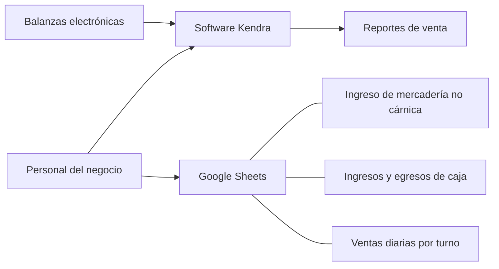

# 00-contexto
# 00 - Contexto del negocio y del proceso actual

| Campo | Valor |
|---|---|
| Proyecto | Sistema de gestión para Carnicería Rojano |
| Tipo de trabajo | Trabajo de Campo, Ingeniería Informática (proyecto individual) |
| Versión | 0.1 (borrador) |
| Fuente principal | Relevamiento real con el responsable de la carnicería, plasmado en el documento de trabajo del alumno (`Trabajo_de_Campo-Sistema_de_gestion_carniceria.pdf`) |
| Estado | Datos tomados del relevamiento real ya realizado (documento actual); las brechas a validar figuran en [01-relevamiento.md](01-relevamiento.md) |

> Convención: lo marcado como **(pendiente)** no está confirmado y no debe tomarse como regla del negocio.

## 1. El negocio

Carnicería Rojano es un negocio familiar con más de 59 años de trayectoria, ubicado actualmente en Córdoba 420.

**Quiénes participan**

- Administración: Fernando Rojano y su padre (los "dueños").
- Equipo: carniceros, cajera, administrativo, personal de limpieza y cadetes externos.

**Rubros de venta mencionados**

- Carne vacuna, que se trabaja a partir de **media res**.
- Productos **no cárnicos**: embutidos, verduras, conservas, vinos, especias, entre otros.

## 2. Cómo se gestiona hoy

La gestión se hace principalmente con herramientas manuales y planillas de **Google Sheets**.

| Aspecto | Situación actual (según el documento) |
|---|---|
| Ingreso de mercadería no cárnica | Se controla en planillas de Google Sheets |
| Caja | Ingresos y egresos de caja registrados en planillas |
| Ventas | Registros de ventas diarios por turno (mañana y tarde) en planillas |
| Datos de las balanzas | El software **Kendra** recopila datos desde las balanzas electrónicas |
| Stock de carne | Control limitado: al trabajar con media res no se conoce con precisión la cantidad disponible de cada corte |
| Stock no cárnico | Control parcial en planillas **(pendiente: detalle)** |
| Control financiero | Existe cierto control, pero no está automatizado ni centralizado |
| Dependencia | Se apoya en registros manuales y en el conocimiento del personal |

### Mapa de herramientas actuales

Este diagrama solo refleja lo que menciona el documento. Los flujos exactos entre herramientas están por validar en el relevamiento.

## 3. Problemas identificados

1. El stock de carne no puede conocerse por corte, por trabajar con media res.
2. La información está repartida entre planillas y Kendra, sin centralizar.
3. La carga manual favorece errores humanos.
4. El control depende del conocimiento del personal.
5. Hay riesgo de pérdidas por vencimientos o faltantes de productos (beneficio esperado en el documento; **pendiente confirmar** si hoy ocurre y con qué frecuencia).

## 4. Necesidad que da origen al proyecto

Centralizar la administración de stock, ventas, estadísticas, pagos a proveedores y cuentas corrientes de clientes en una aplicación web adaptable (responsive), accesible desde computadora y celular.

El detalle de lo que el sistema hará y no hará está en [02-alcance-objetivos.md](02-alcance-objetivos.md).

## 5. Usuarios del sistema (según el documento)

| Rol | Descripción resumida |
|---|---|
| Administrador del local | Nivel medio de manejo informático (usa Sheets). Acceso completo. |
| Cajera | Formación básica, uso limitado de tecnología. Registra ventas y pagos, cierre de caja por turno; en algunos casos agrega productos. |
| Dueños (gerentes) | Nivel medio-alto. Acceso de consulta a reportes, sin modificar datos operativos. |

**Pendiente:** confirmar quién es "Administrador" (el administrativo, los dueños u otra persona). Ver PR-25 en [01-relevamiento.md](01-relevamiento.md).

## 6. Glosario

| Término | Definición |
|---|---|
| Google Sheets | Planilla de cálculo en la nube utilizada por el negocio |
| Stock no cárnico | Productos como embutidos, verduras, vinos, especias, etc. |
| Media res | Mitad de una res vacuna faenada, base de la venta de carne |
| Kendra | Software que toma los datos de las balanzas y genera reportes de venta |
| Turno | Jornada de trabajo dividida en mañana y tarde, usada para registrar ventas |
| Cuenta corriente | Registro del crédito otorgado a ciertos clientes que pagan a futuro |
| Plus interno | Código usado por la carnicería para identificar productos |

## 7. Datos confirmados durante el trabajo

- El internet del local es bueno (informado por el alumno). Esto respalda la decisión de alojar el sistema en la nube.

## 8. Referencias

- Alcance y objetivos: [02-alcance-objetivos.md](02-alcance-objetivos.md)
- Preguntas pendientes y entrevistas: [01-relevamiento.md](01-relevamiento.md)
