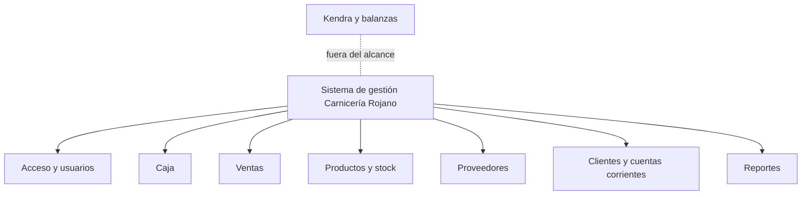

# 02 - Alcance y objetivos

| Campo | Valor |
|---|---|
| Versión | 0.1 (borrador) |
| Base | Relevamiento real ya realizado (ver [01-relevamiento.md](01-relevamiento.md)) y documento de trabajo del alumno |
| Convención | **(a confirmar)** marca lo que depende de una brecha abierta (PR-xx). **(propuesta)** marca lo que agrega el análisis y no figura en el relevamiento base |

## 1. Propósito del sistema

Centralizar la administración de caja, ventas, stock no cárnico, proveedores, pagos y cuentas corrientes de Carnicería Rojano en una aplicación web adaptable (responsive), reemplazando el trabajo manual en planillas de Google Sheets.

## 2. Alcance

### 2.1 Qué incluye

| Módulo | Qué cubre | Origen |
|---|---|---|
| Acceso y usuarios | Inicio de sesión y roles: Administrador, Cajera, Dueños (solo consulta) | Relevamiento base (2.2) |
| Caja | Apertura y cierre por turno (mañana y tarde), ingresos y egresos de caja, diferenciados por medio de pago | Relevamiento base (1.2, 2.1) |
| Ventas | Registro de ventas diarias por producto, medio de pago y ticket | Relevamiento base (1.2) |
| Productos y stock | Catálogo y control de stock de **productos no cárnicos**, ingreso de mercadería, consulta de stock con alertas de stock mínimo | Relevamiento base (1.2) |
| Proveedores | Registro de proveedores, deuda y pagos a proveedores | Relevamiento base (1.2, 2.1) |
| Clientes y cuentas corrientes | Saldos, ventas a crédito, pagos e historial | Relevamiento base (1.2, 2.1) |
| Reportes | Ventas diarias, productos más vendidos, ingresos por día y totales por medio de pago, con exportación a PDF o Excel | Relevamiento base (2.1, CU de reportes) |

### 2.2 Qué no incluye

| Exclusión | Origen |
|---|---|
| Control detallado de cortes de carne provenientes de la media res | Relevamiento base |
| Facturación electrónica ("por el momento") | Relevamiento base |
| Integración automática con las balanzas (se mantiene Kendra) | Relevamiento base |

### 2.3 Funciones previstas que hoy no tienen caso de uso o están a medio definir

Surgen de contradicciones entre las secciones del documento base (ver hallazgos H-xx en [01-relevamiento.md](01-relevamiento.md)). Se incorporan como alcance **(propuesta)** hasta que el responsable del negocio lo confirme.

| Función | Motivo | Estado |
|---|---|---|
| Alta, baja y modificación de productos, clientes, proveedores y usuarios | La cajera puede crear productos y el administrador gestiona clientes y proveedores, pero no hay caso de uso que lo cubra (H-04) | Propuesta |
| Control de vencimientos de productos | El documento base lo cita como beneficio esperado, pero no hay caso de uso ni datos para controlarlo (PR-21) | A confirmar |
| Registro de faltante de stock detectado | Aparece en el diagrama de casos de uso, no en el texto | A confirmar |
| Gestión de pedidos a proveedores | El modelo de clases los incluye, los casos de uso no (PR-19) | A confirmar |
| Reportes automáticos al cierre de jornada | Es una meta; el caso de uso describe reportes a pedido (PR-27) | A confirmar |
| Registro de ventas de carne | La meta pide el 100% de ventas en el sistema, pero Kendra queda afuera (PR-01) | A confirmar |

## 3. Objetivos

### 3.1 Objetivo general

Desarrollar un sistema de gestión web que centralice y organice la información crítica de Carnicería Rojano, agilice las tareas administrativas manuales y brinde control sobre caja, stock no cárnico, proveedores y cuentas corrientes.

### 3.2 Objetivos específicos

| ID | Objetivo | Origen |
|---|---|---|
| OE-01 | Centralizar y organizar la información crítica del negocio | Relevamiento base |
| OE-02 | Agilizar tareas administrativas que hoy se hacen de forma manual | Relevamiento base |
| OE-03 | Brindar mayor control sobre el stock no cárnico y las cuentas corrientes | Relevamiento base |
| OE-04 | Proveer reportes para la toma de decisiones | Relevamiento base |
| OE-05 | Registrar la caja por turno con cierre y control de diferencias | Relevamiento base (CU de caja) |
| OE-06 | Documentar el análisis y el diseño del sistema con la profundidad que exige el Trabajo de Campo | Alcance académico |

## 4. Beneficios esperados

- Reducción de errores humanos en la carga de datos.
- Mejora en el control financiero del negocio.
- Disminución de pérdidas por vencimientos o faltantes de productos **(a confirmar si hoy ocurre; ver PR-21)**.
- Mejor aprovechamiento del tiempo del personal administrativo.

## 5. Metas

| ID | Meta | Observación |
|---|---|---|
| M-01 | Prototipo funcional del sistema en 2 meses | El plazo se contrasta con el cronograma en [07-planificacion.md](07-planificacion.md) y con las fechas de la cátedra (PA-01) |
| M-02 | Lograr el registro de ventas y pagos al 100% desde el sistema | **Conflicto:** con Kendra fuera de alcance, las ventas de carne podrían no registrarse. Se resuelve con PR-01 (H-01) |
| M-03 | Obtener reportes automáticos de ventas y stock al finalizar cada jornada | **Conflicto:** el caso de uso describe reportes a pedido. Se resuelve con PR-27 (H-13) |

## 6. Mapa de módulos

## 7. Usuarios y accesos

| Rol | Acceso |
|---|---|
| Administrador | Acceso completo |
| Cajera | Registra ventas y pagos, abre y cierra caja y, en algunos casos, agrega productos |
| Dueños (gerentes) | Consulta de reportes, sin modificar datos operativos |

Detalle y pendientes (quién es "Administrador", qué ven los dueños) en [00-contexto.md](00-contexto.md) y PR-25.

## 8. Supuestos y restricciones

| ID | Supuesto o restricción | Origen |
|---|---|---|
| SU-01 | El sistema se usa desde cualquier dispositivo con navegador (PC, celular o tablet); el uso principal es desde PC de escritorio | Relevamiento base |
| SU-02 | Google Chrome es el navegador principal | Relevamiento base |
| SU-03 | Las balanzas siguen usando Kendra, sin integración con el nuevo sistema | Relevamiento base |
| SU-04 | El negocio ya usa Google Sheets, por lo que los usuarios están familiarizados con planillas | Relevamiento base |
| SU-05 | El sistema se aloja en la nube y se asume conectividad permanente | Relevamiento base; el alumno informa que el internet del local es bueno |
| SU-06 | No se prevé facturación electrónica ni control completo de carne por corte | Relevamiento base |
| RE-01 | Proyecto individual: lo desarrolla y mantiene una sola persona, sin complejidad empresarial | Alcance académico |
| RE-02 | El repositorio no contiene datos reales del negocio, credenciales ni claves | Decisión del proyecto |

## 9. Riesgos del proyecto

Análisis propio, **(propuesta)**.

| ID | Riesgo | Mitigación sugerida |
|---|---|---|
| RI-01 | El alcance crece más de lo que una persona puede mantener | Priorizar requisitos (ver [03-requisitos.md](03-requisitos.md)) y dejar lo "a confirmar" para una segunda etapa |
| RI-02 | Usuarios con uso limitado de tecnología (cajera) rechazan el sistema | Interfaz simple y pocos pasos en la venta; capacitación breve |
| RI-03 | Brechas del relevamiento sin resolver retrasan el diseño | Validación puntual con el responsable, priorizada (ver PR de prioridad alta) |
| RI-04 | Ventas de carne fuera del sistema dejan reportes incompletos | Definir con el dueño qué se registra (PR-01) |
| RI-05 | Caída de internet en el local | Definir contingencia mínima (PR-29) |

## 10. Referencias

- Contexto: [00-contexto.md](00-contexto.md)
- Brechas y hallazgos: [01-relevamiento.md](01-relevamiento.md)
- Requisitos: [03-requisitos.md](03-requisitos.md)
