# 04 - Casos de uso

| Campo | Valor |
|---|---|
| Versión | 0.1 (borrador) |
| Base | Los 9 casos de uso y prototipos del relevamiento real, completados y corregidos |
| Relacionados | [03-requisitos.md](03-requisitos.md), [01-relevamiento.md](01-relevamiento.md), [05-modelo-datos.md](05-modelo-datos.md) |

## 1. Convenciones

- **IDs:** CU-xx para casos de uso y SC-xx para sub-casos reutilizables (se incluyen o extienden desde otros casos). CU-01 a CU-09 mantienen el orden del documento base; CU-10 a CU-14 son propuestos.
- **Marcas:** `(PDF)` = surge del relevamiento base. `(propuesta)` = lo agrega el análisis. `(a confirmar: PR-xx)` = depende de una brecha de [01-relevamiento.md](01-relevamiento.md) y no debe implementarse como regla de negocio hasta resolverse.
- **Requisitos:** cada caso indica los RF/RNF que lo respaldan (ver [03-requisitos.md](03-requisitos.md)).

## 2. Actores

| Actor | Descripción |
|---|---|
| Administrador | Acceso completo al sistema |
| Cajera | Registra ventas y pagos, abre y cierra caja; en algunos casos agrega productos |
| Dueños (gerentes) | Acceso en modo consulta a reportes, sin modificar datos operativos |

Quién es exactamente el "Administrador" y qué ven los dueños queda pendiente en PR-25.

### Matriz de actores y casos de uso

C = confirmado, ? = a confirmar, vacío = no participa.

| Caso de uso | Administrador | Cajera | Dueños |
|---|---|---|---|
| CU-01 Registrar venta | | C | |
| CU-02 Abrir caja por turno | | C | |
| CU-03 Cerrar caja por turno | | C | |
| CU-04 Registrar pago de cliente | C | ? (PR-14) | |
| CU-05 Registrar ingreso de mercadería | C | | |
| CU-06 Consultar stock | C | ? (PR-25) | ? (PR-25) |
| CU-07 Registrar pago a proveedor | C | | |
| CU-08 Gestionar cuentas corrientes | C | | ? (PR-25) |
| CU-09 Generar reportes | C | | C (solo consulta) |
| CU-10 Iniciar sesión | C | C | C |
| CU-11 Gestionar productos | C | alta con permiso | |
| CU-12 Gestionar clientes | C | ? | |
| CU-13 Gestionar proveedores | C | | |
| CU-14 Gestionar usuarios | C | | |

## 3. Diagramas

Mermaid no tiene un diagrama de casos de uso UML nativo; se representan con diagramas de flujo. Los óvalos son casos de uso y los rectángulos redondeados, actores.

### 3.1 Actores y casos de uso

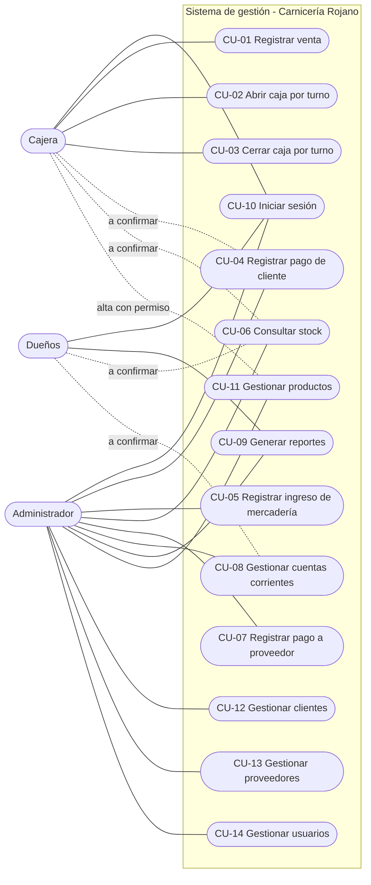

### 3.2 Relaciones include y extend

Las flechas de `extend` van del caso que extiende hacia el caso base, y las de `include` del caso base hacia el incluido.

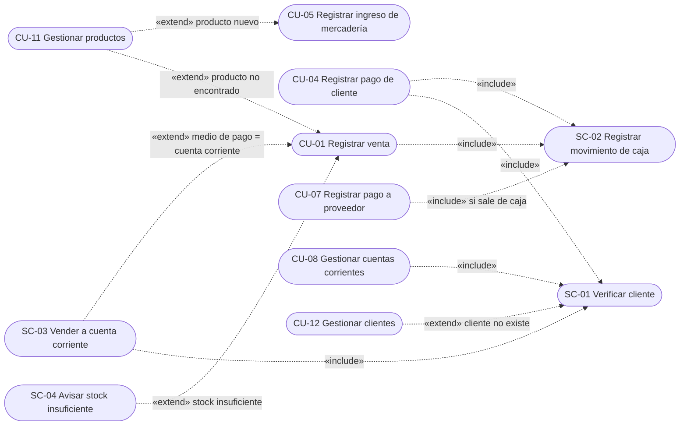

### 3.3 Qué cambió respecto del diagrama del documento base

| Cambio | Motivo |
|---|---|
| Las flechas de `extend` ahora apuntan al caso base | Estaban invertidas |
| Se escribe «include», no "includes" | Notación UML |
| Se quitó "Stock actualizado" | Es una poscondición, no un caso de uso |
| Se quitó "Mostrar resumen del turno" | Es un paso del flujo de CU-03 |
| "Validar stock" y "Emitir comprobante" pasan a ser pasos de CU-01 | No se reutilizan en otros casos |
| "Verificar existencia del cliente" pasa a SC-01 | Lo comparten CU-04, CU-08 y SC-03 |
| "Crear cliente" ya no extiende el pago de cliente | CU-04 exige que el cliente exista; ahora extiende SC-01 |
| "Detectar y registrar stock faltante" pasa a SC-04 | Se mantiene como extensión de CU-01; solo avisa y no registra el faltante aparte (DEC-46) |
| Se agregó el actor Dueños | Es un rol del relevamiento y no figuraba |
| Se agregaron CU-10 a CU-14 | Cubren inicio de sesión y altas de datos (H-04) |
| Cajera y CU-06 pasan a "a confirmar" | El diagrama y el texto del documento base se contradecían (H-02) |

## 4. Reglas de negocio

| ID | Regla | Origen | Estado |
|---|---|---|---|
| RN-01 | Solo puede haber una caja abierta por turno | CU-02 (PDF) | Confirmado |
| RN-02 | Los turnos son mañana y tarde | Glosario y CU-02 (PDF) | Confirmado |
| RN-03 | Una caja cerrada queda bloqueada para edición | CU-03 (PDF) | Confirmado |
| RN-04 | Toda venta o pago actualiza la caja con monto y medio de pago | CU-01, CU-04 (PDF) | Confirmado |
| RN-05 | La cajera solo puede crear productos si tiene permiso | CU-01, 2.2 (PDF) | Confirmado |
| RN-06 | Los dueños solo consultan, sin modificar datos operativos | 2.2 (PDF) | Confirmado |
| RN-07 | Si un pago de cliente supera la deuda, se sugiere registrar el excedente como anticipo | CU-04 (PDF) | Confirmado; tratamiento posterior a confirmar (PR-15) |
| RN-08 | El ingreso de mercadería actualiza el stock y genera deuda o pago al proveedor | CU-05 (PDF) | Confirmado; modalidad a confirmar (PR-18) |
| RN-09 | El pago a proveedor valida la disponibilidad en caja | CU-07 (PDF) | Aplicabilidad a confirmar (PR-17, H-06) |
| RN-10 | La consulta de stock muestra alertas de stock mínimo | CU-06 (PDF) | Umbral y responsable a confirmar (PR-20) |
| RN-11 | Se alerta cuando un cliente tiene deuda vencida | CU-08 (PDF) | Plazo a confirmar (PR-13) |

## 5. Catálogo de casos de uso

### CU-01 Registrar venta

| Campo | Detalle |
|---|---|
| Actor principal | Cajera |
| Requisitos | RF-06, RF-11 a RF-20 |
| Precondiciones | Sesión iniciada. Los productos existen en el catálogo. Caja del turno abierta (propuesta: se deduce de la poscondición que actualiza la caja). |
| Poscondiciones | Venta registrada, stock actualizado en productos con control de stock, caja actualizada con monto y medio de pago, ticket emitido |
| Prototipo (referencia v0, a rediseñar) | 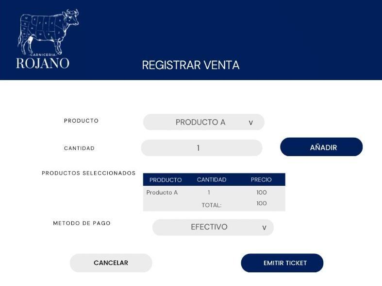 |

**Flujo normal (PDF)**

1. La cajera selecciona "Registrar venta".
2. Escanea o busca cada producto e indica la cantidad.
3. El sistema muestra descripción, precio unitario y subtotal acumulado.
4. La cajera selecciona el medio de pago.
5. El sistema calcula el total.
6. La cajera confirma; el sistema registra la venta, actualiza el stock y la caja (SC-02) y emite el ticket.

**Flujos alternativos**

| ID | Condición | Resultado | Estado |
|---|---|---|---|
| A1 | Producto no encontrado | La cajera puede crearlo si tiene permiso (CU-11) | PDF |
| A2 | Medio de pago = cuenta corriente | Se ejecuta SC-03 | A confirmar: PR-12, PR-13 |
| A3 | Stock insuficiente en un producto con control de stock | Se ejecuta SC-04: la venta se permite con un aviso y el stock puede quedar negativo | Decidido (DEC-46) |
| A4 | La caja del turno no está abierta | El sistema indica que debe abrir la caja (CU-02) | Propuesta |
| A5 | La cajera cancela | No se registra nada | Propuesta |

**Decisiones de diseño (DEC-35):** la carne se vende por kg y no descuenta stock (DEC-36); el lector de códigos carga el plus en el campo de búsqueda (DEC-37); la venta va a la única caja abierta (DEC-39); medios de pago de la tabla `medio_pago`, sin cuenta corriente hasta H4 (DEC-41); un solo medio por venta (DEC-42); ticket no fiscal imprimible desde el navegador (DEC-44); una venta confirmada no se edita: el Administrador la anula con reversa mientras su caja esté abierta (DEC-45). Del spec de CU-01: lista de la venta en el navegador con todo recalculado en el servidor (DEC-47), cantidades enteras por unidad y hasta 3 decimales por kg (DEC-48), subtotal redondeado a 2 decimales (DEC-49), sin venta en una caja de otro día (DEC-50), medio de pago sin valor por defecto (DEC-51), código exacto que agrega el producto (DEC-52), una línea por producto (DEC-53) y ticket con "Imprimir" y "Nueva venta" (DEC-54).
**Observación del prototipo:** no incluye selección de cliente ni la opción de cuenta corriente (H-11).

**Implementación (H2, etapa 2):** pantalla `/ventas/nueva/`, solo para la cajera (con o sin permiso de alta); el Administrador y los dueños reciben 403. Sin caja abierta, o con la caja abierta de otro día, la pantalla avisa y enlaza a Caja. La búsqueda trae productos activos por nombre o plus; un código exacto agrega el producto. La lista de la venta vive en el navegador y, al confirmar, el servidor recalcula precios, subtotales y total, guarda la venta, sus detalles, el ingreso de caja (SC-02) y el descuento de stock en una sola transacción. Una venta con total 0 se rechaza, porque el ingreso de caja tiene que ser mayor a 0. Los avisos de stock insuficiente no muestran cantidades (la cajera no consulta stock). Después de confirmar se ve el ticket. El alta de producto durante la venta (A1) llega en la etapa 4.

### CU-02 Abrir caja por turno

| Campo | Detalle |
|---|---|
| Actor principal | Cajera |
| Requisitos | RF-04, RF-05, RF-10 |
| Precondiciones | Sesión iniciada |
| Poscondiciones | Se crea un registro de caja en estado "Abierta" con fecha, turno y empleado |
| Prototipo (referencia v0, a rediseñar) | 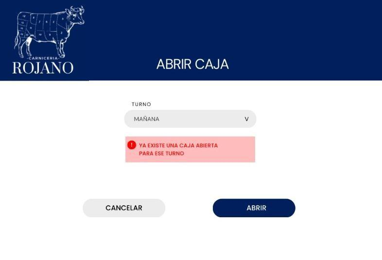 |

**Flujo normal (PDF)**

1. La cajera selecciona "Abrir caja".
2. El sistema solicita el turno (mañana o tarde).
3. El sistema valida que no haya una caja abierta para ese turno (RN-01).
4. El sistema crea el registro de caja con fecha, turno, empleado y estado "Abierta".
5. El sistema notifica que la caja fue abierta correctamente.

**Flujos alternativos**

| ID | Condición | Resultado | Estado |
|---|---|---|---|
| A1 | Ya existe una caja abierta para ese turno | El sistema no permite abrir otra y muestra un mensaje de error | PDF |
| A2 | Fondo de cambio | En el paso 2 la cajera puede cargar un monto inicial en efectivo (opcional; si lo deja vacío se guarda 0) | Decidido (DEC-38) |
| A3 | Hay otra caja abierta (por ejemplo, la de la mañana sin cerrar) | El sistema no permite abrir y pide cerrar la caja abierta | Decidido (DEC-39) |
| A4 | El turno elegido ya tuvo una caja ese día | El sistema no permite reabrirlo; el formulario solo ofrece los turnos que se pueden abrir | Decidido (DEC-39) |

**Decisiones de diseño (DEC-35):** fondo de cambio opcional (DEC-38); una caja por turno y una sola abierta a la vez (DEC-39).

**Implementación (H2, etapa 1):** pantalla `/caja/`, solo para la cajera (con o sin permiso de alta de productos); el Administrador y los dueños reciben 403. Si hay una caja abierta, muestra su turno, fecha, quién la abrió, hora y fondo de cambio, y avisa si es de otro día. Si no la hay, muestra el formulario con los turnos que se pueden abrir hoy ("Elegí un turno" como primera opción) y el fondo de cambio opcional; con los dos turnos usados, avisa que ya no se puede abrir. La fecha es la de hoy y el turno lo elige la cajera. Las reglas están en el servicio de caja, que traduce a mensajes claros los rechazos de la base cuando dos cajeras abren a la vez. El cierre llega con CU-03 (etapa 3).

### CU-03 Cerrar caja por turno

| Campo | Detalle |
|---|---|
| Actor principal | Cajera |
| Requisitos | RF-06 a RF-09 |
| Precondiciones | Existe una caja abierta del turno |
| Poscondiciones | Se genera el reporte de cierre; la caja queda cerrada y bloqueada para edición (RN-03) |
| Prototipo (referencia v0, a rediseñar) | 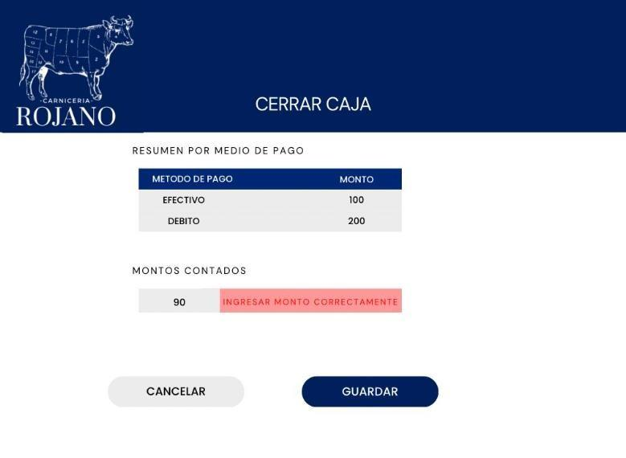 |

**Flujo normal (PDF)**

1. La cajera selecciona "Cerrar caja".
2. El sistema muestra el resumen por medio de pago.
3. La cajera ingresa los montos contados.
4. El sistema calcula las diferencias y guarda el cierre.
5. El sistema genera el reporte de cierre y bloquea la caja.

**Flujos alternativos**

| ID | Condición | Resultado | Estado |
|---|---|---|---|
| A1 | Error al ingresar los montos (valor inválido) | El sistema pide ingresar el monto correctamente | PDF |
| A2 | Hay diferencia entre lo contado y lo registrado | El sistema muestra la diferencia por medio de pago, avisa y pide un motivo obligatorio; no hace falta autorización | Decidido (DEC-40) |

**Decisiones de diseño (DEC-35):** el efectivo esperado incluye el fondo de cambio y los egresos en efectivo (DEC-38, DEC-43); diferencia con aviso y motivo obligatorio (DEC-40).

### CU-04 Registrar pago de cliente (cuenta corriente)

| Campo | Detalle |
|---|---|
| Actor principal | Administrador (la cajera, a confirmar: PR-14) |
| Requisitos | RF-06, RF-36 a RF-38 |
| Precondiciones | El cliente existe y tiene saldo pendiente |
| Poscondiciones | El monto adeudado disminuye y la caja registra el ingreso |
| Prototipo (referencia v0, a rediseñar) | 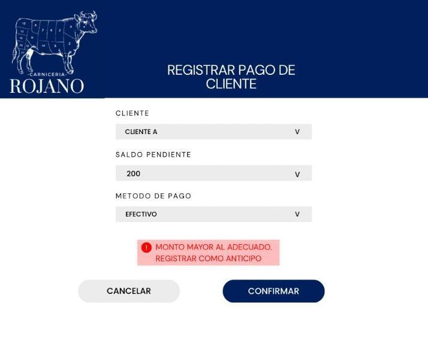 |

**Flujo normal (PDF)**

1. El usuario selecciona al cliente (SC-01).
2. El sistema muestra el saldo pendiente.
3. El usuario ingresa monto y medio de pago.
4. El usuario confirma; el sistema guarda el pago, reduce el saldo y registra el ingreso en caja (SC-02).

**Flujos alternativos**

| ID | Condición | Resultado | Estado |
|---|---|---|---|
| A1 | Monto mayor al adeudado | El sistema sugiere registrar el excedente como anticipo (RN-07) | PDF; tratamiento: PR-15 |
| A2 | La caja del turno no está abierta | El sistema avisa; si el ingreso debe ir a caja, hay que abrirla | Propuesta, a confirmar: PR-14 |

**Pendientes:** PR-14, PR-15.

### CU-05 Registrar ingreso de mercadería

| Campo | Detalle |
|---|---|
| Actor principal | Administrador |
| Requisitos | RF-22 a RF-24, RF-30 |
| Precondiciones | Proveedor registrado |
| Poscondiciones | Stock actualizado; se crea el registro de deuda o pago al proveedor |
| Prototipo (referencia v0, a rediseñar) | 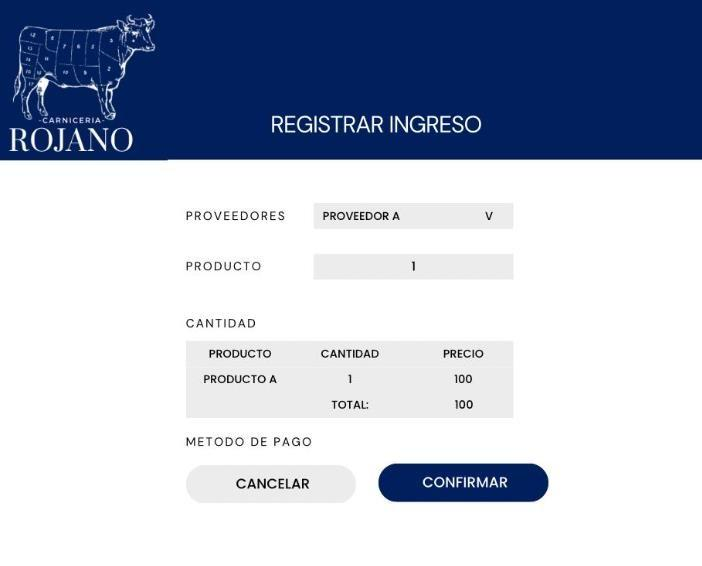 |

**Flujo normal (PDF)**

1. El Administrador selecciona "Registrar ingreso".
2. El sistema muestra la lista de proveedores.
3. El Administrador selecciona el proveedor.
4. El sistema muestra la interfaz para cargar productos.
5. El Administrador busca o selecciona productos e ingresa cantidades y precio unitario.
6. El sistema valida los productos y muestra el resumen del ingreso.
7. El Administrador confirma.
8. El sistema actualiza el stock y genera el registro de deuda o pago al proveedor.

**Flujos alternativos**

| ID | Condición | Resultado | Estado |
|---|---|---|---|
| A1 | Producto nuevo | Se crea el producto (CU-11) | PDF |

**Observación del prototipo:** muestra un campo "Método de pago", que sugiere que el ingreso puede registrarse como pagado; el texto solo habla de "deuda o pago" (PR-18).
**Pendientes:** PR-17, PR-18.

### CU-06 Consultar stock

| Campo | Detalle |
|---|---|
| Actor principal | Administrador (cajera y dueños, a confirmar: PR-25) |
| Requisitos | RF-25, RF-26, RF-28 |
| Precondiciones | Existen productos registrados |
| Poscondiciones | Ninguna (solo consulta) |
| Prototipo (referencia v0, a rediseñar) | 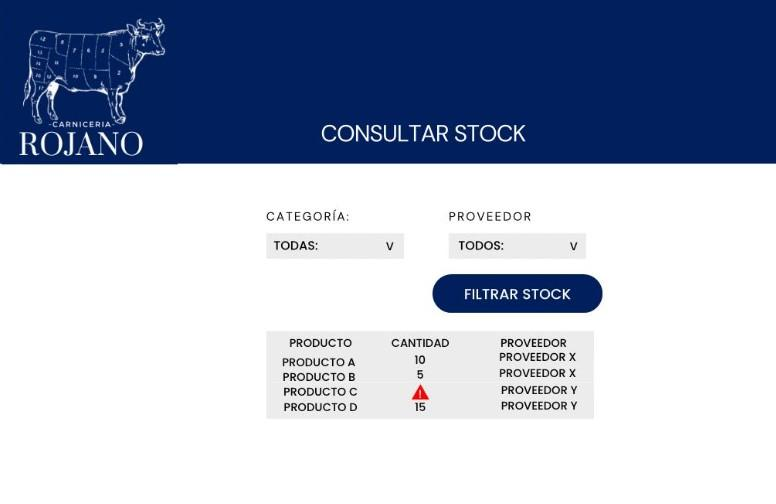 |

**Flujo normal (PDF)**

1. El usuario abre el módulo Stock.
2. El sistema muestra todos los productos registrados.
3. El usuario aplica filtros (categoría, proveedor, etc.).
4. El sistema muestra los productos filtrados con cantidades y alertas de stock mínimo (RN-10).

**Flujos alternativos (el documento base decía "no aplica")**

| ID | Condición | Resultado | Estado |
|---|---|---|---|
| A1 | Los filtros no devuelven productos | El sistema muestra "Sin productos para el filtro seleccionado" | Propuesta |
| A2 | El usuario no tiene permiso de consulta | El sistema no muestra el módulo | Propuesta, a confirmar: PR-25 |

**Alcance:** solo productos no cárnicos.
**Pendientes:** PR-20 (stock mínimo), PR-21 (vencimientos).

### CU-07 Registrar pago a proveedor

| Campo | Detalle |
|---|---|
| Actor principal | Administrador |
| Requisitos | RF-06, RF-31 a RF-33 |
| Precondiciones | El proveedor existe y hay una deuda pendiente (o factura, a confirmar: PR-18) |
| Poscondiciones | Se actualiza el estado de la deuda; si el pago sale de caja, se registra el egreso |
| Prototipo (referencia v0, a rediseñar) | 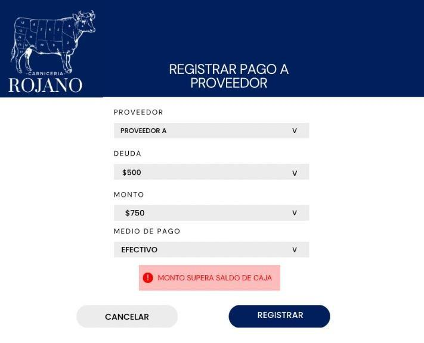 |

**Flujo normal (PDF)**

1. El Administrador selecciona "Registrar pago a proveedor".
2. El sistema muestra los proveedores con deudas pendientes.
3. El Administrador selecciona proveedor y deuda a pagar.
4. Ingresa monto y medio de pago.
5. El sistema valida la disponibilidad en caja (si el pago sale de caja).
6. Si es válido, registra el pago, actualiza el saldo del proveedor y, cuando corresponde, el egreso de caja (SC-02).

**Flujos alternativos**

| ID | Condición | Resultado | Estado |
|---|---|---|---|
| A1 | El monto supera el saldo de caja | El sistema advierte el saldo máximo disponible y sugiere un monto menor | PDF; aplicable solo si el pago sale de caja (H-06) |
| A2 | El monto supera la deuda | El sistema advierte y pide corregir | Propuesta |

**Pendientes:** PR-17 (forma de pago a proveedores), PR-18 (facturas).

### CU-08 Gestionar cuentas corrientes

| Campo | Detalle |
|---|---|
| Actor principal | Administrador (dueños en consulta, a confirmar: PR-25) |
| Requisitos | RF-39 a RF-41 |
| Precondiciones | El cliente está registrado |
| Poscondiciones | Estado de cuenta actualizado |
| Prototipo (referencia v0, a rediseñar) | 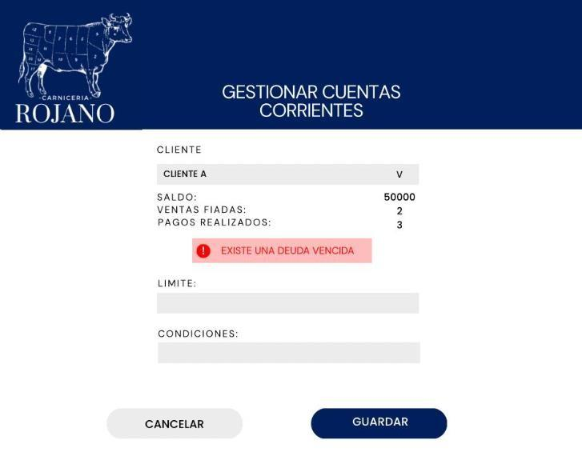 |

**Flujo normal (PDF)**

1. El usuario selecciona al cliente (SC-01).
2. El sistema muestra saldo, listado de ventas fiadas y pagos realizados.
3. Si existe deuda vencida, el sistema muestra una alerta (RN-11).
4. El usuario puede editar límites o condiciones si tiene permiso.

**Flujos alternativos (el documento base los dejaba vacíos)**

| ID | Condición | Resultado | Estado |
|---|---|---|---|
| A1 | No hay deuda vencida | No se muestra alerta | Propuesta |
| A2 | El usuario no tiene permiso para editar | Los campos de límite y condiciones quedan de solo lectura | Propuesta |
| A3 | El cliente no tiene movimientos | El sistema muestra saldo cero y listados vacíos | Propuesta |

**Pendientes:** PR-12 (límites), PR-13 (plazo de vencimiento), PR-16 (recargos).

### CU-09 Generar reportes

| Campo | Detalle |
|---|---|
| Actor principal | Administrador; dueños en modo consulta (a confirmar: PR-25) |
| Requisitos | RF-42 a RF-46 |
| Precondiciones | Existen ventas y pagos registrados |
| Poscondiciones | Reporte generado (PDF o Excel) y disponible para descarga |
| Prototipo (referencia v0, a rediseñar) | 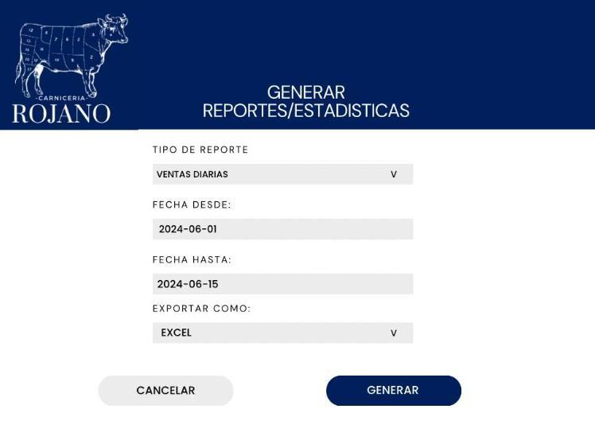 |

**Flujo normal (PDF)**

1. El usuario accede a "Generar reportes".
2. El sistema muestra los tipos de reporte (ventas diarias, producto más vendido, etc.).
3. El usuario selecciona el tipo.
4. El sistema solicita rango de fechas y formato de exportación (PDF o Excel).
5. El usuario completa y confirma.
6. El sistema genera el reporte.
7. El usuario lo visualiza y lo descarga.

**Flujos alternativos**

| ID | Condición | Resultado | Estado |
|---|---|---|---|
| A1 | No hay datos para el período | El sistema muestra "Sin registros disponibles" | PDF |
| A2 | La fecha "desde" es posterior a "hasta" | El sistema pide corregir el rango | Propuesta |

**Pendientes:** PR-27 (lista de reportes y si son automáticos o a pedido).

### CU-10 Iniciar sesión

| Campo | Detalle |
|---|---|
| Actores | Administrador, Cajera, Dueños |
| Requisitos | RF-01, RF-02, RNF-06, RNF-07 |
| Origen | Propuesta; el documento base lo supone como precondición de CU-02 |
| Precondiciones | El usuario existe y está activo |
| Poscondiciones | Sesión iniciada con las funciones permitidas según el rol |

**Flujo normal**

1. El usuario ingresa usuario y contraseña.
2. El sistema valida las credenciales.
3. El sistema muestra las funciones permitidas según el rol.

**Flujos alternativos**

| ID | Condición | Resultado |
|---|---|---|
| A1 | Credenciales inválidas | El sistema muestra un mensaje de error genérico y no inicia sesión |
| A2 | Usuario dado de baja | El sistema no permite el ingreso |
| A3 | El usuario cierra sesión | La sesión termina |

**Implementación (H1):** pantalla propia de ingreso para los tres roles. A1 y A2 muestran el mismo mensaje genérico ("Usuario o contraseña incorrectos."), para no revelar si la cuenta existe o está dada de baja. A3 cierra la sesión con un botón y vuelve al ingreso. Solo el Administrador entra además al panel de administración (DEC-32).

**Pendientes:** PR-26 (usuarios individuales), PR-34 (cierre de sesión por inactividad).

### CU-11 Gestionar productos

| Campo | Detalle |
|---|---|
| Actor principal | Administrador; la cajera solo para alta con permiso (RN-05) |
| Requisitos | RF-17, RF-21, RF-24 |
| Origen | Propuesta (H-04); el alta ya aparece como flujo alternativo de CU-01 y CU-05 |
| Poscondiciones | Catálogo actualizado |

**Flujo normal (alta)**

1. El usuario selecciona "Gestionar productos" y elige "Nuevo producto".
2. Completa los datos del producto (nombre, categoría, precio, unidad de medida, plus interno, stock mínimo; los datos finales dependen de PR-03, PR-20, PR-21, PR-22; el plus, de DEC-37).
3. El sistema valida los datos y guarda el producto.

**Otras operaciones:** modificar datos y dar de baja (baja lógica, para conservar el historial de ventas; propuesta).

**Flujos alternativos**

| ID | Condición | Resultado |
|---|---|---|
| A1 | El plus interno ya existe | El sistema avisa junto al campo y no guarda. El nombre repetido no se bloquea: era una propuesta y no está confirmada (PR-22) |
| A2 | La cajera sin permiso intenta crear un producto | El sistema lo impide (RN-05) |

**Implementación (H1):** pantalla `/productos/` con búsqueda por nombre o plus interno y, por defecto, solo los productos activos. El Administrador da de alta, modifica y da de baja (con confirmación), ve el stock y puede incluir los dados de baja en el listado; un producto dado de baja no se edita desde esta pantalla (ni por su URL) y la reactivación se hace desde el panel de administración. La unidad de medida no viene elegida: el formulario muestra "Elegí una unidad" y obliga a elegir (PR-03). La cajera con permiso solo da de alta y no ve el stock (CU-06 para la cajera está a confirmar: PR-25). La cajera sin permiso y los dueños no acceden. El stock actual arranca en 0 y no se edita en esta pantalla (RI-07); el alta durante la venta (CU-01 A1, RF-17) llega con H2 (DEC-33).

### CU-12 Gestionar clientes

| Campo | Detalle |
|---|---|
| Actor principal | Administrador |
| Requisitos | RF-35 |
| Origen | Propuesta (H-04) |
| Poscondiciones | Clientes actualizados |

**Flujo normal (alta):** el Administrador ingresa los datos del cliente (nombre y contacto, según el modelo del documento base) y el sistema lo guarda. También permite modificar y dar de baja.
**Pendientes:** PR-11 (volumen y datos), y si la cajera puede dar de alta clientes durante una venta a cuenta corriente.

### CU-13 Gestionar proveedores

| Campo | Detalle |
|---|---|
| Actor principal | Administrador |
| Requisitos | RF-29 |
| Origen | Propuesta; CU-05 exige "proveedor registrado" |
| Poscondiciones | Proveedores actualizados |

**Flujo normal (alta):** el Administrador ingresa nombre y contacto del proveedor (según el modelo del documento base) y el sistema lo guarda. También permite modificar y dar de baja.
**Pendientes:** PR-17.

### CU-14 Gestionar usuarios

| Campo | Detalle |
|---|---|
| Actor principal | Administrador |
| Requisitos | RF-03 |
| Origen | Propuesta |
| Poscondiciones | Usuarios actualizados con su rol |

**Flujo normal (alta):** el Administrador crea el usuario, le asigna un rol (Administrador, Cajera o Dueños) y una contraseña inicial; el sistema lo guarda. También permite modificar, dar de baja y restablecer contraseña.
**Pendientes:** PR-25, PR-26.

## 6. Sub-casos reutilizables

### SC-01 Verificar cliente

Incluido en CU-04, CU-08 y SC-03. El usuario busca o selecciona al cliente. Si no existe, el sistema ofrece crearlo (CU-12, propuesta).

### SC-02 Registrar movimiento de caja

Incluido en CU-01, CU-04 y CU-07 (cuando el pago sale de caja). Registra un ingreso o egreso con monto y medio de pago en la caja abierta del turno (RN-04). Si no hay caja abierta, el sistema avisa. La cajera también registra desde la pantalla de Caja los egresos "otros" (gastos y retiros en efectivo) con descripción obligatoria, concepto `OTRO` (DEC-43).

### SC-03 Vender a cuenta corriente (a confirmar: PR-12, PR-13)

Extiende CU-01 cuando el medio de pago es cuenta corriente. Selecciona el cliente (SC-01), valida límite y deuda vencida según las reglas que defina el negocio, y registra la venta como deuda del cliente. El tratamiento en la caja del turno está por definir.

### SC-04 Avisar stock insuficiente (DEC-46)

Extiende CU-01 cuando el stock de un producto con control es insuficiente. El sistema avisa a la cajera y la venta se permite; el `stock_actual` puede quedar negativo. No se registra un faltante aparte (DEC-46).

## 7. Prototipos

Los prototipos de CU-01 a CU-09 provienen del relevamiento base y se guardan en `docs/prototipos/` **solo como referencia (v0)**. Muestran qué datos y acciones se esperaba en cada pantalla, pero **no son el diseño del sistema final**: se rediseñan por completo (visual, de flujo y de usabilidad) en una etapa posterior, por ejemplo en Figma. Hasta entonces sirven de guía funcional.

| CU | Archivo | Observaciones |
|---|---|---|
| CU-01 | `prototipos/CU-01-registrar-venta.png` | Falta cliente y cuenta corriente (H-11) |
| CU-02 | `prototipos/CU-02-abrir-caja.png` | Falta el monto inicial opcional (DEC-38) |
| CU-03 | `prototipos/CU-03-cerrar-caja.png` | Muestra un solo campo de monto contado; el resumen es por medio de pago |
| CU-04 | `prototipos/CU-04-registrar-pago-cliente.png` | Incluye el aviso de anticipo |
| CU-05 | `prototipos/CU-05-registrar-ingreso-mercaderia.png` | Tiene "Método de pago" no descripto en el texto |
| CU-06 | `prototipos/CU-06-consultar-stock.png` | Muestra alerta de stock bajo |
| CU-07 | `prototipos/CU-07-registrar-pago-proveedor.png` | Incluye el aviso de monto superior al saldo de caja |
| CU-08 | `prototipos/CU-08-gestionar-cuentas-corrientes.png` | Incluye alerta de deuda vencida, límite y condiciones |
| CU-09 | `prototipos/CU-09-generar-reportes.png` | Tipo, rango de fechas y formato de exportación |

Los prototipos definitivos (incluidos los de CU-10 a CU-14 y las correcciones indicadas) se diseñan en una etapa posterior y se guardan en `docs/prototipos/` con la versión v1 en el nombre, por ejemplo `CU-01-registrar-venta-v1.png`. Los de referencia v0 se conservan para consultar el origen.

## 8. Mantenimiento

Al confirmar una brecha, actualizar el caso de uso afectado (marca y flujos), las reglas de negocio de la sección 4, los requisitos en [03-requisitos.md](03-requisitos.md), el modelo de datos en [05-modelo-datos.md](05-modelo-datos.md) y las pruebas en [08-pruebas.md](08-pruebas.md).
