# 04 - Casos de uso

| Campo | Valor |
|---|---|
| Versión | 0.1 (borrador) |
| Base | Los 9 casos de uso y prototipos del relevamiento real, completados y corregidos |
| Relacionados | [03-requisitos.md](03-requisitos.md), [01-relevamiento.md](01-relevamiento.md), [05-modelo-datos.md](05-modelo-datos.md) |

## 1. Convenciones

- **IDs:** CU-xx para casos de uso y SC-xx para sub-casos reutilizables (se incluyen o extienden desde otros casos). CU-01 a CU-09 mantienen el orden del documento base; CU-10 a CU-14 son propuestos.
- **Marcas:** `(PDF)` = surge del relevamiento base. `(propuesta)` = lo agrega el análisis. `(a confirmar: PR-xx)` = depende de una brecha de [01-relevamiento.md](01-relevamiento.md) y no debe implementarse como regla de negocio hasta resolverse.
- **Requisitos:** cada caso indica los RF/RNF que lo respaldan (ver [03-requisitos.md](03-requisitos.md)).

## 2. Actores

| Actor | Descripción |
|---|---|
| Administrador | Acceso completo al sistema |
| Cajera | Registra ventas y pagos, abre y cierra caja; en algunos casos agrega productos |
| Dueños (gerentes) | Acceso en modo consulta a reportes, sin modificar datos operativos |

**Decidido como supuesto del proyecto, no confirmado por el negocio (DEC-134, PR-25):** "Administrador" es un rol con acceso completo, sin atarlo a una persona. Los dueños entran en solo lectura y ven únicamente Reportes (CU-09), que incluye la consulta de cierres por fecha (DEC-59). Cada persona tiene su propio usuario (DEC-135).

### Matriz de actores y casos de uso

C = confirmado, ? = a confirmar, vacío = no participa.

| Caso de uso | Administrador | Cajera | Dueños |
|---|---|---|---|
| CU-01 Registrar venta | historial de ventas y anular (DEC-45, DEC-86) | C | |
| CU-02 Abrir caja por turno | | C | |
| CU-03 Cerrar caja por turno | | C | |
| CU-04 Registrar pago de cliente | C; anula cobros (DEC-113) | C (DEC-110, supuesto) | |
| CU-05 Registrar ingreso de mercadería | C | | |
| CU-06 Consultar stock | C | C, solo lectura (DEC-103) | |
| CU-07 Registrar pago a proveedor | C | | |
| CU-08 Gestionar cuentas corrientes | C | | |
| CU-09 Generar reportes | C | | C (solo consulta; lo único que ven, DEC-134) |
| CU-10 Iniciar sesión | C | C | C |
| CU-11 Gestionar productos | C | consulta y stock en solo lectura (DEC-103); alta con permiso | |
| CU-12 Gestionar clientes | C | elige un cliente existente en la venta y el cobro, sin alta (DEC-116) | |
| CU-13 Gestionar proveedores | C | | |
| CU-14 Gestionar usuarios | C | | |

## 3. Diagramas

Mermaid no tiene un diagrama de casos de uso UML nativo; se representan con diagramas de flujo. Los óvalos son casos de uso y los rectángulos redondeados, actores.

### 3.1 Actores y casos de uso

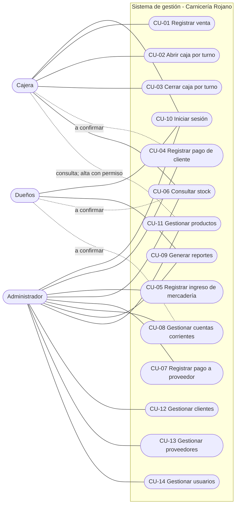

### 3.2 Relaciones include y extend

Las flechas de `extend` van del caso que extiende hacia el caso base, y las de `include` del caso base hacia el incluido.

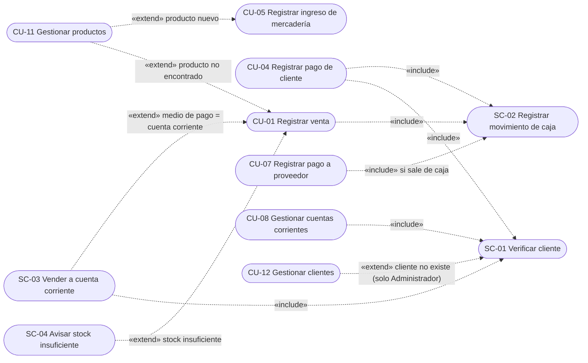

### 3.3 Qué cambió respecto del diagrama del documento base

| Cambio | Motivo |
|---|---|
| Las flechas de `extend` ahora apuntan al caso base | Estaban invertidas |
| Se escribe «include», no "includes" | Notación UML |
| Se quitó "Stock actualizado" | Es una poscondición, no un caso de uso |
| Se quitó "Mostrar resumen del turno" | Es un paso del flujo de CU-03 |
| "Validar stock" y "Emitir comprobante" pasan a ser pasos de CU-01 | No se reutilizan en otros casos |
| "Verificar existencia del cliente" pasa a SC-01 | Lo comparten CU-04, CU-08 y SC-03 |
| "Crear cliente" ya no extiende el pago de cliente | CU-04 exige que el cliente exista; ahora extiende SC-01 |
| "Detectar y registrar stock faltante" pasa a SC-04 | Se mantiene como extensión de CU-01; por ahora solo avisa y no registra el faltante aparte (supuesto DEC-46; el registro queda pendiente de PR-37) |
| Se agregó el actor Dueños | Es un rol del relevamiento y no figuraba |
| Se agregaron CU-10 a CU-14 | Cubren inicio de sesión y altas de datos (H-04) |
| CU-15 Ajustar stock se integró a CU-11 | El Administrador edita el stock al crear o modificar un producto y cada cambio queda registrado como ajuste (DEC-98); el ID CU-15 no se reutiliza |
| Cajera y CU-06 pasaron a "a confirmar" y después se confirmaron | El diagrama y el texto del documento base se contradecían (H-02); DEC-103 sigue al diagrama: la cajera consulta el stock en solo lectura |

## 4. Reglas de negocio

| ID | Regla | Origen | Estado |
|---|---|---|---|
| RN-01 | Solo puede haber una caja abierta por turno | CU-02 (PDF) | Confirmado; se aplica como una sola caja abierta a la vez, con varias cajas posibles por turno (DEC-83) |
| RN-02 | Los turnos son mañana y tarde | Glosario y CU-02 (PDF) | Confirmado |
| RN-03 | Una caja cerrada queda bloqueada para edición | CU-03 (PDF) | Confirmado |
| RN-04 | Toda venta o pago actualiza la caja con monto y medio de pago | CU-01, CU-04 (PDF) | Confirmado |
| RN-05 | La cajera solo puede crear productos si tiene permiso | CU-01, 2.2 (PDF) | Confirmado |
| RN-06 | Los dueños solo consultan, sin modificar datos operativos | 2.2 (PDF) | Confirmado |
| RN-07 | Si un pago de cliente supera la deuda, se sugiere registrar el excedente como anticipo | CU-04 (PDF) | Reemplazada por DEC-111 (supuesto): no hay saldo a favor; un cobro mayor al saldo se rechaza y se muestra el máximo a cobrar |
| RN-08 | El ingreso de mercadería actualiza el stock y genera deuda o pago al proveedor | CU-05 (PDF) | Confirmado; modalidad decidida (DEC-81, supuesto) |
| RN-09 | El pago a proveedor valida la disponibilidad en caja | CU-07 (PDF) | Decidido (DEC-80, DEC-106, supuestos): solo para pagos en efectivo que salen de la caja abierta |
| RN-10 | La consulta de stock muestra alertas de stock mínimo | CU-06 (PDF) | Decidido (DEC-82, ajustado por DEC-101, supuesto): mínimo por producto cargado por el Administrador; sin mínimo, alerta con stock en 0 o menos |
| RN-11 | Se alerta cuando un cliente tiene deuda vencida | CU-08 (PDF) | Decidido (DEC-109, supuesto): plazo único de 30 días, calculado al consultar; solo alerta, no bloquea |

## 5. Catálogo de casos de uso

### CU-01 Registrar venta

| Campo | Detalle |
|---|---|
| Actor principal | Cajera |
| Requisitos | RF-06, RF-11 a RF-20 |
| Precondiciones | Sesión iniciada. Los productos existen en el catálogo. Caja del turno abierta (propuesta: se deduce de la poscondición que actualiza la caja). |
| Poscondiciones | Venta registrada, stock actualizado en productos con control de stock, caja actualizada con monto y medio de pago, ticket emitido |
| Prototipo (referencia v0, a rediseñar) | 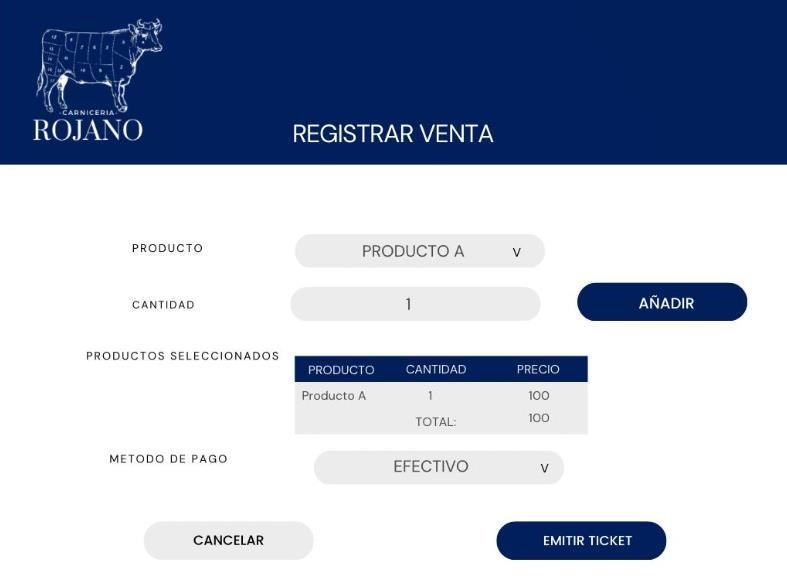 |

**Flujo normal (PDF)**

1. La cajera selecciona "Registrar venta".
2. Escanea o busca cada producto e indica la cantidad.
3. El sistema muestra descripción, precio unitario y subtotal acumulado.
4. La cajera selecciona el medio de pago.
5. El sistema calcula el total.
6. La cajera confirma; el sistema registra la venta, actualiza el stock y la caja (SC-02) y emite el ticket.

**Flujos alternativos**

| ID | Condición | Resultado | Estado |
|---|---|---|---|
| A1 | Producto no encontrado | La cajera puede crearlo si tiene permiso (CU-11), sin salir de la venta (DEC-62 a DEC-65) | PDF |
| A2 | Medio de pago = cuenta corriente | Se ejecuta SC-03 | Decidido (DEC-108, DEC-109, supuestos); implementado en H4, etapa 3 |
| A3 | Stock insuficiente en un producto con control de stock | Se ejecuta SC-04: al agregar el producto o cambiar su cantidad la pantalla avisa con la cantidad disponible (DEC-102, DEC-103); la venta se permite y el stock puede quedar negativo | Decidido (DEC-46, DEC-102) |
| A4 | La caja del turno no está abierta | El sistema indica que debe abrir la caja (CU-02) | Propuesta |
| A5 | La cajera cancela | No se registra nada | Propuesta |

**Decisiones de diseño (DEC-35):** la carne se vende por kg y no descuenta stock (DEC-36); el lector de códigos carga el plus en el campo de búsqueda (DEC-37); la venta va a la única caja abierta (DEC-83, que reemplaza a DEC-39); medios de pago de la tabla `medio_pago`, con cuenta corriente desde H4 (DEC-41, SC-03); un solo medio por venta (DEC-42); ticket no fiscal imprimible desde el navegador (DEC-44); una venta confirmada no se edita: el Administrador la anula con reversa mientras su caja esté abierta (DEC-45). Del spec de CU-01: lista de la venta en el navegador con todo recalculado en el servidor (DEC-47), cantidades enteras por unidad y hasta 3 decimales por kg (DEC-48), subtotal redondeado a 2 decimales (DEC-49), sin venta en una caja de otro día (DEC-50), medio de pago sin valor por defecto (DEC-51), código exacto que agrega el producto (DEC-52), una línea por producto (DEC-53) y ticket con "Imprimir" y "Nueva venta" (DEC-54).
**Observación del prototipo:** no incluye selección de cliente ni la opción de cuenta corriente (H-11).

**Implementación (H2, etapa 2):** pantalla `/ventas/nueva/`, solo para la cajera (con o sin permiso de alta); el Administrador y los dueños reciben 403. Sin caja abierta, o con la caja abierta de otro día, la pantalla avisa y enlaza a Caja. La búsqueda trae productos activos por nombre o plus; un código exacto agrega el producto. La lista de la venta vive en el navegador y, al confirmar, el servidor recalcula precios, subtotales y total, guarda la venta, sus detalles, el ingreso de caja (SC-02) y el descuento de stock en una sola transacción. Una venta con total 0 se rechaza, porque el ingreso de caja tiene que ser mayor a 0. El aviso de stock insuficiente del ticket no muestra cantidades; la pantalla de venta avisa con la cantidad disponible (etapa 5 de H3, DEC-102). Después de confirmar se ve el ticket. La venta en curso se guarda en la pestaña (`sessionStorage`) y se recupera al volver a la pantalla; se borra al confirmar o vaciar, y al salir con productos cargados el navegador avisa (DEC-47, etapa 0b de H3).

**Implementación (H2, etapa 4):** spec `docs/specs/SPEC-CU-01-etapa4.md`.
- **Alta durante la venta (A1):** si la búsqueda no trae resultados, la cajera con permiso de alta ve "Crear producto", que abre un diálogo con los mismos campos que `/productos/nuevo/` y precarga lo buscado (solo dígitos, en el plus; si no, en el nombre). El alta usa el servicio de CU-11 (`/ventas/producto/`); con éxito, el producto se agrega a la venta en curso, que no se pierde, y los errores se muestran junto a cada campo. La cajera sin permiso no ve la opción y el alta le da 403 (RN-05).
- **Lector y cantidades (DF-01):** después de cargar un peso, Enter vuelve al buscador; si el lector escribe en el campo de cantidad, el código se busca como producto y la cantidad no cambia (DEC-75). El servidor rechaza una línea con más de 100 kg o 100 unidades (DEC-76, supuesto pendiente de PR-36). En el celular, la tabla de la venta se desplaza dentro de su recuadro (DF-02).
- **Anulación (DEC-45):** el Administrador anula desde el detalle de una venta de la caja abierta, aunque sea de otro día.  Desde el detalle anula con un motivo obligatorio y una confirmación: en una sola operación la venta pasa a `ANULADA` con fecha, usuario y motivo, se registra un egreso `ANULACION` por su total y su medio de pago, y vuelve el stock de los productos que lo controlan. La venta, sus detalles y su ingreso no se modifican. Se rechaza si la venta ya está anulada, si su caja está cerrada o si la reversa en efectivo deja el efectivo esperado por debajo de 0. El cierre de caja descuenta la reversa y, junto con su reporte, lista las ventas anuladas (DEC-77). El motivo admite hasta 255 caracteres. El ticket y el detalle muestran la anulación; el resumen del día no cuenta las anuladas y las últimas ventas las marcan (DEC-66 a DEC-73).
- **Ventas de la caja e historial (etapa 0b de H3):** la cajera tiene "Ventas de la caja" (`/ventas/`): lista, detalle y ticket de las ventas de la caja abierta, sin "Anular venta"; el detalle y el ticket de otras ventas le dan 403 (DEC-84, L4). El Administrador tiene "Historial de ventas" (`/ventas/historial/`): por defecto la caja abierta (si no hay, todas), filtros por fecha desde y hasta, turno y caja, opción "Todas las ventas" y paginación de a 25; abre el detalle y el ticket de cualquier venta, y anula solo las de la caja abierta. Los dueños no acceden. No reemplaza a CU-09 (DEC-86).
- **Lista de productos en el buscador (DEC-97):** con clic en el buscador vacío, flecha abajo o "Ver productos", la cajera (con o sin permiso de alta) ve los productos activos con nombre, plus, precio y unidad, sin stock (el botón muestra siempre todos y limpia lo escrito); la lista filtra mientras escribe, se elige con el mouse o con flechas y Enter, y trae hasta 50 con el aviso "Seguí escribiendo para ver más". No se abre sola después de agregar un producto, y el código del lector sigue agregando con Enter (DEC-37, DEC-52).

### CU-02 Abrir caja por turno

| Campo | Detalle |
|---|---|
| Actor principal | Cajera |
| Requisitos | RF-04, RF-05, RF-10 |
| Precondiciones | Sesión iniciada |
| Poscondiciones | Se crea un registro de caja en estado "Abierta" con fecha, turno y empleado |
| Prototipo (referencia v0, a rediseñar) | 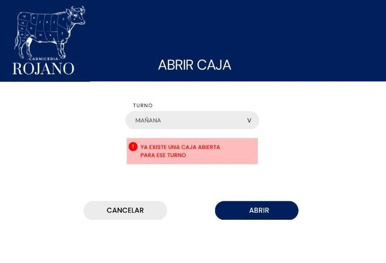 |

**Flujo normal (PDF)**

1. La cajera selecciona "Abrir caja".
2. El sistema solicita el turno (mañana o tarde).
3. El sistema valida que no haya ninguna caja abierta (RN-01, DEC-83).
4. El sistema crea el registro de caja con fecha, turno, empleado y estado "Abierta".
5. El sistema notifica que la caja fue abierta correctamente.

**Flujos alternativos**

| ID | Condición | Resultado | Estado |
|---|---|---|---|
| A1 | Ya existe una caja abierta para ese turno | El sistema no permite abrir otra y muestra un mensaje de error | PDF |
| A2 | Fondo de cambio | En el paso 2 la cajera puede cargar un monto inicial en efectivo (opcional; si lo deja vacío se guarda 0) | Decidido (DEC-38) |
| A3 | Hay otra caja abierta (por ejemplo, la de la mañana sin cerrar) | El sistema no permite abrir y pide cerrar la caja abierta | Decidido (DEC-39) |
| A4 | El turno elegido ya tuvo una caja ese día, ya cerrada | Se abre una caja nueva en ese turno; la cerrada no se reabre ni se edita. Sin caja abierta, el formulario ofrece los dos turnos | Decidido (DEC-83, reemplaza a DEC-39) |

**Decisiones de diseño (DEC-35):** fondo de cambio opcional (DEC-38); una sola caja abierta a la vez, con varias cajas posibles por turno (DEC-83, que reemplaza a DEC-39).

**Implementación (H2, etapa 1):** pantalla `/caja/`, solo para la cajera (con o sin permiso de alta de productos); el Administrador y los dueños reciben 403. Si hay una caja abierta, muestra su turno, fecha, quién la abrió, hora y fondo de cambio, y avisa si es de otro día. Si no la hay, muestra el formulario con los turnos que se pueden abrir hoy ("Elegí un turno" como primera opción) y el fondo de cambio opcional; con los dos turnos usados, avisa que ya no se puede abrir. La fecha es la de hoy y el turno lo elige la cajera. Las reglas están en el servicio de caja, que traduce a mensajes claros los rechazos de la base cuando dos cajeras abren a la vez. El cierre llega con CU-03 (etapa 3).

### CU-03 Cerrar caja por turno

| Campo | Detalle |
|---|---|
| Actor principal | Cajera |
| Requisitos | RF-06 a RF-09 |
| Precondiciones | Existe una caja abierta del turno |
| Poscondiciones | Se genera el reporte de cierre; la caja queda cerrada y bloqueada para edición (RN-03) |
| Prototipo (referencia v0, a rediseñar) | 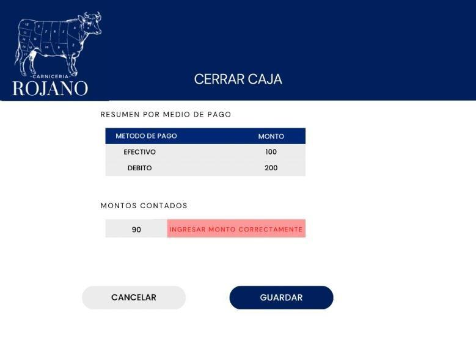 |

**Flujo normal (PDF)**

1. La cajera selecciona "Cerrar caja".
2. El sistema muestra el resumen por medio de pago.
3. La cajera ingresa los montos contados.
4. El sistema calcula las diferencias y guarda el cierre.
5. El sistema genera el reporte de cierre y bloquea la caja.

**Flujos alternativos**

| ID | Condición | Resultado | Estado |
|---|---|---|---|
| A1 | Error al ingresar los montos (valor inválido) | El sistema pide ingresar el monto correctamente | PDF |
| A2 | Hay diferencia entre lo contado y lo registrado | El sistema muestra la diferencia por medio de pago, avisa y pide un motivo obligatorio; no hace falta autorización | Decidido (DEC-40) |

**Decisiones de diseño (DEC-35):** el efectivo esperado incluye el fondo de cambio y los egresos en efectivo (DEC-38, DEC-43); diferencia con aviso y motivo obligatorio (DEC-40).

**Implementación (H2, etapa 3):** desde la pantalla de Caja, "Cerrar caja" lleva a `/caja/cerrar/`, solo para la cajera (cualquier cajera puede cerrar la caja abierta, también si es de otro día). Muestra lo esperado por medio de pago (ingresos menos egresos; el efectivo suma el fondo de cambio), con todos los medios activos que ingresan a caja más los que tengan movimientos (DEC-56), y pide lo contado de cada uno. Si alguna diferencia no es cero, exige el motivo. Al cerrar, en una sola operación guarda esperado y contado por medio (la diferencia se calcula, no se guarda), deja la caja cerrada con fecha y usuario y bloquea su fila para que no se cuele una venta. Después se ve el reporte de cierre en `/caja/<id>/cierre/`, imprimible, que también pueden abrir el Administrador y los Dueños por enlace directo (DEC-59, DEC-60).

### CU-04 Registrar pago de cliente (cuenta corriente)

| Campo | Detalle |
|---|---|
| Actor principal | Administrador y cajera (DEC-110, supuesto; amplía el CU 3.2.4 del documento original, que era solo del Administrador) |
| Requisitos | RF-06, RF-36 a RF-38 |
| Precondiciones | El cliente existe y tiene saldo pendiente |
| Poscondiciones | El monto adeudado disminuye y la caja registra el ingreso |
| Prototipo (referencia v0, a rediseñar) | 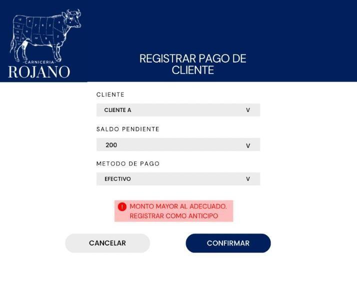 |

**Flujo normal (PDF)**

1. El usuario selecciona al cliente (SC-01).
2. El sistema muestra el saldo pendiente.
3. El usuario ingresa monto y medio de pago.
4. El usuario confirma; el sistema guarda el pago, reduce el saldo y registra el ingreso en caja (SC-02).

**Flujos alternativos**

| ID | Condición | Resultado | Estado |
|---|---|---|---|
| A1 | Monto mayor al adeudado | El sistema rechaza el cobro y muestra el saldo como máximo a cobrar. Reemplaza el "anticipo" del CU 3.2.4 original (RN-07) | Decidido (DEC-111, supuesto) |
| A2 | No hay caja abierta del día | La cajera no puede cobrar y el sistema indica abrir la caja (CU-02). El Administrador puede registrar el cobro sin movimiento de caja, desmarcando "Entra a la caja abierta" (criterio de DEC-106) | Decidido (DEC-110, supuesto) |
| A3 | Medio de pago = cuenta corriente | No se ofrece: una deuda no se paga con más deuda | Decidido (DEC-110) |
| A4 | El Administrador anula un cobro | Con motivo: se registra un movimiento inverso `ANULACION_PAGO` en la cuenta corriente y, si entró a caja, un egreso `ANULACION_COBRO` en su caja, que tiene que seguir abierta; con esa caja cerrada se rechaza, como el pago a proveedor (DEC-92, DEC-106) | Decidido (DEC-113) |

**Decisiones de diseño (DEC-107):** cobran el Administrador y la cajera; el cobro entra como ingreso `PAGO_CLIENTE` con su medio a la caja abierta del día (DEC-110); el saldo nunca es menor a 0 (DEC-111); sin recargos ni intereses (DEC-112); anulación con movimiento inverso (DEC-113).

**Implementación (H4, etapa 4):** pantalla `/clientes/cobrar/`. La cajera llega desde "Cobrar cuenta corriente" en el menú (S-2) y necesita la caja abierta de hoy: si no la hay, la pantalla avisa y enlaza a Caja. El Administrador llega desde "Clientes" ("Registrar cobro" o "Cobrar" en la fila de un cliente que debe, que lo deja elegido). El cliente se elige con SC-01, con flechas, Inicio, Fin, Enter y Escape como el buscador de productos (el componente `elegir_cliente.js` usa la lógica de `buscador.js`), incluidos los dados de baja que deben; se ve su saldo como máximo a cobrar y la alerta de deuda vencida. El medio no tiene valor por defecto ni ofrece cuenta corriente. "Entra a la caja abierta" solo la ve el Administrador y solo con caja de hoy, marcada; sin caja de hoy, su cobro va sin movimiento de caja (S-6). El servidor valida medio, monto, saldo (DEC-111) y caja; un error deja el cliente elegido. Con caja, el cobro deja en la misma operación el `PAGO`, el ingreso `PAGO_CLIENTE` con su medio a nombre de quien cobra y su cobro (`pago_cliente.entra_a_caja`). El detalle del cobro (`/clientes/cobros/<id>/`, solo del Administrador) permite anularlo con motivo: `ANULACION_PAGO` y, si entró a caja, el egreso `ANULACION_COBRO` en su caja, que tiene que seguir abierta; si no, se explica por qué no se puede (DEC-113). La pantalla de cierre y su reporte listan los cobros y sus reversas (S-8). El estado de cuenta (CU-08, etapa 5) enlaza a cada cobro y el detalle vuelve a él.

### CU-05 Registrar ingreso de mercadería

| Campo | Detalle |
|---|---|
| Actor principal | Administrador |
| Requisitos | RF-22 a RF-24, RF-30 |
| Precondiciones | Proveedor registrado |
| Poscondiciones | Stock actualizado; se crea el registro de deuda o pago al proveedor |
| Prototipo (referencia v0, a rediseñar) | 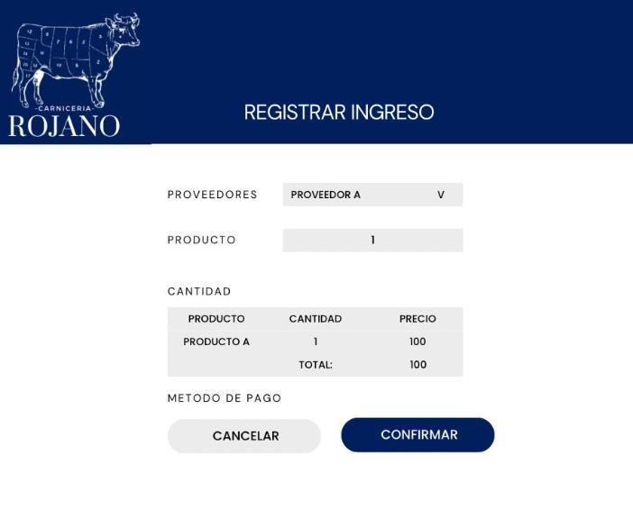 |

**Flujo normal (PDF)**

1. El Administrador selecciona "Registrar ingreso".
2. El sistema muestra la lista de proveedores.
3. El Administrador selecciona el proveedor.
4. El sistema muestra la interfaz para cargar productos.
5. El Administrador busca o selecciona productos e ingresa cantidades y precio unitario.
6. El sistema valida los productos y muestra el resumen del ingreso.
7. El Administrador confirma.
8. El sistema actualiza el stock y genera el registro de deuda o pago al proveedor.

**Flujos alternativos**

| ID | Condición | Resultado | Estado |
|---|---|---|---|
| A1 | Producto nuevo | Se crea el producto (CU-11) | PDF |

**Observación del prototipo:** muestra un campo "Método de pago", que sugiere que el ingreso puede registrarse como pagado; el texto solo habla de "deuda o pago". Se resolvió con DEC-81.

**Decisiones de diseño (DEC-78, supuestos del proyecto):**

- **Condición de pago (DEC-81):** `A_CREDITO` deja como deuda el total del ingreso. `CONTADO` pide el medio de pago y registra el pago por el total con las reglas de CU-07 (DEC-80, DEC-106), en una sola operación atómica con el ingreso: si el pago se rechaza (por ejemplo, por falta de efectivo en la caja), no se guarda el ingreso.
- **Remito (DEC-81):** el número de remito o de factura se anota como texto libre en `observacion`.
- **Cantidades (DEC-79):** por `UNIDAD`, enteras; por `KG`, hasta 3 decimales (DEC-48). El tope por línea de la venta (DEC-76) no se aplica al ingreso.

**Implementación (H3, etapas 3 y 4):** pantallas en `/proveedores/ingresos/`, solo del Administrador, con la pestaña "Ingresos de mercadería" junto a "Proveedores".
- **Carga:** proveedor activo, remito u observación y líneas armadas en el navegador. La búsqueda filtra mientras se escribe, como en la venta (DEC-97), y trae también la carne. El precio se completa con el último precio de compra con ese proveedor y se puede cambiar; si se cambia de proveedor, se vuelven a completar los que no se tocaron (DEC-90). Una línea por producto, como en la venta (DEC-53). "Crear producto" abre un diálogo con el servicio de CU-11, sin stock inicial, y agrega el producto (A1, DEC-91, DEC-99).
- **Confirmación:** el servidor valida y guarda en una operación el ingreso con la fecha de hoy (DEC-93), los detalles, el stock con `mover_stock` (la carne no lo mueve, DEC-94) y el precio en `producto_proveedor`. El total es la suma de los subtotales redondeados (DEC-89). El precio admite hasta 2 decimales y no puede ser negativo.
- **Listado y detalle:** listado paginado de a 25 (DEC-95) con total y saldo; el detalle muestra las líneas, el total y el saldo derivado. El listado de proveedores muestra el saldo de cada uno (ingresos vigentes menos pagos, sin guardarlo).
- **Contado (etapa 4, DEC-81):** la carga ofrece "A crédito" o "Contado"; al contado se elige el medio (cualquiera activo salvo cuenta corriente) y, en efectivo, si sale de la caja abierta (DEC-106); el pago por el total se registra con el servicio de CU-07 en la misma operación: si se rechaza (por ejemplo, por falta de efectivo), no se guarda nada.
- **Anulación (DEC-92):** desde el detalle, con motivo obligatorio y confirmación, solo si no tiene pagos vigentes (un contado se anula después de anular su pago). El ingreso queda `ANULADO` con fecha, usuario y motivo (migración `proveedores/0003`), su deuda deja de contar y el stock vuelve, aunque quede negativo; el precio de compra no se revierte.

### CU-06 Consultar stock

| Campo | Detalle |
|---|---|
| Actor principal | Administrador y cajera, en solo lectura (DEC-103); los dueños no acceden (DEC-134) |
| Requisitos | RF-25, RF-26, RF-28 |
| Precondiciones | Existen productos registrados |
| Poscondiciones | Ninguna (solo consulta) |
| Prototipo (referencia v0, a rediseñar) | 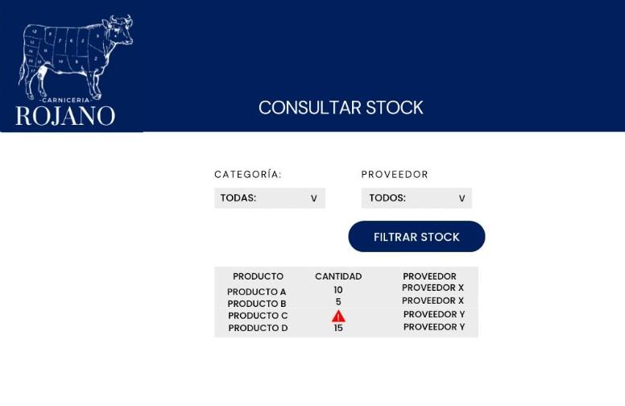 |

**Flujo normal (PDF)**

1. El usuario abre Productos: la consulta de stock se integra en esa pantalla (DEC-105).
2. El sistema muestra todos los productos registrados.
3. El usuario aplica filtros (categoría, proveedor, etc.).
4. El sistema muestra los productos filtrados con cantidades y alertas de stock mínimo (RN-10).

**Flujos alternativos (el documento base decía "no aplica")**

| ID | Condición | Resultado | Estado |
|---|---|---|---|
| A1 | Los filtros no devuelven productos | El sistema muestra "Sin productos para el filtro seleccionado" | Propuesta |
| A2 | El usuario no tiene permiso de consulta | El sistema no muestra el módulo | Propuesta; los dueños (DEC-134) |

**Alcance:** el stock y las alertas son solo de productos no cárnicos; el listado también muestra la carne, como "Sin control" (DEC-105).
**Implementación (H3, etapa 5, DEC-105):** en `/productos/`, para el Administrador y toda cajera: filtros por categoría, por proveedor (los activos con productos, por la relación inversa de `producto_proveedor`, R-7) y "Solo stock bajo", que se pueden combinar con la búsqueda y se conservan al paginar, y la marca "Stock bajo" en cada fila. La alerta se define una sola vez en el servicio de catálogo (R-8). El inicio del Administrador tiene la tarjeta "Stock bajo" con la cantidad de productos, que lleva al listado filtrado.
**Stock mínimo (DEC-82 y DEC-101, supuestos del proyecto):** un producto con control de stock muestra la alerta si `stock_actual <= stock_minimo`; sin mínimo, si `stock_actual <= 0` (sin stock o negativo, DEC-46). Sin mínimo y con stock mayor a 0 no hay alerta. El Administrador corrige el stock al modificar el producto (CU-11, DEC-98). La carne no tiene alerta (DEC-36). La tarjeta "stock bajo" del inicio se muestra solo al Administrador; la cajera no la ve, porque su inicio no muestra totales del negocio (DEC-137, supuesto).
**Pendientes:** PR-21 (vencimientos). Los dueños no consultan el stock (DEC-134).

### CU-07 Registrar pago a proveedor

| Campo | Detalle |
|---|---|
| Actor principal | Administrador |
| Requisitos | RF-06, RF-31 a RF-33 |
| Precondiciones | El proveedor existe y tiene un ingreso con saldo pendiente (DEC-81) |
| Poscondiciones | Se actualiza el estado de la deuda; si el pago sale de caja, se registra el egreso |
| Prototipo (referencia v0, a rediseñar) | 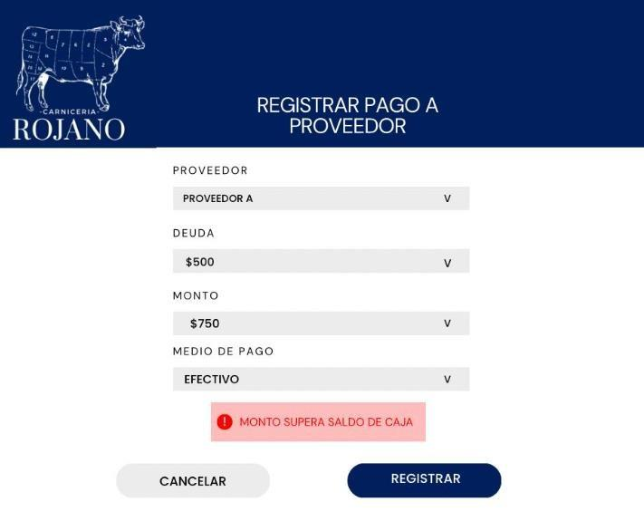 |

**Flujo normal (PDF)**

1. El Administrador selecciona "Registrar pago a proveedor".
2. El sistema muestra los proveedores con deudas pendientes.
3. El Administrador selecciona proveedor y deuda a pagar.
4. Ingresa monto y medio de pago.
5. El sistema valida la disponibilidad en caja (si el pago sale de caja).
6. Si es válido, registra el pago, actualiza el saldo del proveedor y, cuando corresponde, el egreso de caja (SC-02).

**Flujos alternativos**

| ID | Condición | Resultado | Estado |
|---|---|---|---|
| A1 | El monto de un pago que sale de la caja supera su efectivo esperado | El sistema rechaza el pago y muestra el máximo disponible | PDF; ajustado por DEC-80 y DEC-106: solo si sale de la caja |
| A2 | El monto supera la deuda | El sistema advierte y pide corregir | Propuesta |

**Decisiones de diseño (DEC-78, supuestos del proyecto):**

- **Medios (DEC-106):** cualquier medio activo salvo cuenta corriente (DEC-41).
- **Efectivo que sale de la caja (DEC-80, DEC-106):** opción "Sale de la caja abierta", marcada por defecto. Exige la caja abierta del día; sin caja abierta, o si la abierta es de otro día, se rechaza. Genera en la misma operación un egreso `PAGO_PROVEEDOR` (SC-02). El Administrador puede registrarlo en la caja abierta por otro usuario; el movimiento queda a nombre de quien lo registra.
- **Efectivo que no sale de la caja y demás medios (DEC-106):** no generan movimiento de caja ni validan disponibilidad.
- **Deuda (DEC-81):** se elige un ingreso del proveedor con saldo pendiente; el saldo del proveedor es la suma de los totales de sus ingresos menos la suma de sus pagos.

**Implementación (H3, etapa 4):** pantallas en `/proveedores/pagos/`, solo del Administrador, con la pestaña "Pagos".
- **Registro:** "Registrar pago" desde el listado o desde el detalle de un ingreso con saldo, que precarga el ingreso y el saldo. Se elige un ingreso vigente de un proveedor activo con saldo; el monto, mayor a 0, con centavos y no mayor al saldo (RI-08, A2), y el medio: cualquiera activo salvo cuenta corriente (DEC-106).
- **Efectivo:** aparece "Sale de la caja abierta", marcada, con lo disponible en la caja abierta de hoy. Marcada, el pago va en la caja abierta del día con el egreso `PAGO_PROVEEDOR` a nombre de quien registra, con las funciones públicas de caja (R-3); sin caja, con la de otro día o sin efectivo suficiente se rechaza mostrando el máximo (A1). Desmarcada, se registra sin movimiento y sin exigir caja.
- **Otros medios:** sin movimiento de caja.
- **Concurrencia:** el pago bloquea el ingreso, como su anulación, y si sale de caja después la caja, como el cierre: un pago y un cierre, o un pago y la anulación del ingreso, al mismo tiempo no se cruzan.
- **Anulación (DEC-92):** desde el detalle del pago, con motivo y confirmación: si no salió de caja, siempre y sin reversa; si salió, solo con la caja de su egreso abierta, con una reversa `INGRESO` `ANULACION_PAGO` en esa caja (el egreso no se toca). El saldo vuelve a subir; un ingreso se puede anular cuando no le quedan pagos vigentes.

### CU-08 Gestionar cuentas corrientes

| Campo | Detalle |
|---|---|
| Actor principal | Administrador (los dueños no acceden, DEC-134) |
| Requisitos | RF-39 a RF-41 |
| Precondiciones | El cliente está registrado |
| Poscondiciones | Estado de cuenta actualizado |
| Prototipo (referencia v0, a rediseñar) | 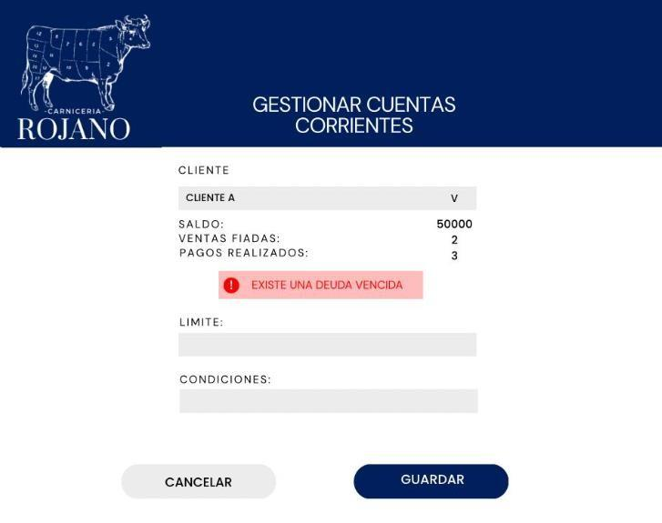 |

**Flujo normal (PDF)**

1. El usuario selecciona al cliente (SC-01).
2. El sistema muestra saldo, listado de ventas fiadas y pagos realizados.
3. Si existe deuda vencida, el sistema muestra una alerta (RN-11).
4. El usuario puede editar límites o condiciones si tiene permiso (las condiciones van en "Observaciones", DEC-117).

**Flujos alternativos (el documento base los dejaba vacíos)**

| ID | Condición | Resultado | Estado |
|---|---|---|---|
| A1 | No hay deuda vencida | No se muestra alerta | Propuesta |
| A2 | El usuario no tiene permiso para editar | Los campos de límite y observaciones quedan de solo lectura | Propuesta |
| A3 | El cliente no tiene movimientos | El sistema muestra saldo cero y listados vacíos | Propuesta |
| A4 | El cliente ya debía antes de usar el sistema | El Administrador carga el saldo inicial con monto, fecha de origen y motivo; uno vigente por cliente; se anula con un movimiento inverso | Decidido (DEC-119, supuesto) |

**Decisiones de diseño (DEC-107):** límite de crédito opcional por cliente, definido por el Administrador; vacío, sin límite (DEC-108). Deuda vencida: saldo de los cargos con más de 30 días, imputando los cobros a los cargos más antiguos y calculada al consultar; solo alerta (DEC-109). Sin recargos ni intereses; "Observaciones" es texto libre informativo (DEC-112, DEC-117). El estado de cuenta lista el saldo inicial, las ventas a cuenta corriente, los cobros y sus anulaciones (DEC-113, DEC-119); el saldo inicial cuenta para el vencimiento con su fecha de origen.

**Implementación (H4, etapa 5):** pantalla `/clientes/<id>/`, solo del Administrador (S-10; la cajera y los dueños reciben 403), a la que se llega desde el nombre del cliente en el listado, también si está dado de baja. Muestra saldo, límite (DEC-115), disponible y deuda vencida, con la alerta si la hay (RN-11), y los movimientos del más nuevo al más viejo, paginados de a 25: saldo inicial, ventas a cuenta corriente (con enlace al detalle de la venta), cobros (con enlace a su detalle, el medio y si fue sin caja) y sus anulaciones, con la marca "Anulado" en la venta, el cobro o el saldo inicial que se revirtió. "Registrar cobro" lleva al cobro con el cliente elegido; "Anular" en un cobro vigente lleva a su detalle, desde donde se anula (S-11). En la misma pantalla se modifican el límite y las observaciones (RF-41; un cliente dado de baja primero se reactiva) y se carga el saldo inicial con monto, fecha de origen y motivo o, si hay uno vigente, se anula con motivo (A4, DEC-119); los rechazos (uno ya vigente, saldo menor al monto) se muestran en su sección.

### CU-09 Generar reportes

| Campo | Detalle |
|---|---|
| Actor principal | Administrador; dueños en solo lectura (DEC-134) |
| Requisitos | RF-42 a RF-45 (RF-46 descartado, DEC-136) |
| Precondiciones | Existen ventas y pagos registrados |
| Poscondiciones | Reporte visible en pantalla y, si se pide, exportado a Excel o PDF para descargar |
| Prototipo (referencia v0, a rediseñar) | 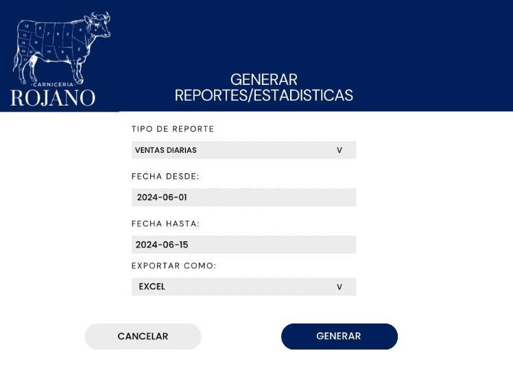 |

**Flujo normal (PDF)**

1. El usuario accede a "Generar reportes".
2. El sistema muestra los tipos de reporte (ventas diarias, producto más vendido, etc.).
3. El usuario selecciona el tipo.
4. El sistema solicita rango de fechas y formato de exportación (PDF o Excel).
5. El usuario completa y confirma.
6. El sistema genera el reporte.
7. El usuario lo visualiza y lo descarga.

**Flujos alternativos**

| ID | Condición | Resultado | Estado |
|---|---|---|---|
| A1 | No hay datos para el período | El sistema muestra "Sin registros disponibles" | PDF |
| A2 | La fecha "desde" es posterior a "hasta" | El sistema pide corregir el rango | Propuesta |

**Decisiones de diseño (DEC-133):** cuatro reportes, los de RF-42: ventas diarias, producto más vendido, ingresos por día y totales por medio de pago. Son a pedido, con rango de fechas, se ven en pantalla y se exportan a Excel o PDF; ninguno se genera solo (DEC-136, supuesto). CU-09 incluye además la consulta de cierres de caja por fecha (DEC-59), que lleva al reporte de cierre de cada caja. La meta de reportes al cierre la cubre el resumen de cierre de CU-03 (H-13). Lo ven el Administrador y los dueños, en solo lectura (DEC-134).

**Decisiones del spec (SPEC-H5):** ventas diarias por fecha y turno, con las ventas a cuenta corriente (DEC-140); producto más vendido por importe (DEC-141); ingresos por día con las ventas no fiadas y los cobros, sin anuladas, y una columna que separa lo que entró a caja de lo que quedó fuera de caja (DEC-142, supuesto); totales por medio de pago (DEC-143); consulta de cierres (DEC-144); rango por defecto hoy, sin fechas futuras (DEC-145); Excel y PDF (DEC-146).

### CU-10 Iniciar sesión

| Campo | Detalle |
|---|---|
| Actores | Administrador, Cajera, Dueños |
| Requisitos | RF-01, RF-02, RNF-06, RNF-07 |
| Origen | Propuesta; el documento base lo supone como precondición de CU-02 |
| Precondiciones | El usuario existe y está activo |
| Poscondiciones | Sesión iniciada con las funciones permitidas según el rol |

**Flujo normal**

1. El usuario ingresa usuario y contraseña.
2. El sistema valida las credenciales.
3. El sistema muestra las funciones permitidas según el rol.

**Flujos alternativos**

| ID | Condición | Resultado |
|---|---|---|
| A1 | Credenciales inválidas | El sistema muestra un mensaje de error genérico y no inicia sesión |
| A2 | Usuario dado de baja | El sistema no permite el ingreso |
| A3 | El usuario cierra sesión | La sesión termina |

**Implementación (H1):** pantalla propia de ingreso para los tres roles. A1 y A2 muestran el mismo mensaje genérico ("Usuario o contraseña incorrectos."), para no revelar si la cuenta existe o está dada de baja. A3 cierra la sesión con un botón y vuelve al ingreso. Solo el Administrador entra además al panel de administración (DEC-32).

**Inicio por rol (DEC-137, supuesto, H5):** después de ingresar, la cajera ve el estado de la caja (la caja abierta, o que no hay una) y accesos a Registrar venta, Cobrar cuenta corriente y Cerrar caja, sin totales del negocio. El inicio del Administrador no cambia. El dueño ve en el inicio solo el acceso a Reportes, sin totales (DEC-147).

**Implementación (H5, etapa 1):** la vista de inicio elige la plantilla por rol y solo calcula los totales para el Administrador (R-4, DEC-154): `comun/inicio_cajera.html` con la caja abierta (turno, fecha, quién la abrió y la hora) o "No hay caja abierta" con "Abrir caja", y los accesos a `/ventas/nueva/`, `/clientes/cobrar/` y `/caja/cerrar/`, que avisan si falta la caja (DEC-148); `comun/inicio_duenio.html` con el acceso a Reportes, "Pronto" hasta la etapa 3. Un dueño recibe 403 en el resto de las pantallas; abre el reporte de cierre por enlace (DEC-59) (CP-126, CP-127).

**Pendientes:** PR-34 (cierre de sesión por inactividad). Cada persona tiene su propio usuario (DEC-135, PR-26).

### CU-11 Gestionar productos

| Campo | Detalle |
|---|---|
| Actor principal | Administrador; la cajera consulta el listado y el stock (DEC-103) y da de alta con permiso (RN-05) |
| Requisitos | RF-17, RF-21, RF-24 |
| Origen | Propuesta (H-04); el alta ya aparece como flujo alternativo de CU-01 y CU-05 |
| Poscondiciones | Catálogo actualizado |

**Flujo normal (alta)**

1. El usuario selecciona "Gestionar productos" y elige "Nuevo producto".
2. Completa los datos del producto (nombre, categoría, precio, unidad de medida, plus interno, stock mínimo y, solo el Administrador, stock inicial; la unidad es `UNIDAD` o `KG` (DEC-79), el stock mínimo es opcional y por producto (DEC-82) y el stock inicial es opcional, solo con control de stock, y se registra como ajuste "Stock inicial" (DEC-99); quedan pendientes PR-21 y PR-22; el plus, de DEC-37).
3. El sistema valida los datos y guarda el producto.

**Otras operaciones:** modificar datos y dar de baja (baja lógica, para conservar el historial de ventas; propuesta).

**Flujos alternativos**

| ID | Condición | Resultado |
|---|---|---|
| A1 | El plus interno ya existe | El sistema avisa junto al campo y no guarda. El nombre repetido no se bloquea: era una propuesta y no está confirmada (PR-22) |
| A2 | La cajera sin permiso intenta crear un producto | El sistema lo impide (RN-05) |

**Implementación (H1):** pantalla `/productos/` con búsqueda por nombre o plus interno y, por defecto, solo los productos activos. El Administrador da de alta, modifica y da de baja (con confirmación), ve el stock y puede incluir los dados de baja en el listado; un producto dado de baja no se edita desde esta pantalla (ni por su URL): primero se reactiva con "Reactivar" en el listado de dados de baja, solo el Administrador y sin condición de stock (DEC-85). La unidad de medida no viene elegida: el formulario muestra "Elegí una unidad" y obliga a elegir (DEC-79). Toda cajera, con o sin permiso de alta, ve el listado con el stock en solo lectura, sin editar ni dar de baja; la cajera con permiso además da de alta (DEC-103, que reemplaza en esto a DEC-33). Los dueños no acceden. El stock actual arranca en 0 y no se edita en esta pantalla (RI-07); el alta durante la venta (CU-01 A1, RF-17) se implementó en la etapa 4 de H2 (DEC-62 a DEC-65).

**Panel sin borrado (H5, etapa 1, DEC-138, L14):** el panel de administración no borra productos, tengan o no referencias, ni ofrece borrar varios a la vez; se dan de baja (CP-128).

**Stock editable (etapa 1b de H3, DEC-98 a DEC-100, supuestos del proyecto):** el Administrador ve y edita el stock al crear y al modificar un producto, en `/productos/` y en el panel de administración, que guarda con el mismo servicio de catálogo. Solo para productos que controlan stock; mayor o igual a 0 y con el formato de DEC-79. Si al guardar el stock cambió, el servicio lo aplica con `mover_stock` y registra un ajuste (`ajuste_stock`) con usuario, fecha, stock anterior, stock nuevo y motivo: en el alta, "Stock inicial"; al modificar, el que se elija (por defecto "Modificación manual"; también conteo, vencimiento, rotura u otro). El cambio se mide contra el stock que mostró el formulario, así una venta hecha mientras se editaba no se deshace. Solo el Administrador cambia el stock: la cajera lo ve en el listado pero su alta no carga stock y arranca en 0 (DEC-103), igual que el alta durante la venta y desde el ingreso. Los ajustes no se editan ni se borran: se consultan en el panel ("Ajustes de stock"), de solo lectura.

### CU-12 Gestionar clientes

| Campo | Detalle |
|---|---|
| Actor principal | Administrador |
| Requisitos | RF-35 |
| Origen | Propuesta (H-04) |
| Poscondiciones | Clientes actualizados |

**Flujo normal (alta):** el Administrador ingresa los datos del cliente y el sistema lo guarda. También permite modificar, dar de baja y reactivar.

**Decisiones de diseño (DEC-107):** solo el Administrador da de alta y modifica clientes; la cajera elige uno existente en la venta (SC-03) y en el cobro (CU-04), sin alta (DEC-116). Nombre obligatorio; teléfono, dirección y observaciones opcionales, con las condiciones de crédito dentro de "Observaciones"; el nombre repetido no se bloquea (DEC-117). Límite de crédito opcional (DEC-108), que se muestra como "Sin límite" si está vacío y "Sin crédito habilitado" si es 0 (DEC-115). Listado con buscador por nombre o teléfono y paginación de a 25, para decenas a pocos cientos de clientes (DEC-118). La deuda que ya existía se carga como saldo inicial desde el estado de cuenta (CU-08, DEC-119).
**Implementación (H4, etapa 2):** pantalla `/clientes/`, solo del Administrador (DEC-116; la cajera y los dueños reciben 403 y no la ven en el menú, S-2). Igual que CU-13 (S-1): listado de activos paginado de a 25 con búsqueda por nombre o teléfono, "Solo con deuda vencida" e "Incluir dados de baja", que se conservan al paginar; cada fila muestra teléfono, dirección, el límite con el texto de DEC-115, el saldo y, si la tiene, la marca "Vencida" con el monto (S-7). Saldos y deuda vencida de la página salen de dos consultas, no de una por cliente (R-7). Alta y modificación con nombre obligatorio y teléfono, dirección, límite y observaciones opcionales; baja lógica con confirmación, que avisa el saldo si el cliente debe (la deuda sigue y se le puede cobrar); "Reactivar" (POST) en el listado de dados de baja. Un cliente dado de baja no se edita: primero se reactiva. Las reglas y los permisos están también en el servicio.

### CU-13 Gestionar proveedores

| Campo | Detalle |
|---|---|
| Actor principal | Administrador |
| Requisitos | RF-29 |
| Origen | Propuesta; CU-05 exige "proveedor registrado" |
| Poscondiciones | Proveedores actualizados |

**Flujo normal (alta):** el Administrador ingresa nombre y contacto del proveedor (según el modelo del documento base) y el sistema lo guarda. También permite modificar y dar de baja.
**Implementación (H3, etapa 2):** pantalla `/proveedores/`, solo del Administrador (DEC-88; la cajera y los dueños reciben 403 y no la ven en el menú). Igual que CU-11 (DEC-87): listado de activos paginado de a 25 (DEC-95) con búsqueda por nombre, teléfono o email e "Incluir dados de baja"; alta y modificación con nombre obligatorio y teléfono y email opcionales; baja lógica con confirmación; "Reactivar" (POST) en el listado de dados de baja. Un proveedor dado de baja no se edita: primero se reactiva. El nombre repetido no se bloquea. Las reglas y los permisos están también en el servicio (R-9), y una prueba de estructura verifica que catálogo y caja no importan `proveedores` (R-6).
**Pendientes:** ninguno para el pago (PR-17 cerrada por DEC-80); los datos de contacto dependen de PR-31.

### CU-14 Gestionar usuarios

| Campo | Detalle |
|---|---|
| Actor principal | Administrador |
| Requisitos | RF-03 |
| Origen | Propuesta |
| Poscondiciones | Usuarios actualizados con su rol |

**Flujo normal (alta):** el Administrador crea el usuario, le asigna un rol (Administrador, Cajera o Dueños) y una contraseña inicial; el sistema lo guarda. También permite modificar, dar de baja y restablecer contraseña.

**Decisiones de diseño (DEC-133):** un usuario por persona y sin autorregistro: solo el Administrador da de alta usuarios. CU-14 es solo del Administrador: alta con rol y contraseña inicial, edición de los datos y del rol, desactivación (baja lógica: el usuario no puede ingresar, CU-10 A2) y restablecimiento de la contraseña. Un usuario no se borra, porque sus operaciones lo referencian. La auditoría es el usuario que registra cada operación, sin un registro aparte (DEC-135, supuesto). Pantalla y reglas en DEC-149 a DEC-151: los Administradores creados en CU-14 no entran al panel de administración, que queda para el superusuario técnico (DEC-150, supuesto). El panel tampoco borra usuarios (DEC-153, H5 etapa 1).

### CU-15 Ajustar stock (integrado a CU-11)

Se integró a CU-11 Gestionar productos: el stock se cambia al crear o modificar el producto y cada cambio queda registrado como ajuste (DEC-98 a DEC-100). El ID CU-15 no se reutiliza.

## 6. Sub-casos reutilizables

### SC-01 Verificar cliente

Incluido en CU-04, CU-08 y SC-03. El usuario busca al cliente por nombre o teléfono entre los activos y lo elige (DEC-118); el sistema muestra su saldo, su límite (DEC-115) y la alerta de deuda vencida si la tiene (DEC-109). Si no existe, solo el Administrador puede crearlo (CU-12, DEC-116); la cajera no tiene esa opción. En el cobro también se puede elegir un cliente dado de baja con saldo (DEC-116).

**Implementación (H4, etapa 2):** el servicio `buscar_para_elegir` y `GET /clientes/buscar/?q=` (con `para=cobro` para sumar los dados de baja que deben) devuelven hasta 50 clientes con nombre, teléfono, saldo, límite (DEC-115), disponible y deuda vencida, y si hay más (como DEC-97). Lo usan el Administrador y la cajera (la vista acepta las funciones "Clientes" y "Ventas"; desde la etapa 4, también la del cobro); los dueños reciben 403. La elección en pantalla se arma en la venta (etapa 3) y en el cobro (etapa 4).

### SC-02 Registrar movimiento de caja

Incluido en CU-01, CU-04 (cuando el cobro entra a caja, DEC-110) y CU-07 (cuando el pago sale de caja). Registra un ingreso o egreso con monto y medio de pago en la caja abierta del turno (RN-04). Si no hay caja abierta, el sistema avisa.

**Implementación (H2, etapas 2 y 3):** el ingreso de cada venta se registra junto con la venta. Los egresos "otros" se cargan desde la pantalla de Caja: monto mayor a 0, descripción obligatoria, en el medio marcado como efectivo (DEC-55) y sin superar el efectivo esperado (DEC-57). Los egresos "otros" (gastos y retiros en efectivo) llevan el concepto `OTRO` (DEC-43). La pantalla lista los egresos del turno, que no se editan ni se borran (DEC-58).

**Implementación (H2, etapa 4):** la anulación de una venta registra un egreso con concepto `ANULACION`, que referencia la venta, por su total y con su medio de pago (DEC-68). La pantalla de cierre y su reporte listan las ventas anuladas (DEC-77) y, desde H3, los pagos a proveedores en efectivo y sus reversas, que también cambian lo esperado.

### SC-03 Vender a cuenta corriente (DEC-108, DEC-109, DEC-113)

Extiende CU-01 cuando el medio de pago es cuenta corriente. Selecciona el cliente (SC-01) y muestra su saldo y, si la tiene, la alerta de deuda vencida, que no bloquea (DEC-109). Si el cliente tiene límite de crédito y el saldo más el total de la venta lo supera, la venta se rechaza mostrando el saldo y el disponible (DEC-108); con límite 0 se muestra "Sin crédito habilitado" (DEC-115). Solo se eligen clientes activos (DEC-116). Registra la venta como deuda del cliente (`movimiento_cuenta_corriente` `VENTA_FIADA`) sin movimiento de caja (`ingresa_a_caja = false`, DEC-41); la venta queda en la caja abierta como venta del turno. Su anulación revierte la deuda con un movimiento inverso `ANULACION_VENTA` en lugar del egreso de caja, y se rechaza solo si el saldo actual del cliente es menor al total de la venta (DEC-113, DEC-114, L1).

**Implementación (H4, etapa 3):** en `/ventas/nueva/` el medio "Cuenta corriente" (el activo que no ingresa a caja, S-3) aparece entre los demás. Al elegirlo se abre SC-01: la cajera busca por nombre o teléfono, elige un cliente activo y ve su saldo, límite (DEC-115), disponible y la alerta de deuda vencida, que no frena la venta; si el total pasa el disponible, la pantalla avisa antes de confirmar. La venta en curso guardada en la pestaña recuerda el cliente y, al volver, pide de nuevo sus datos (S-4). Al confirmar, el servidor vuelve a validar el cliente (que exista y esté activo, DEC-116) y el límite (DEC-108), y guarda la venta con su cliente y un `VENTA_FIADA` por el total, sin movimiento de caja (R-2); bloquea caja, cliente y productos en ese orden (DEC-128). El ticket muestra el cliente sin su saldo; el cierre de caja no cuenta la venta (no hay movimiento) y el resumen del día, las ventas de la caja y el historial sí, con el nombre del cliente (S-5). La anulación, desde el historial del Administrador, registra `ANULACION_VENTA` en lugar del egreso de caja, devuelve el stock y se rechaza si el saldo actual del cliente es menor al total (L1, DEC-113, DEC-114).

### SC-04 Avisar stock insuficiente (DEC-46)

Extiende CU-01 cuando el stock de un producto con control es insuficiente. El sistema avisa a la cajera en la línea, al agregar el producto o cambiar su cantidad, con la cantidad disponible (DEC-102, DEC-103), y otra vez en el ticket; la venta se permite y el `stock_actual` puede quedar negativo. Por ahora no se registra un faltante aparte: es un supuesto (DEC-46) y el registro del faltante, que figura en el relevamiento base (RF-27), queda pendiente de PR-37.

## 7. Prototipos

Los prototipos de CU-01 a CU-09 provienen del relevamiento base y se guardan en `docs/prototipos/` **solo como referencia (v0)**. Muestran qué datos y acciones se esperaba en cada pantalla, pero **no son el diseño del sistema final**: se rediseñan por completo (visual, de flujo y de usabilidad) en una etapa posterior, por ejemplo en Figma. Hasta entonces sirven de guía funcional.

| CU | Archivo | Observaciones |
|---|---|---|
| CU-01 | `prototipos/CU-01-registrar-venta.png` | Falta cliente y cuenta corriente (H-11) |
| CU-02 | `prototipos/CU-02-abrir-caja.png` | Falta el monto inicial opcional (DEC-38) |
| CU-03 | `prototipos/CU-03-cerrar-caja.png` | Muestra un solo campo de monto contado; el resumen es por medio de pago |
| CU-04 | `prototipos/CU-04-registrar-pago-cliente.png` | Incluye el aviso de anticipo |
| CU-05 | `prototipos/CU-05-registrar-ingreso-mercaderia.png` | Tiene "Método de pago" no descripto en el texto |
| CU-06 | `prototipos/CU-06-consultar-stock.png` | Muestra alerta de stock bajo |
| CU-07 | `prototipos/CU-07-registrar-pago-proveedor.png` | Incluye el aviso de monto superior al saldo de caja |
| CU-08 | `prototipos/CU-08-gestionar-cuentas-corrientes.png` | Incluye alerta de deuda vencida, límite y condiciones (las condiciones van en "Observaciones", DEC-117) |
| CU-09 | `prototipos/CU-09-generar-reportes.png` | Tipo, rango de fechas y formato de exportación |

Los prototipos definitivos (incluidos los de CU-10 a CU-14 y las correcciones indicadas) se diseñan en una etapa posterior y se guardan en `docs/prototipos/` con la versión v1 en el nombre, por ejemplo `CU-01-registrar-venta-v1.png`. Los de referencia v0 se conservan para consultar el origen.

## 8. Mantenimiento

Al confirmar una brecha, actualizar el caso de uso afectado (marca y flujos), las reglas de negocio de la sección 4, los requisitos en [03-requisitos.md](03-requisitos.md), el modelo de datos en [05-modelo-datos.md](05-modelo-datos.md) y las pruebas en [08-pruebas.md](08-pruebas.md).
