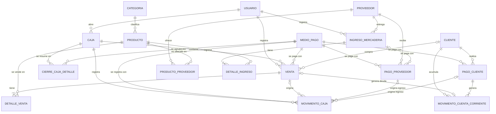
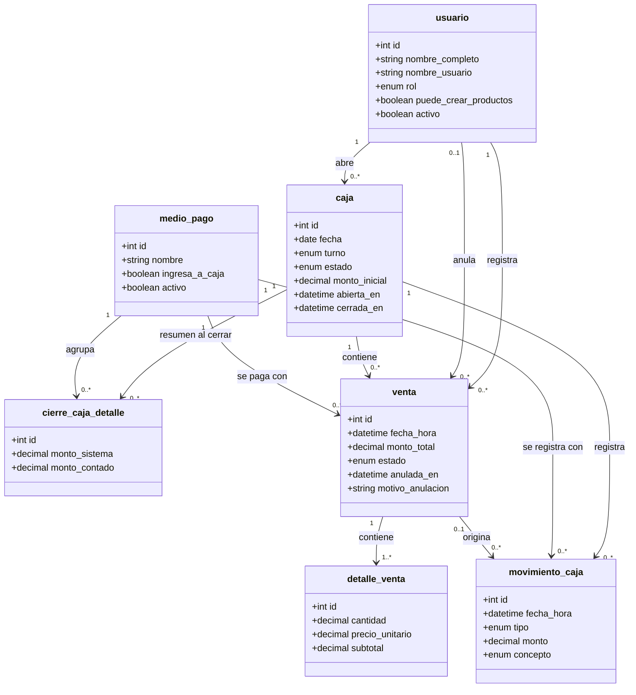
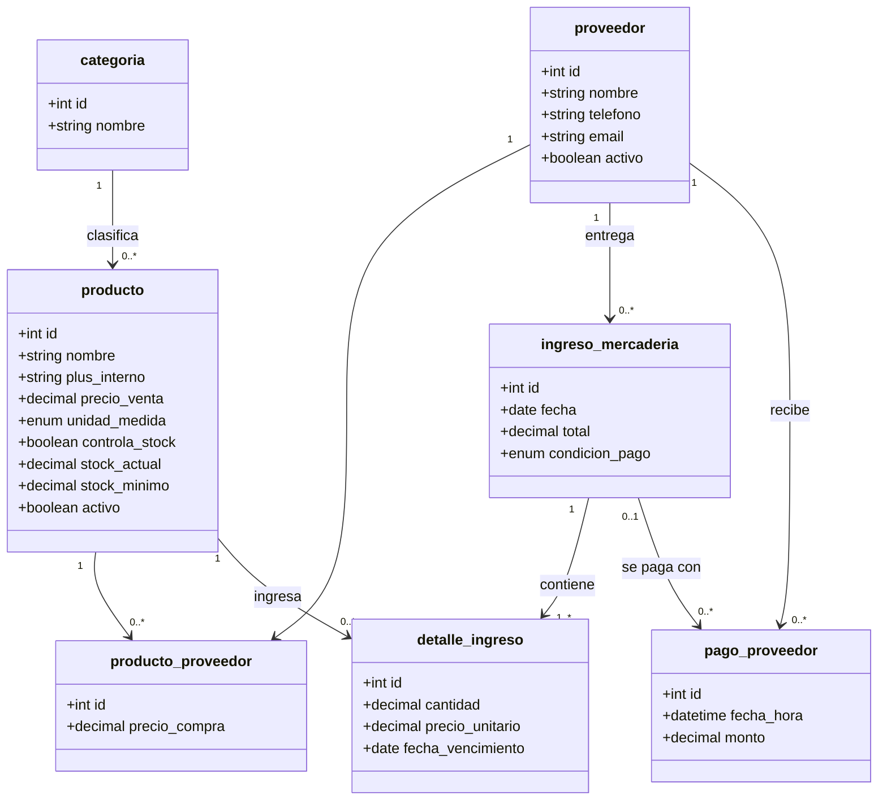
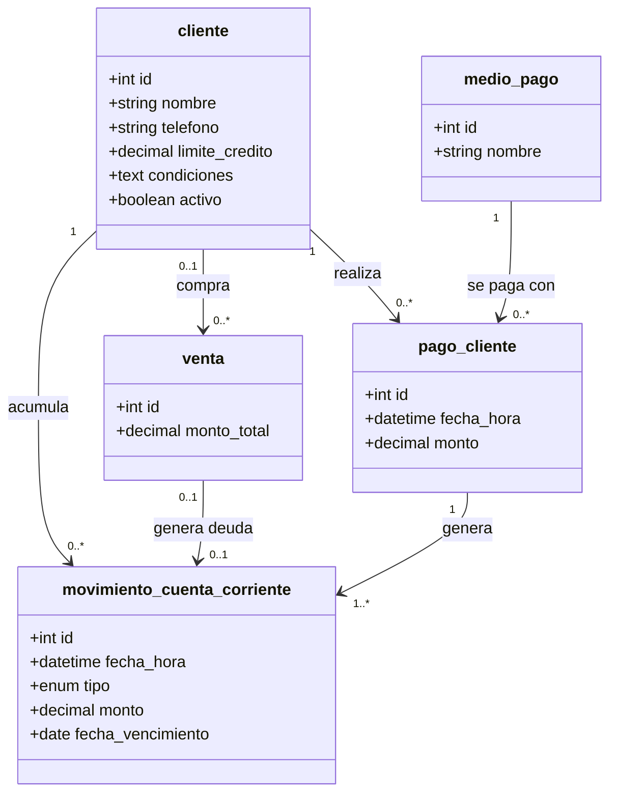

# 05 - Modelo de datos

| Campo | Valor |
|---|---|
| Versión | 0.3 (borrador) |
| Base | Modelo de clases del relevamiento real, corregido y ampliado |
| Nivel | Modelo lógico. El motor de base de datos elegido (PostgreSQL) y las decisiones técnicas están en [06-arquitectura.md](06-arquitectura.md) |
| Relacionados | [03-requisitos.md](03-requisitos.md), [04-casos-de-uso.md](04-casos-de-uso.md), [01-relevamiento.md](01-relevamiento.md) |

## 1. Convenciones

- **Nombres:** entidades en singular y `snake_case` para atributos (por ejemplo `monto_total`). Toda entidad tiene `id` como clave primaria.
- **Tipos lógicos:** `int`, `string`, `text`, `decimal` (montos y cantidades), `date`, `datetime`, `boolean`, `enum`.
- **Montos:** `decimal` con dos decimales, en pesos argentinos (propuesta, a confirmar con RNF-15).
- **Marcas:** `(PDF)` = viene del modelo base. `(propuesta)` = lo agrega el análisis. `(a confirmar: PR-xx)` = depende de una brecha de [01-relevamiento.md](01-relevamiento.md).
- **Auditoría:** todas las tablas guardan `creado_en` y `actualizado_en` (no se repiten en el diccionario).
- **Enfoque iterativo:** el modelo se construye por etapas. Se mantiene lo necesario para los casos de uso actuales y se ajusta a medida que avanza el desarrollo; lo que falte o sobre se registra en [09-decisiones.md](09-decisiones.md).
- **Baja lógica:** productos, clientes, proveedores y usuarios no se borran, se marcan con `activo = false`, para conservar el historial de ventas, pagos y cuentas corrientes.

## 2. Resumen del modelo

El modelo se organiza en cuatro áreas.

| Área | Entidades |
|---|---|
| Acceso | `usuario` |
| Caja y ventas | `caja`, `cierre_caja_detalle`, `movimiento_caja`, `medio_pago`, `venta`, `detalle_venta` |
| Catálogo, stock y proveedores | `categoria`, `producto`, `proveedor`, `producto_proveedor`, `ingreso_mercaderia`, `detalle_ingreso`, `pago_proveedor` |
| Clientes y cuentas corrientes | `cliente`, `pago_cliente`, `movimiento_cuenta_corriente` |

Hay además tres entidades **condicionales** que solo se agregan si el negocio lo confirma o si el desarrollo lo muestra necesario: `pedido_proveedor` (PR-19), `faltante_stock` (diferida hasta responder PR-37; mientras tanto, DEC-46) y `movimiento_stock` (diferida por ahora). Se describen en la sección 6.

## 3. Diagramas

### 3.1 Vista general de relaciones

### 3.2 Caja y ventas

### 3.3 Catálogo, stock y proveedores

### 3.4 Clientes y cuentas corrientes

## 4. Diccionario de datos

`Req.` indica si el campo es obligatorio (S) u opcional (N). Los tipos de clave foránea se omiten: son `int` y apuntan al `id` de la entidad indicada.

### 4.1 Acceso

**usuario** (reemplaza a `empleado` y `usuario` del modelo base)

| Campo | Tipo | Req. | Notas |
|---|---|---|---|
| id | int | S | Clave primaria |
| nombre_completo | string | S | |
| telefono | string | N | PDF: `contacto` de `empleado`, separado en dato atómico (a confirmar: PR-31) |
| email | string | N | (a confirmar: PR-31) |
| nombre_usuario | string | S | Único |
| contrasena_hash | string | S | Nunca en texto plano (RNF-07). El modelo base lo llamaba `contraseña` |
| rol | enum | S | `ADMINISTRADOR`, `CAJERA`, `DUENIO` |
| puede_crear_productos | boolean | S | Solo aplica a `CAJERA` (RN-05) |
| activo | boolean | S | Baja lógica |

**Implementación (DEC-27):** `usuario` es el modelo de usuario propio de Django (`AUTH_USER_MODEL = "usuarios.Usuario"`, hereda de `AbstractUser`), definido antes de la primera migración. Correspondencia con el diccionario:

| Diccionario | Campo en Django |
|---|---|
| `nombre_usuario` | `username` (ya es único) |
| `contrasena_hash` | `password` (hash del framework, RNF-07) |
| `activo` | `is_active` |
| `nombre_completo`, `telefono`, `rol`, `puede_crear_productos` | Campos propios; `rol` con lista fija y `CHECK` |
| `email` | `email` (ya existe en `AbstractUser`) |

`first_name` y `last_name` de `AbstractUser` se eliminan porque los reemplaza `nombre_completo`. El framework agrega además `is_staff`, `is_superuser`, `last_login`, `date_joined` y dos tablas de relación con grupos y permisos (`usuario_groups`, `usuario_user_permissions`), que usa el panel de administración.

### 4.2 Caja y ventas

**medio_pago**

| Campo | Tipo | Req. | Notas |
|---|---|---|---|
| id | int | S | |
| nombre | string | S | Único. Valores mencionados: efectivo, tarjeta, transferencia, QR, cuenta corriente (DEC-41) |
| ingresa_a_caja | boolean | S | `false` para cuenta corriente (DEC-41) |
| es_efectivo | boolean | S | `true` solo en el medio en efectivo: fondo de cambio y egresos "otros" (DEC-55) |
| activo | boolean | S | |

Es una tabla y no una lista fija para poder ajustar los medios de pago sin cambiar el código.

**caja**

| Campo | Tipo | Req. | Notas |
|---|---|---|---|
| id | int | S | |
| fecha | date | S | |
| turno | enum | S | `MANANA`, `TARDE` (RN-02) |
| usuario_id | FK usuario | S | Quien abrió la caja |
| monto_inicial | decimal | N | Fondo de cambio en efectivo, opcional; si se deja vacío, la aplicación guarda 0 (DEC-38) |
| estado | enum | S | `ABIERTA`, `CERRADA` |
| abierta_en | datetime | S | |
| cerrada_en | datetime | N | |
| cerrada_por_usuario_id | FK usuario | N | |
| observacion_cierre | text | N | Motivo obligatorio si hay diferencia (DEC-40) |

Los totales por medio de pago (`totalEfectivo`, `totalTarjeta`, `totalTransferencia` del modelo base) ya no son columnas: se calculan desde `movimiento_caja` y se guardan al cerrar en `cierre_caja_detalle`.

**cierre_caja_detalle** (propuesta: reemplaza las columnas de totales de `caja`; `diferencia` pasa a calcularse)

| Campo | Tipo | Req. | Notas |
|---|---|---|---|
| id | int | S | |
| caja_id | FK caja | S | |
| medio_pago_id | FK medio_pago | S | |
| monto_sistema | decimal | S | Calculado al cerrar |
| monto_contado | decimal | S | Ingresado por la cajera (CU-03) |

Restricción: un registro por (`caja_id`, `medio_pago_id`). La diferencia (`monto_contado - monto_sistema`) no se guarda: se calcula (ver sección 5).

**movimiento_caja** (propuesta; implementa SC-02)

| Campo | Tipo | Req. | Notas |
|---|---|---|---|
| id | int | S | |
| caja_id | FK caja | S | Debe estar `ABIERTA` |
| fecha_hora | datetime | S | |
| tipo | enum | S | `INGRESO`, `EGRESO` |
| monto | decimal | S | Siempre positivo; el signo lo da `tipo` |
| medio_pago_id | FK medio_pago | S | |
| concepto | enum | S | `VENTA`, `PAGO_CLIENTE`, `PAGO_PROVEEDOR`, `OTRO` (gastos y retiros en efectivo, con descripción: DEC-43), `ANULACION` (egreso que revierte una venta anulada: DEC-68) |
| venta_id | FK venta | N | Si `concepto = VENTA` o `ANULACION`; a lo sumo una `ANULACION` por venta |
| pago_cliente_id | FK pago_cliente | N | Si `concepto = PAGO_CLIENTE` |
| pago_proveedor_id | FK pago_proveedor | N | Si `concepto = PAGO_PROVEEDOR` |
| usuario_id | FK usuario | S | |
| descripcion | string | N | |

**venta**

| Campo | Tipo | Req. | Notas |
|---|---|---|---|
| id | int | S | |
| fecha_hora | datetime | S | El modelo base tenía `fecha` y `turno`; el turno se obtiene de `caja` |
| caja_id | FK caja | S | |
| usuario_id | FK usuario | S | Quien registró la venta (reemplaza `empleadoID`) |
| cliente_id | FK cliente | N | Obligatorio si el medio de pago es cuenta corriente (a confirmar: PR-12) |
| medio_pago_id | FK medio_pago | S | Un solo medio por venta (DEC-42) |
| monto_total | decimal | S | Igual a la suma de `subtotal` de sus detalles |
| estado | enum | S | `CONFIRMADA` (por defecto) o `ANULADA`. Una venta no se edita: se anula con reversa (DEC-45, DEC-67) |
| anulada_en | datetime | N | Solo si `estado = ANULADA` |
| anulada_por_usuario_id | FK usuario | N | Quien anuló (el Administrador). Solo si `estado = ANULADA` |
| motivo_anulacion | string | N | Obligatorio si `estado = ANULADA` (DEC-66); vacío si no |

**detalle_venta**

| Campo | Tipo | Req. | Notas |
|---|---|---|---|
| id | int | S | |
| venta_id | FK venta | S | |
| producto_id | FK producto | S | |
| cantidad | decimal | S | Decimal para productos por peso (a confirmar: PR-03) |
| precio_unitario | decimal | S | Precio al momento de la venta. PDF: `precioUnitarioVenta` |
| subtotal | decimal | S | `cantidad * precio_unitario` |

### 4.3 Catálogo, stock y proveedores

**categoria** (propuesta; permite filtrar en CU-06)

| Campo | Tipo | Req. | Notas |
|---|---|---|---|
| id | int | S | |
| nombre | string | S | Único |

**producto**

| Campo | Tipo | Req. | Notas |
|---|---|---|---|
| id | int | S | |
| nombre | string | S | |
| categoria_id | FK categoria | N | |
| plus_interno | string | N | Código interno de la carnicería, único si existe; en envasados, su código de barras (DEC-37) |
| precio_venta | decimal | S | PDF: `precioUnitario` |
| unidad_medida | enum | S | `UNIDAD`, `KG` (a confirmar: PR-03) |
| controla_stock | boolean | S | `false` para los productos cárnicos (DEC-36) |
| stock_actual | decimal | S | Dato guardado: se actualiza en la misma operación que la venta o el ingreso (RI-07). Solo aplica si `controla_stock = true`; puede quedar negativo si se vende sin stock suficiente (DEC-46). PDF: `StockActual` |
| stock_minimo | decimal | N | Umbral de alerta (a confirmar: PR-20) |
| activo | boolean | S | |

El campo `fechaIngreso` del modelo base se elimina de `producto`: la fecha de cada entrada queda en `ingreso_mercaderia`.

**proveedor**

| Campo | Tipo | Req. | Notas |
|---|---|---|---|
| id | int | S | |
| nombre | string | S | |
| telefono | string | N | PDF: `contacto`, separado en datos atómicos (a confirmar: PR-31) |
| email | string | N | (a confirmar: PR-31) |
| activo | boolean | S | |

El campo `saldoPendiente` del modelo base se elimina: es un dato derivable (ver sección 5).

**producto_proveedor** (PDF)

| Campo | Tipo | Req. | Notas |
|---|---|---|---|
| id | int | S | |
| producto_id | FK producto | S | |
| proveedor_id | FK proveedor | S | |
| precio_compra | decimal | S | Último precio conocido; sugiere el precio en CU-05 |

Restricción: único (`producto_id`, `proveedor_id`).

**ingreso_mercaderia** (propuesta; implementa CU-05)

| Campo | Tipo | Req. | Notas |
|---|---|---|---|
| id | int | S | |
| fecha | date | S | |
| proveedor_id | FK proveedor | S | |
| usuario_id | FK usuario | S | |
| total | decimal | S | Suma de los detalles |
| condicion_pago | enum | S | `CONTADO`, `A_CREDITO` (a confirmar: PR-18) |
| observacion | string | N | Por ejemplo, número de remito (a confirmar: PR-18) |

**detalle_ingreso** (propuesta)

| Campo | Tipo | Req. | Notas |
|---|---|---|---|
| id | int | S | |
| ingreso_id | FK ingreso_mercaderia | S | |
| producto_id | FK producto | S | |
| cantidad | decimal | S | |
| precio_unitario | decimal | S | |
| fecha_vencimiento | date | N | Solo para productos con vencimiento (a confirmar: PR-21) |

**pago_proveedor** (implementa CU-07)

| Campo | Tipo | Req. | Notas |
|---|---|---|---|
| id | int | S | |
| fecha_hora | datetime | S | PDF: `fecha` |
| proveedor_id | FK proveedor | S | |
| ingreso_id | FK ingreso_mercaderia | N | Deuda que se paga (CU-07 permite elegir la deuda) |
| monto | decimal | S | |
| medio_pago_id | FK medio_pago | S | |
| usuario_id | FK usuario | S | |

Si el pago sale de la caja, se crea además un `movimiento_caja` de tipo `EGRESO` (a confirmar: PR-17).

### 4.4 Clientes y cuentas corrientes

**cliente**

| Campo | Tipo | Req. | Notas |
|---|---|---|---|
| id | int | S | |
| nombre | string | S | |
| telefono | string | N | |
| limite_credito | decimal | N | Visible en el prototipo de CU-08 (a confirmar: PR-12) |
| condiciones | text | N | Texto libre, visible en el prototipo de CU-08 |
| activo | boolean | S | |

El campo `estadoCuentaCorriente` del modelo base se elimina: el saldo se deriva de los movimientos.

**pago_cliente** (propuesta; implementa CU-04)

| Campo | Tipo | Req. | Notas |
|---|---|---|---|
| id | int | S | |
| fecha_hora | datetime | S | |
| cliente_id | FK cliente | S | |
| monto | decimal | S | |
| medio_pago_id | FK medio_pago | S | |
| usuario_id | FK usuario | S | |

**movimiento_cuenta_corriente** (propuesta; libro de la cuenta corriente)

| Campo | Tipo | Req. | Notas |
|---|---|---|---|
| id | int | S | |
| cliente_id | FK cliente | S | |
| fecha_hora | datetime | S | |
| tipo | enum | S | `VENTA_FIADA` (aumenta la deuda), `PAGO` (la reduce), `ANTICIPO` (saldo a favor, a confirmar: PR-15) |
| monto | decimal | S | Siempre positivo; el efecto lo da `tipo` |
| venta_id | FK venta | N | Si `tipo = VENTA_FIADA` |
| pago_cliente_id | FK pago_cliente | N | Si `tipo = PAGO` o `ANTICIPO` |
| fecha_vencimiento | date | N | Solo para `VENTA_FIADA`, para detectar deuda vencida (a confirmar: PR-13) |

## 5. Datos derivados (no se guardan)

| Dato | Cómo se calcula | Se usa en |
|---|---|---|
| Saldo de un cliente | Suma de `VENTA_FIADA` menos suma de `PAGO` y `ANTICIPO` | CU-04, CU-08 |
| Deuda vencida de un cliente | `VENTA_FIADA` con `fecha_vencimiento` pasada y no cubierta por pagos (criterio exacto a confirmar: PR-13) | CU-08 |
| Saldo de un ingreso | `total` menos suma de `pago_proveedor.monto` asociados | CU-07 |
| Saldo de un proveedor | Suma de los saldos de sus ingresos | CU-07 |
| Diferencia de caja por medio de pago | `monto_contado - monto_sistema` de `cierre_caja_detalle` | CU-03 |
| Total de caja por medio de pago | Suma de ingresos menos egresos de `movimiento_caja`, agrupado por `medio_pago_id` | CU-03 |
| Productos bajo el mínimo | `controla_stock = true` y `stock_actual <= stock_minimo` | CU-06 |
| Productos por vencer | `detalle_ingreso` con `fecha_vencimiento` próxima (sin descuento por lote; a confirmar: PR-21) | CU-06 |

No guardar estos valores evita que se desfasen. Si más adelante el rendimiento lo exige, se pueden guardar como datos calculados con una decisión registrada en [09-decisiones.md](09-decisiones.md).

## 6. Entidades condicionales

Solo se incorporan si el negocio lo confirma.

**pedido_proveedor** y **detalle_pedido** (a confirmar: PR-19). El modelo base tenía `PedidoProveedor` con un campo `detalle` de tipo texto. Si se gestiona, se modela con cabecera (`id`, `fecha`, `proveedor_id`, `estado`, `usuario_id`) y detalle (`pedido_id`, `producto_id`, `cantidad`), y el ingreso de mercadería podría referenciar al pedido.

**movimiento_stock** (diferida por decisión del proyecto; se reevalúa si aparecen diferencias de stock o si se confirma PR-32). Sería un libro de entradas y salidas de stock con campos tentativos: `id`, `producto_id`, `fecha_hora`, `tipo` (`INGRESO`, `VENTA`, `AJUSTE`), `cantidad` con signo, referencias al detalle de venta o de ingreso, `usuario_id` y `motivo`. Permitiría verificar que `stock_actual` coincide con lo registrado.

**faltante_stock** (diferida hasta responder PR-37; mientras tanto rige DEC-46 y el stock puede quedar negativo). Campos tentativos: `id`, `fecha_hora`, `producto_id`, `venta_id` (opcional), `cantidad_faltante`, `usuario_id`.

## 7. Normalización y buenas prácticas

### 7.1 Principios aplicados

| Principio | Cómo se aplica |
|---|---|
| Tercera forma normal (3FN) como punto de partida | Cada dato se guarda en un solo lugar; los atributos dependen de la clave de su tabla |
| Desnormalizar solo con motivo | Toda redundancia está listada en 7.3 con su justificación y su control |
| Tipos exactos para dinero | Montos y cantidades en `decimal`. El modelo base usaba `float` para montos: se cambia, porque `float` acumula errores de redondeo |
| Integridad referencial | Toda relación es una clave foránea; no se permite borrar registros referenciados (baja lógica) |
| Restricciones en la base, no solo en la aplicación | `UNIQUE`, `NOT NULL`, `CHECK` y claves foráneas protegen los datos aunque haya errores de código |
| Operaciones atómicas | Venta, ingreso, pagos y cierre de caja se ejecutan en una transacción (RNF-10) |
| Historial inmutable | Los precios se copian en los detalles; ventas y movimientos no se reescriben; una venta se anula con reversa (DEC-45) |
| Fechas | `datetime` en UTC y se muestran en la hora local; `caja.fecha` es la fecha de negocio, no se deriva del UTC |
| Nombres | Tablas en singular, `snake_case`, claves foráneas como `<entidad>_id` |
| Claves primarias | Numéricas autoincrementales de 64 bits (decisión D-05 en [06-arquitectura.md](06-arquitectura.md)) |
| Listas de valores | Las listas estables (`rol`, `turno`, `estado`, `tipo`) se implementan como enum o `CHECK`; las que el negocio puede cambiar (`medio_pago`, `categoria`) son tablas |

### 7.2 Verificación de formas normales

| Forma | Qué exige | Resultado |
|---|---|---|
| 1FN | Datos atómicos, sin listas ni grupos repetidos | Se corrigió `contacto` (podía mezclar teléfono y mail) separándolo en `telefono` y `email`. El campo `detalle` de `pedido_proveedor` del modelo base era una lista en un texto; se reemplaza por una tabla de detalle (sección 6). `condiciones` de `cliente` queda como texto libre a propósito: es una nota, no un dato consultable |
| 2FN | Sin dependencias parciales de una clave compuesta | Las tablas usan clave primaria simple (`id`). Las claves únicas compuestas (`producto_proveedor`, `cierre_caja_detalle`) tienen atributos que dependen de la clave completa |
| 3FN | Sin dependencias entre atributos que no son clave | Se eliminaron los saldos guardados (`estadoCuentaCorriente`, `saldoPendiente`), el turno repetido en `venta` y los totales fijos de `caja`. El rol deja de repetirse. Las redundancias que quedan son deliberadas (7.3) |

### 7.3 Desnormalizaciones deliberadas

| Dato redundante | Motivo | Control |
|---|---|---|
| `precio_unitario` en `detalle_venta` y `detalle_ingreso` | Es una copia histórica: el precio del producto cambia, la venta pasada no | RI-12 |
| `detalle_venta.subtotal`, `venta.monto_total`, `ingreso_mercaderia.total` | Guardan el resultado ya redondeado de la operación y facilitan reportes | RI-03; prueba automática de que el total coincide con la suma |
| `producto.stock_actual` | Conocer el stock sin sumar todas las ventas e ingresos | Se actualiza en la misma transacción que la operación (RI-07). Si aparecen diferencias de stock, se evalúa agregar un libro de movimientos (sección 6) |
| `monto_sistema` en `cierre_caja_detalle` | Congela lo que decía el sistema al cerrar | Se calcula una sola vez al cerrar, y la caja queda bloqueada (RI-02) |
| `proveedor_id` en `pago_proveedor` y `cliente_id` en `movimiento_cuenta_corriente` | Permiten pagos sin deuda asociada y consultas por proveedor o cliente sin uniones | RI-14, RI-15 |
| Tres referencias opcionales en `movimiento_caja` | Evita una tabla por cada origen del movimiento | RI-13 (un `CHECK` exige exactamente una según el concepto) |

### 7.4 Restricciones sugeridas

| Entidad | Restricción |
|---|---|
| `usuario` | `UNIQUE (nombre_usuario)`; `CHECK` de `rol` |
| `medio_pago`, `categoria` | `UNIQUE (lower(nombre))`: único sin distinguir mayúsculas, para que "Efectivo" y "efectivo" no queden como dos registros (DEC-31) |
| `medio_pago` | Índice único parcial `medio_pago_un_solo_efectivo`: un solo medio con `es_efectivo = true` (DEC-55, migración `caja/0005`) |
| `producto` | `UNIQUE (plus_interno)` si no es nulo; `CHECK (plus_interno IS NULL OR plus_interno <> '')` (sin código se guarda nulo, nunca texto vacío); `CHECK (precio_venta >= 0)`; `CHECK (stock_minimo >= 0)`; `CHECK` de `unidad_medida` |
| `caja` | `UNIQUE (fecha, turno)` y un índice único parcial que admite una sola caja con `estado = 'ABIERTA'` (RI-01, DEC-39: `caja_unica_por_fecha_turno` y `caja_una_sola_abierta`, desde la migración `caja/0004` de CU-02); `CHECK (cerrada_en IS NULL OR estado = 'CERRADA')`; `CHECK` de `turno` y `estado`; `CHECK (monto_inicial >= 0)` |
| `cierre_caja_detalle` | `UNIQUE (caja_id, medio_pago_id)`; `CHECK (monto_contado >= 0)` |
| `movimiento_caja` | `CHECK (monto > 0)`; `CHECK` de coherencia entre `concepto` y referencias (RI-13); `CHECK` de `tipo` y `concepto`; `CHECK (concepto <> 'ANULACION' OR tipo = 'EGRESO')` y `UNIQUE (venta_id)` si `concepto = 'ANULACION'` (DEC-68) |
| `venta` y `detalle_venta` | `CHECK` de `estado`; `CHECK` de que `anulada_en`, `anulada_por_usuario_id` y `motivo_anulacion` estén si y solo si `estado = 'ANULADA'` (DEC-67); `CHECK (monto_total >= 0)`; `CHECK (cantidad > 0)`; `CHECK (precio_unitario >= 0)`; `CHECK (subtotal >= 0)` |
| `movimiento_cuenta_corriente` | `CHECK (monto > 0)`; `CHECK` de coherencia entre `tipo` y referencias; `CHECK` de `tipo`; `UNIQUE (venta_id)` si no es nulo (una venta genera como mucho un movimiento, diagrama 3.1) |
| `pago_cliente`, `pago_proveedor` | `CHECK (monto > 0)`, coherente con `movimiento_caja` y `movimiento_cuenta_corriente`, que exigen monto positivo (más estricto que RI-16) |
| `producto_proveedor` | `UNIQUE (producto_id, proveedor_id)`; `CHECK (precio_compra >= 0)` |
| `ingreso_mercaderia` y `detalle_ingreso` | `CHECK (total >= 0)`; `CHECK` de `condicion_pago`; `CHECK (cantidad > 0)`; `CHECK (precio_unitario >= 0)` |
| `cliente` | `CHECK (limite_credito >= 0)` |
| Todas las claves foráneas | `ON DELETE RESTRICT` |

Con PostgreSQL, el motor elegido en [06-arquitectura.md](06-arquitectura.md), se pueden usar índices únicos parciales. Si más adelante se cambia de motor y no los admite, la regla se valida en la aplicación dentro de la transacción.

**Implementación (H1):** las claves foráneas usan `on_delete=PROTECT` de Django, que rechaza el borrado desde la aplicación. En la base, Django crea la clave foránea como `NO ACTION` diferida hasta el final de la transacción en lugar de `RESTRICT`: el efecto es el mismo (la base impide borrar un registro referenciado), pero el rechazo llega al confirmar la transacción. La prueba CP-58 fuerza el control inmediato para verificarlo. Las listas fijas (`rol`, `turno`, `estado`, `tipo`, `concepto`, `unidad_medida`, `condicion_pago`) llevan todas su `CHECK` (sección 7.1). RI-14 y RI-15 cruzan tablas y no se pueden expresar con `CHECK`: se validan en la capa de servicios.

### 7.5 Índices sugeridos

Además de los índices de las claves únicas:

| Entidad | Índice | Para qué |
|---|---|---|
| `venta` | (`caja_id`, `fecha_hora`) y (`cliente_id`) | Cierre de caja y estado de cuenta |
| `detalle_venta` | (`producto_id`) | Reportes de producto más vendido |
| `movimiento_caja` | (`caja_id`, `medio_pago_id`) | Totales por medio de pago en el cierre |
| `movimiento_cuenta_corriente` | (`cliente_id`, `fecha_hora`) | Saldo y deuda vencida |
| `pago_proveedor` | (`proveedor_id`), (`ingreso_id`) | Saldo de proveedores |
| `producto` | (`nombre`) | Búsqueda en la venta |
| `detalle_ingreso` | (`fecha_vencimiento`) cuando no es nulo | Productos por vencer |

Se ajustan con datos reales de uso; con el volumen de una carnicería, estos índices alcanzan.

## 8. Reglas de integridad

| ID | Regla | Origen |
|---|---|---|
| RI-01 | Una sola caja por fecha y turno, y una sola caja `ABIERTA` a la vez (RN-01, DEC-39) | CU-02 |
| RI-02 | No se pueden agregar ni modificar ventas ni movimientos de una caja `CERRADA` (RN-03) | CU-03, RNF-09 |
| RI-03 | `venta.monto_total` es igual a la suma de los `subtotal` de sus detalles | CU-01 |
| RI-04 | Toda venta con un medio de pago que ingresa a caja genera un `movimiento_caja` de tipo `INGRESO` en la misma operación | RN-04, RNF-10 |
| RI-05 | Una venta con medio de pago cuenta corriente exige `cliente_id` y genera un `movimiento_cuenta_corriente` `VENTA_FIADA` (a confirmar: PR-12) | SC-03 |
| RI-06 | Un `pago_cliente` genera su `movimiento_cuenta_corriente`; si excede la deuda, el excedente se registra como `ANTICIPO` (a confirmar: PR-15) | CU-04, RN-07 |
| RI-07 | Las ventas y los ingresos actualizan `stock_actual` solo si `producto.controla_stock = true`, dentro de la misma operación | CU-01, CU-05, RNF-10 |
| RI-08 | La suma de pagos de un ingreso no puede superar su `total` | CU-07 (A2) |
| RI-09 | Un pago a proveedor que sale de caja no puede superar la disponibilidad de caja (a confirmar: PR-17) | RN-09 |
| RI-10 | La diferencia de caja se calcula siempre como `monto_contado - monto_sistema`; no se guarda | CU-03 |
| RI-11 | Las claves foráneas no permiten borrar registros referenciados; se usa baja lógica | RNF-09 |
| RI-12 | Los precios de venta y compra se copian en el detalle al momento de la operación; cambiar el precio de un producto no altera ventas pasadas | CU-01, CU-05 |
| RI-13 | En `movimiento_caja`, según el `concepto`, exactamente una de las referencias (`venta_id`, `pago_cliente_id`, `pago_proveedor_id`) está informada y las otras son nulas; `VENTA` y `ANULACION` llevan `venta_id` y `OTRO` no lleva ninguna | Normalización |
| RI-14 | Si `pago_proveedor.ingreso_id` está informado, su `proveedor_id` coincide con el del ingreso | Normalización |
| RI-15 | El `cliente_id` de un `movimiento_cuenta_corriente` coincide con el de la venta o el pago que lo origina | Normalización |
| RI-16 | Los montos y precios son mayores o iguales a cero y las cantidades de venta, ingreso y detalle son mayores a cero | RNF-10 |

## 9. Cambios respecto del modelo de clases del documento base

| Cambio | Motivo |
|---|---|
| `empleado` y `usuario` se unifican en `usuario`; el rol queda una sola vez | El rol estaba repetido (H-09). Ningún caso de uso usa empleados sin acceso al sistema. Si el negocio quisiera registrar personal sin acceso, se agrega después |
| `venta` pierde `turno` y `metodoPago` (texto); gana `medio_pago_id` y `usuario_id` | El turno estaba duplicado con `caja`; el medio de pago pasa a un catálogo |
| `caja` pierde `totalEfectivo`, `totalTarjeta`, `totalTransferencia` y `diferencia`; aparecen `movimiento_caja` y `cierre_caja_detalle` | Los totales se derivan, y así se admiten QR y cuenta corriente sin cambiar la estructura (H-05) |
| `cliente.estadoCuentaCorriente` y `proveedor.saldoPendiente` se eliminan | Son datos derivables que se desfasan |
| Nuevas: `pago_cliente`, `movimiento_cuenta_corriente` | Faltaban pagos y movimientos de cuenta corriente (H-08) |
| Nuevas: `ingreso_mercaderia` y `detalle_ingreso` | Faltaba el ingreso de mercadería (H-07) |
| `producto` gana `plus_interno`, `unidad_medida`, `controla_stock`, `stock_minimo` y `categoria_id`; pierde `fechaIngreso` | Cubre stock mínimo, plus interno, unidad de medida y filtros por categoría (H-09). La fecha de ingreso pasa a `ingreso_mercaderia` |
| Vencimientos: `detalle_ingreso.fecha_vencimiento` | Cubre vencimientos sin complicar el modelo con lotes (a confirmar: PR-21) |
| `pago_proveedor` gana `ingreso_id` y `medio_pago_id` | CU-07 permite elegir la deuda y el medio de pago |
| `pedido_proveedor` pasa a entidad condicional | No tiene caso de uso asociado (H-07, PR-19) |
| Se corrigen las multiplicidades (por ejemplo, `1...*` pasa a `1..*`) | Notación UML |
| Los montos pasan de `float` a `decimal` | Evita errores de redondeo en dinero |
| `contacto` se separa en `telefono` y `email` | Datos atómicos (1FN) |
| La diferencia de caja deja de guardarse | Es derivable de dos columnas existentes |
| `cliente` gana `limite_credito` y `condiciones` | Aparecen en el prototipo y en el texto de CU-08 |

## 10. Trazabilidad con casos de uso

| Caso de uso | Entidades principales |
|---|---|
| CU-01 Registrar venta | `venta`, `detalle_venta`, `producto`, `medio_pago`, `caja`, `movimiento_caja` |
| CU-02 Abrir caja | `caja` |
| CU-03 Cerrar caja | `caja`, `movimiento_caja`, `cierre_caja_detalle`, `medio_pago` |
| CU-04 Registrar pago de cliente | `pago_cliente`, `movimiento_cuenta_corriente`, `movimiento_caja` |
| CU-05 Registrar ingreso de mercadería | `ingreso_mercaderia`, `detalle_ingreso`, `producto`, `proveedor` |
| CU-06 Consultar stock | `producto`, `categoria`, `proveedor`, `producto_proveedor` |
| CU-07 Registrar pago a proveedor | `pago_proveedor`, `ingreso_mercaderia`, `movimiento_caja` |
| CU-08 Gestionar cuentas corrientes | `cliente`, `movimiento_cuenta_corriente` |
| CU-09 Generar reportes | `venta`, `detalle_venta`, `movimiento_caja`, `producto` |
| CU-10 Iniciar sesión, CU-14 Gestionar usuarios | `usuario` |
| CU-11 Gestionar productos | `producto`, `categoria`, `producto_proveedor` |
| CU-12 Gestionar clientes | `cliente` |
| CU-13 Gestionar proveedores | `proveedor` |

## 11. Decisiones abiertas que afectan el modelo

| Brecha | Impacto en el modelo |
|---|---|
| PR-02 (reportes de Kendra) | Define si se importan totales; la venta de carne ya está decidida (DEC-36) |
| PR-12, PR-13, PR-15, PR-16 | Definen `limite_credito`, `fecha_vencimiento`, `ANTICIPO` y posibles recargos |
| PR-18, PR-19 | Definen `condicion_pago`, remitos y si existe `pedido_proveedor` |
| PR-20, PR-21 | Definen `stock_minimo` y `fecha_vencimiento`; si se pide control por lote, hay que agregar una entidad de lotes |
| PR-31 (datos de contacto) | Define si hacen falta más campos (dirección, identificación fiscal) en cliente y proveedor |
| PR-32 (ajustes de stock) | Define si hace falta un caso de uso de ajuste de stock (conteo de inventario). Hoy un ajuste modificaría `stock_actual` directamente; conviene evaluar entonces el libro de movimientos |
| DEC-45 (anulaciones, ex PR-30) | `venta.estado` y los datos de la anulación (DEC-67) y el concepto `ANULACION` en `movimiento_caja` (DEC-68). Aplicado en las migraciones `caja/0006` y `ventas/0003` (H2, etapa 4) |
| DEC-39 (una caja abierta a la vez, ex PR-06) | RI-01 pasa a: una caja por (`fecha`, `turno`) y una sola caja `ABIERTA` en total. Aplicado en la migración `caja/0004` (H2, etapa 1) |
| DEC-46 (stock insuficiente) y PR-37 | Se acepta `stock_actual` negativo en productos con control de stock. Si PR-37 confirma que los faltantes se registran, se agrega `faltante_stock` (sección 6) |

## 12. Mantenimiento

Al cambiar una entidad o confirmar una brecha, actualizar este documento (diagramas, diccionario y reglas de integridad), los casos de uso en [04-casos-de-uso.md](04-casos-de-uso.md), los requisitos en [03-requisitos.md](03-requisitos.md) y las pruebas en [08-pruebas.md](08-pruebas.md). Todo cambio de estructura de datos se anota como decisión en [09-decisiones.md](09-decisiones.md).
