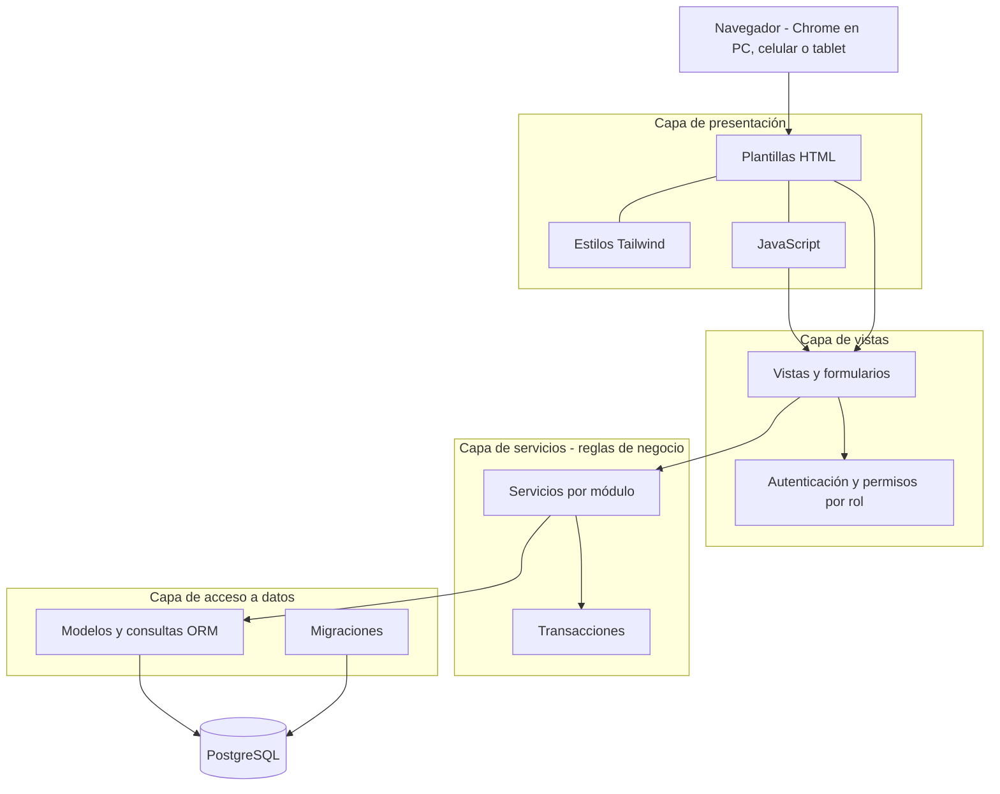
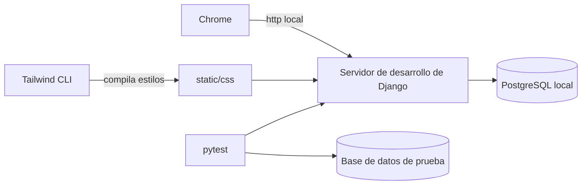

# 06 - Arquitectura y tecnologías

| Campo | Valor |
|---|---|
| Versión | 0.2 (borrador) |
| Estado | Stack **confirmado por el alumno**; claves primarias y autenticación resueltas por recomendación (a confirmar). El despliegue queda **diferido** |
| Base | Requisitos no funcionales de [03-requisitos.md](03-requisitos.md) y modelo de [05-modelo-datos.md](05-modelo-datos.md) |
| Criterio | Se incluye ahora lo que es barato de definir y caro de cambiar después. Lo que agrega complejidad permanente y se puede sumar más adelante queda diferido |
| Alcance de esta etapa | Dejar funcionando **en local** la base de datos, el back y el front. No se preparan archivos de despliegue |

> Las versiones se eligieron al iniciar el desarrollo (H1) y se anotan en D-02 y D-04; las dependencias de Python quedan con versión fija en `requirements.txt`.

## 1. Requisitos que condicionan la arquitectura

| Requisito | Qué implica técnicamente |
|---|---|
| RNF-01, RNF-02 | Aplicación web usable en PC, celular y tablet desde Chrome |
| RNF-03 | Pantallas simples, pocos pasos en la venta |
| RNF-05 | Pensada para la nube; el despliegue se prepara más adelante |
| RNF-06, RNF-07, RNF-08 | Autenticación, permisos por rol, contraseñas protegidas |
| RNF-09, RNF-10 | Transacciones: venta, ingreso y pagos se aplican completos o no se aplican |
| RNF-13 | Mantenible por una sola persona: pocas piezas, código con pruebas |
| RNF-14, RNF-16 | Sin integración con Kendra; sin datos reales ni credenciales reales en el repositorio |
| RF-43 | Exportar reportes a PDF y Excel |

## 2. Decisiones

La columna "Reversibilidad" aplica el criterio: lo difícil de revertir se decide ahora.

| ID | Tema | Decisión | Origen | Reversibilidad |
|---|---|---|---|---|
| D-01 | Estilo de arquitectura | Arquitectura **por capas**, en un solo proyecto (monolito en capas) | Elegido por el alumno | Difícil |
| D-02 | Lenguaje y framework | Python con **Django**. Versiones: Python 3.13 y Django 5.2 LTS (`requirements.txt`) | Elegido por el alumno | Difícil |
| D-03 | Interfaz | HTML con plantillas de Django, **Tailwind CSS** y **JavaScript** propio | Elegido por el alumno | Media |
| D-04 | Base de datos | **PostgreSQL**. Versión local: 18 | Elegido por el alumno | Difícil |
| D-05 | Claves primarias | Numéricas autoincrementales de 64 bits | Recomendación (delegada por el alumno) | Difícil |
| D-06 | Autenticación | **Sesiones de Django** con permisos por rol. JWT no se usa por ahora. En H1 los permisos salen del campo `rol` del usuario y de una tabla de funciones por rol (`apps/comun/menu.py`), la misma que arma el menú; no se usan los grupos de Django (DEC-32) | Recomendación (delegada por el alumno) | Media |
| D-07 | Alojamiento y despliegue | Diferido: no se preparan archivos por ahora | Pedido del alumno | Fácil |
| D-08 | Copias de seguridad | Diferidas hasta tener producción; en local, volcado manual cuando se necesite | Consecuencia de D-07 | Fácil |
| D-09 | Pruebas | `pytest` con una base de datos de prueba; GitHub Actions (`.github/workflows/pruebas.yml`) corre ruff, el control de migraciones y las pruebas con PostgreSQL 18 en cada Pull Request y en `main` (desde H1) | Propuesta | Fácil |
| D-10 | Reportes PDF y Excel | Diferidos hasta CU-09 | Propuesta | Fácil |
| D-11 | Impresión de ticket | Diferida; primero impresión desde el navegador | Propuesta | Fácil |
| D-12 | Base de datos local | PostgreSQL instalado en la computadora; Docker queda diferido | Propuesta | Fácil |
| D-13 | Compilación de Tailwind | Con su herramienta de línea de comandos (Tailwind 4.3.3 instalado con `npm` solo para compilar: `npm run estilos`), sin empaquetador de JavaScript | Propuesta | Fácil |
| D-14 | Credenciales de la base local | `.env.example` solo con nombres y valores de ejemplo; el `.env` local queda fuera de GitHub y del permiso de lectura de los agentes; las pruebas usan una base de prueba con credenciales exclusivas de desarrollo | Decidida (sección 6) | Fácil |

### 2.1 Autenticación: por qué sesiones y no JWT (D-06)

| Criterio | Sesiones de Django | JWT |
|---|---|---|
| Tipo de sistema | Páginas generadas por el servidor, que es nuestro caso | Pensado para un frontend separado, una app móvil o una API pública |
| Piezas que se agregan | Ninguna, viene con el framework | Librería adicional, manejo de tokens de acceso y de renovación |
| Cierre de sesión y revocación | Inmediatos: se borra la sesión en el servidor | Más complejo: el token vale hasta que vence, salvo que se agregue una lista de revocados |
| Protección de formularios | CSRF incluido | Hay que resolverla aparte |
| Dónde se guarda en el navegador | Cookie protegida que el JavaScript no puede leer | Si se guarda donde el JavaScript puede leerlo, un fallo de seguridad en la página expone el token |
| Encaja con "una sola persona" | Muy bien | Más decisiones y más código |

**Recomendación:** sesiones. Si más adelante hace falta una API para una app móvil u otro cliente, se agrega JWT en esa parte sin cambiar lo existente, por eso la reversibilidad es media.

### 2.2 Claves primarias (D-05)

Se usan enteros de 64 bits autoincrementales, que es el valor por defecto de Django. Son simples, ocupan poco, ordenan bien los índices y facilitan la depuración. El UUID sería útil si varios sistemas generaran identificadores por separado o si los identificadores se expusieran públicamente, y no es el caso. Los permisos por rol evitan que alguien recorra registros cambiando un número en la dirección.

### 2.3 Interfaz con Tailwind, HTML y JavaScript (D-03, D-13)

- **HTML:** plantillas de Django con una plantilla base y fragmentos reutilizables (menú por rol, tablas, formularios, avisos).
- **Tailwind CSS:** diseño responsive desde el celular hacia la PC. Se compila a un único archivo de estilos con su herramienta de línea de comandos. Se verifica en la instalación si la versión elegida ofrece un ejecutable independiente que no requiere Node; si no, se usa `npm` solo para esa compilación.
- **JavaScript:** archivos propios, sin empaquetador ni librería pesada. Se usa donde la pantalla lo necesita, por ejemplo en la venta para buscar productos, sumar líneas y mostrar el total. Esas pantallas consultan unos pocos puntos internos de la misma aplicación que devuelven JSON; no son una API pública y usan la sesión y el CSRF de siempre.
- **Mostrador:** botones y campos grandes y buen contraste, pensando en uso táctil y en pantallas de PC chicas.
- **Lector de códigos de barras:** los lectores USB comunes escriben el código como si fuera un teclado, por lo que alcanza con un campo de búsqueda enfocado (RF-11). Se confirma el lector con PR-04.

## 3. Arquitectura por capas



### Qué va en cada capa y qué no

| Capa | Responsabilidad | No debe contener |
|---|---|---|
| Presentación | Qué se ve: plantillas, estilos, JavaScript de la pantalla | Reglas de negocio ni consultas a la base |
| Vistas | Recibir la solicitud, validar el formulario, verificar permisos, llamar al servicio y devolver la respuesta | Cálculos ni reglas del negocio |
| Servicios | Reglas de negocio y casos de uso (por ejemplo, abrir caja, registrar venta, registrar pago). Cada operación que toca varias tablas corre en una transacción | Detalles de pantalla (HTML, formularios) |
| Acceso a datos | Modelos, restricciones, migraciones y consultas | Reglas que dependen del caso de uso |

**Regla de dependencia:** cada capa solo llama a la inmediatamente inferior. Con esto las reglas del negocio (RN-xx y RI-xx) se prueban sin abrir el navegador y cada pantalla las reutiliza.

## 4. Módulos y su relación con el modelo

Cada módulo es una aplicación del proyecto. Los nombres son una propuesta.

| Módulo | Entidades ([05-modelo-datos.md](05-modelo-datos.md)) | Casos de uso |
|---|---|---|
| `usuarios` | `usuario` | CU-10, CU-14 |
| `caja` | `caja`, `cierre_caja_detalle`, `movimiento_caja`, `medio_pago` | CU-02, CU-03, SC-02 |
| `ventas` | `venta`, `detalle_venta` | CU-01, SC-03, SC-04 |
| `catalogo` | `categoria`, `producto` | CU-06, CU-11 |
| `proveedores` | `proveedor`, `producto_proveedor`, `ingreso_mercaderia`, `detalle_ingreso`, `pago_proveedor` | CU-05, CU-07, CU-13 |
| `clientes` | `cliente`, `pago_cliente`, `movimiento_cuenta_corriente` | CU-04, CU-08, CU-12, SC-01 |
| `reportes` | (consultas sobre las anteriores; la aplicación se crea en H5) | CU-09 |
| `comun` | Ninguna: solo el modelo base abstracto con `creado_en` y `actualizado_en` que heredan todas las entidades | — |

### Estructura propuesta del repositorio

```
sistema-gestion-carniceria/
├── README.md
├── docs/                      documentación (fuente de verdad)
├── config/                    configuración del proyecto
├── apps/
│   ├── comun/                 modelo base de auditoría
│   └── <módulo>/              usuarios, caja, ventas, catalogo, proveedores, clientes, reportes
│       ├── models.py          capa de acceso a datos
│       ├── services.py        capa de servicios (reglas de negocio)
│       ├── views.py           capa de vistas
│       ├── forms.py
│       ├── urls.py
│       ├── admin.py           registro en el panel de administración
│       └── tests/
├── templates/                 plantillas HTML
├── static/                    JavaScript, estilos compilados y recursos
├── conftest.py                datos ficticios compartidos por las pruebas
├── pyproject.toml             configuración de ruff y pytest
├── requirements.txt           dependencias con versión fija
├── .env.example               plantilla: solo nombres y valores de ejemplo
├── CLAUDE.md                  instrucciones para Claude Code
└── .claude/settings.json      permisos de Claude Code
```

La estructura se ajusta durante el desarrollo; lo importante es que cada módulo mantenga las capas separadas y sus pruebas junto al código.

## 5. Entorno local



Necesita instalarse en la computadora del alumno:

| Herramienta | Para qué |
|---|---|
| Python (versión estable vigente) con entorno virtual | Ejecutar Django |
| PostgreSQL | Base de datos de desarrollo y de prueba |
| Git | Ya instalado |
| Tailwind CLI | Compilar los estilos |
| Claude Code | Agente de desarrollo, cuando corresponda |

La guía de instalación paso a paso va en el `README.md` del repositorio.

## 6. Primer hito: base funcionando en local

El objetivo de esta etapa es tener la base de datos, el back y el front funcionando juntos, antes de construir los módulos completos.

| Paso | Contenido | Se verifica cuando |
|---|---|---|
| H1.1 | Proyecto Django configurado con PostgreSQL local y variables de entorno | El servidor arranca y conecta a la base |
| H1.2 | Modelos y migraciones de las 17 entidades de [05-modelo-datos.md](05-modelo-datos.md), con sus restricciones `UNIQUE`, `CHECK` y claves foráneas | Las migraciones se aplican en una base vacía |
| H1.3 | Datos de ejemplo cargables con un comando (sin datos reales) | Hay productos, clientes y usuarios de prueba |
| H1.4 | Tailwind configurado y plantilla base responsive con menú según el rol (`templates/base.html`, `apps/comun/menu.py`; estilo en DEC-30) | La página se ve bien en PC y en celular |
| H1.5 | Inicio y cierre de sesión con permisos por rol (CU-10; RF-01, RF-02) | Cada rol ve solo sus funciones |
| H1.6 | Un caso de uso completo de punta a punta que atraviese todas las capas: **CU-11 Gestionar productos** (alta, modificación y baja lógica) | Se puede crear y editar un producto desde la pantalla y queda en la base |
| H1.7 | `pytest` funcionando con la base de datos de prueba y las primeras pruebas de reglas de integridad | Las pruebas pasan |

CU-11 se elige para el hito porque no depende de otros casos de uso y ejercita todas las capas. Los hitos siguientes (caja y venta, stock y proveedores, clientes y cuentas corrientes, reportes) se ordenan en [07-planificacion.md](07-planificacion.md).

### Credenciales de la base local y salvaguardas (D-14)

**Decisión:** el agente (hoy Claude Code; Codex se suma más adelante) puede correr pruebas contra una base local de prueba con datos ficticios, sin acceso a secretos reales.

| Elemento | Tratamiento |
|---|---|
| `.env.example` | Se sube al repo. Solo nombres de variables y valores de ejemplo, nunca secretos |
| `.env` | Local, ignorado por Git (`.env`, `.env.*`, salvo `.env.example`). Los agentes no lo leen |
| Base de pruebas | PostgreSQL local con usuario y contraseña exclusivos de desarrollo y datos ficticios |
| Cómo se conectan las pruebas | Django lee el `.env` por su cuenta; el agente ejecuta `pytest` sin necesitar ver el contenido |
| Secretos reales (producción, correo, servicios externos) | Nunca en el repo ni en la computadora de desarrollo hasta que existan; se tratan al definir el despliegue |
| Configuración | Por ahora solo Claude Code: `CLAUDE.md` y `.claude/settings.json` con lectura denegada sobre secretos. Al sumar Codex se agrega `AGENTS.md` como fuente única y su propia configuración de permisos |

**Límite conocido:** las reglas de lectura de los agentes no alcanzan a los procesos que ellos lancen (un script podría leer el `.env`). Se acepta porque las credenciales locales son descartables y no abren nada fuera de la base de pruebas. Si más adelante hubiera secretos con valor, se agrega un entorno aislado (sandbox o contenedor).

## 7. Recomendaciones técnicas

| Tema | Recomendación |
|---|---|
| Dinero y cantidades | `DecimalField` con dos decimales para montos; nunca `float` |
| Transacciones | Cada servicio que toca varias tablas usa una transacción atómica (RNF-10) |
| Zona horaria | Guardar en UTC y mostrar en hora local |
| Panel de administración de Django | Útil para el alta inicial de datos y para el administrador, pero la cajera usa pantallas propias. Usa el tema django-unfold con el estilo del sistema (DEC-30). Desde H1 todos los modelos están registrados; el primer administrador se crea con `createsuperuser` (ver `README.md`). Los registros operativos (cajas, cierres, movimientos de caja, ventas, pagos, ingresos y movimientos de cuenta corriente) se consultan en el panel pero no se cargan, modifican ni borran ahí: se crean solo desde su caso de uso, que aplica las reglas en una transacción (DEC-31). Los formularios repiten los límites de la base (no negativo, mayor a 0) para mostrar el error junto al campo |
| Datos de ejemplo | Un comando que carga datos ficticios, para desarrollar y probar sin datos reales |
| Formato del código | Una herramienta automática de formato y análisis, ejecutada antes de cada commit: `ruff` (configurado en `pyproject.toml`) |
| Reglas de negocio | Cada regla RN-xx o RI-xx con al menos una prueba automática |
| Documentación | Todo cambio de código actualiza los archivos afectados de `/docs` |

## 8. Seguridad

| Aspecto | Decisión |
|---|---|
| Contraseñas | Con el sistema de hash del framework, nunca en texto plano (RNF-07) |
| Permisos | Por rol y por función; Dueños solo ven reportes; la cajera solo ve sus funciones (RF-02). Cada pantalla se protege con `requiere_funcion`, que usa la tabla del menú: sin sesión redirige al ingreso y sin permiso responde 403. El panel de Django es solo para el Administrador (DEC-32). Qué ve la cajera en el inicio está a confirmar (PR-35) |
| Sesiones | Cookies protegidas y cierre por inactividad. El tiempo está a confirmar (PR-34); mientras tanto queda el valor por defecto de Django (dos semanas). Salir cierra la sesión en el servidor |
| Formularios | Protección contra falsificación de solicitudes del framework |
| Base de datos | Consultas por el ORM, que evita la inyección SQL |
| Secretos | Variables de entorno; el repositorio solo incluye `.env.example` sin secretos (RE-02, D-14) |
| Datos de clientes | Acceso restringido por rol (RNF-08) |
| Intentos de ingreso | Se evaluará limitar los intentos fallidos antes del uso real |

## 9. Despliegue (diferido)

Por decisión del alumno, en esta etapa no se preparan archivos de despliegue. Cuando se retome, la plataforma de alojamiento deberá cumplir estas condiciones, sin ligarse a un proveedor en particular:

- Conexión segura por HTTPS.
- PostgreSQL con copias automáticas y posibilidad de restaurar.
- Despliegue desde el repositorio de GitHub.
- Variables de entorno para claves y configuración.
- Costo acorde al presupuesto del negocio (PR-33).

El proveedor y el costo se verifican con los planes vigentes al decidir. Si la cátedra solo exige una demostración local (PA-05), el despliegue puede no ser parte de la entrega.

## 10. Decisiones diferidas

Se postergan a propósito. Se reevalúan durante el desarrollo.

| Tema | Cuándo se reevalúa |
|---|---|
| Despliegue y alojamiento | Cuando el sistema funcione en local y se defina PA-05 |
| Copias de seguridad automáticas | Junto con el despliegue |
| Reportes PDF y Excel | Al llegar a CU-09 |
| Libro de movimientos de stock | Si aparecen diferencias de stock (ver [05-modelo-datos.md](05-modelo-datos.md)) |
| API con JWT y aplicación móvil | Si hace falta un cliente que no sea el navegador |
| Modo sin conexión | Según PR-29 |
| Impresora térmica de tickets | Según PR-24 |
| Docker | Si la instalación local resulta engorrosa |
| Limitación de intentos de ingreso | Antes del uso real |

## 11. Riesgos técnicos

| ID | Riesgo | Mitigación |
|---|---|---|
| RT-01 | Caída de internet en el local | Definir contingencia mínima (PR-29); modo sin conexión diferido |
| RT-02 | Pérdida de datos | Copias automáticas al desplegar (D-08) |
| RT-03 | Costo del alojamiento no sostenible | Validar presupuesto (PR-33) antes de elegir proveedor |
| RT-04 | El agente introduce cambios sin pruebas | Pull Request obligatorio, pruebas automáticas y reglas en `CLAUDE.md` |
| RT-05 | Reglas de negocio mezcladas con las pantallas | Capa de servicios y pruebas de reglas |
| RT-06 | Poco conocimiento repartido del sistema | Documentación actualizada en `/docs` y pruebas que explican el comportamiento |

## 12. Preguntas pendientes que afectan esta arquitectura

| Brecha | Impacto |
|---|---|
| PR-33 | Costo y elección del alojamiento |
| PA-05 | Si el despliegue es parte de la entrega |
| PR-23 | Cantidad de usuarios y dispositivos |
| PR-29 | Contingencia ante caída de internet |
| PR-24 | Impresión de tickets |
| PR-04 | Lector de códigos de barras y formato del plus interno |
| PR-34 | Tiempo de cierre de sesión por inactividad |
| PR-35 | Qué ve la cajera en el inicio (total del día y últimas ventas, o solo su caja) |

## 13. Mantenimiento

Al cambiar una decisión técnica, actualizar este documento y registrar el motivo en [09-decisiones.md](09-decisiones.md); revisar el impacto en [05-modelo-datos.md](05-modelo-datos.md), en [08-pruebas.md](08-pruebas.md) y en `CLAUDE.md`.
