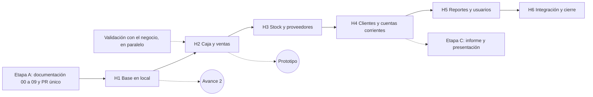

# 07 - Planificación

| Campo | Valor |
|---|---|
| Versión | 0.2 (borrador) |
| Estado | **Sin fechas fijas.** No hay fecha de entrega impuesta (PA-01) ni horas semanales fijas (PA-06): el alumno decide cuándo presenta un avance al profesor y el trabajo avanza por sesiones, tanto como se pueda en cada una |
| Base | Hito del sistema definido en [06-arquitectura.md](06-arquitectura.md), requisitos en [03-requisitos.md](03-requisitos.md) y casos de uso en [04-casos-de-uso.md](04-casos-de-uso.md) |
| Enfoque | Iterativo: se avanza por hitos chicos y se ajusta lo que falte o sobre. Lo que se pueda prever, se resuelve antes |

## 1. Supuestos

- Proyecto individual: una sola persona decide, desarrolla (con ayuda de agentes de código) y mantiene.
- **No hay fecha de entrega fija** (PA-01). El alumno decide cuándo presentar un avance al profesor; el profesor lo controla y se arma una entrega parcial en ese momento.
- **No hay horas semanales fijas** (PA-06). Se trabaja por **sesiones**, cuando el alumno quiere, y en cada sesión se avanza tanto como se pueda.
- Por eso el plan no usa semanas ni fechas: ordena el trabajo en hitos con un **tamaño relativo** (chico, mediano, grande) y define **puntos de entrega** posibles (sección 5).
- El "prototipo funcional en 2 meses" de las metas del relevamiento base (M-01) deja de ser un plazo: se interpreta como **H1 más H2** (base funcionando, caja y venta), que se presenta cuando el alumno decida.

## 2. Etapas y entregables

| Etapa | Contenido | Entregable | Estado |
|---|---|---|---|
| A. Documentación | Cerrar los documentos 07, 08 y 09, revisar la consistencia y subir todo al repositorio en un solo Pull Request | `/docs` completo y coherente | Terminada (Avance 1 disponible) |
| B. Sistema | Construir la aplicación por hitos (sección 3) | Sistema funcionando en local, con pruebas | En curso (H1 a H4 terminados; H5 en su etapa 0) |
| C. Informe y presentación | Armar el informe final maquetado a partir de `/docs` y la presentación | Informe y presentación listos para entregar | Pendiente |

En paralelo a la etapa A corre la **validación puntual con el responsable del negocio** (preguntas de prioridad alta de [01-relevamiento.md](01-relevamiento.md)). No bloquea el avance: lo no confirmado queda marcado "a confirmar".

## 3. Hitos del sistema

| Hito | Contenido | Casos de uso | Requisitos principales | Se apoya en estas brechas | Tamaño relativo |
|---|---|---|---|---|---|
| H1 | Base funcionando en local: Django con PostgreSQL, las 17 entidades migradas, datos de ejemplo, Tailwind con plantilla responsive, inicio de sesión con roles, CU-11 de punta a punta y primeras pruebas (detalle en [06-arquitectura.md](06-arquitectura.md), sección 6) | CU-10, CU-11 | RF-01, RF-02, RF-21, RNF-01, RNF-02, RNF-03, RNF-13 | PR-04 | Mediano |
| H2 | Caja y ventas | CU-02, CU-03, CU-01, SC-02 | RF-04 a RF-17, RF-48 | PR-01, PR-04 a PR-10, PR-24 y PR-30 cerradas por DEC-36 a DEC-46 (DEC-35). Quedan abiertas con un supuesto vigente: PR-36 (DEC-76) y PR-37 (DEC-46) | Grande |
| H3 | Stock y proveedores | CU-06, CU-13, CU-05, CU-07, CU-11 (stock editable) | RF-22 a RF-26, RF-29 a RF-33, RF-50, RF-51 | PR-03, PR-17, PR-18, PR-20 y PR-32 cerradas por DEC-79 a DEC-82 y DEC-98 (DEC-78), como supuestos del proyecto | Grande |
| H4 | Clientes y cuentas corrientes | CU-12, CU-04, CU-08, SC-01, SC-03 | RF-18, RF-35 a RF-41 | PR-11 a PR-16 y PR-31 cerradas por DEC-108 a DEC-112, DEC-117 y DEC-118 (DEC-107), como supuestos del proyecto; la anulación de cobros y L1, por DEC-113 y DEC-114; el límite en pantalla y el alta de clientes, por DEC-115 y DEC-116; el saldo inicial, por DEC-119 | Grande |
| H5 | Reportes y usuarios | CU-09, CU-14; inicio por rol (CU-10); filtros de CU-05 y CU-07 | RF-02, RF-03, RF-42 a RF-46, RNF-09 | PR-25, PR-26, PR-27 y PR-35 (L9) cerradas por DEC-134 a DEC-137 (DEC-133), como supuestos del proyecto; L14 y los filtros de L12, por DEC-138 y DEC-139. CU-09 agrupa por fecha y turno varias cajas del mismo turno (DEC-83). El "Historial de ventas" (DEC-86) no lo reemplaza: CU-09 son los reportes con totales | Mediano |
| H6 | Integración, pruebas integrales, correcciones, manual de usuario y capacitación breve (RNF-04) | Todos | Todos | PR-23, PR-29 | Mediano |

**Prototipo funcional (M-01):** H1 más H2. Es el primer punto de entrega que muestra un sistema usable (caja y ventas).

**Estado:** H1 terminado y mergeado en `main` (PR #6) con sus tres etapas (modelo y pruebas; datos de ejemplo, interfaz e inicio de sesión; CU-11 y GitHub Actions). H2 terminado y mergeado en `main` (PR #13): etapas 1 a 3 implementadas (las dos primeras entraron con el PR #11, la tercera con el PR #12); de la etapa 4 están implementados el alta durante la venta y la anulación (spec `docs/specs/SPEC-CU-01-etapa4.md`), y RM-03 y RM-04 están registrados en 08. Los defectos DF-01 y DF-02 que encontró RM-04 están corregidos (DEC-75 y DEC-76, este último un supuesto pendiente de PR-36) y la prueba de venta y cierre al mismo tiempo está automatizada (CP-88). La revisión de H2 está hecha y sus hallazgos bloqueantes y menores, corregidos (DEC-77, PR-37). **H3 terminado y mergeado en `main` (PR #15), con sus etapas 1 a 6.** H4: en su etapa 0 se cerraron sus preguntas como supuestos del proyecto (DEC-107 a DEC-119) y se aprobó su spec (`docs/specs/SPEC-H4.md`; S-1 a S-11 como DEC-120 a DEC-130 y R-1 a R-7 como DEC-131). Etapa 1 de H4 implementada: migraciones `clientes/0005` y `0006` y `caja/0010`, plazo de 30 días en `config/settings.py` y servicio de cuenta corriente (saldo, disponible, límite, deuda vencida y saldo inicial), con CP-42, CP-44 (servicio), CP-119 y CP-122. Etapa 2 implementada: CU-12 en `/clientes/` con saldo, límite y deuda vencida, menú "Clientes" del Administrador y SC-01 (`/clientes/buscar/`) para la venta y el cobro (CP-114). Etapa 3 implementada: SC-03 en la venta con el cliente, el límite y la alerta de vencida, `VENTA_FIADA` sin caja, ticket con el cliente y anulación con `ANULACION_VENTA` (L1), con el orden de bloqueos de DEC-128 (CP-18, CP-19, CP-115, CP-116). Etapa 4 implementada: CU-04 en `/clientes/cobrar/` para la cajera (menú "Cobrar cuenta corriente") y el Administrador, con caja o sin ella, tope en el saldo, anulación con sus dos reversas y cobros en el cierre (CP-40, CP-41, CP-117, CP-118, CP-120). Etapa 5 implementada: CU-08 en `/clientes/<id>/` con saldo, límite, disponible, alerta de deuda vencida, movimientos con sus anulaciones y enlaces, edición de límite y observaciones y carga y anulación del saldo inicial (CP-44, CP-121, CP-122). Etapa 6 hecha: revisión del diff con simplificaciones sin cambio de comportamiento, prueba integral (CP-123) y recorridos RM-07 y RM-11 con Playwright. **H4 terminado y mergeado en `main` (PR #16, merge `bacc7f5`), con sus etapas 0 a 6; CI en verde, con 847 pruebas de Python y 30 de JavaScript.** H5, en la rama `h5`: etapa 0 hecha, con PR-25, PR-26, PR-27 y PR-35 cerradas como supuestos del proyecto (DEC-133 a DEC-137), L14 y los filtros de L12 dentro del hito (DEC-138, DEC-139) y el spec aprobado (`docs/specs/SPEC-H5.md`; DEC-140 a DEC-154). Etapa 1 implementada: los dueños solo en Reportes (menú, inicio y 403 en el resto), inicio de la cajera con el estado de la caja y sus tres accesos, sin totales (R-4), y el panel sin borrado de productos ni usuarios (CP-126, CP-127, CP-128). Etapa 2 implementada: CU-14 en `/usuarios/` (alta, edición, desactivación y reactivación, contraseña, siempre un Administrador activo y los usuarios con panel fuera de CU-14, DEC-156) y L18 resuelto con categorías y ajustes de stock como pestañas de Productos y medios de pago en `/caja/medios/` (DEC-155, migración `catalogo/0006`; CP-124, CP-125, CP-135 a CP-137). Etapa 3 implementada: CU-09 en pantalla con la app `reportes` (ventas diarias por fecha y turno, producto más vendido, ingresos por día con la columna de caja, totales por medio de pago y cierres de caja por fecha), rango de fechas, "Sin registros disponibles" y solo lectura para los dueños (CP-60 a CP-62, CP-129 a CP-132); los datos de ejemplo suman un Administrador del negocio sin panel (`admin_negocio`); fechas de cada operación en DEC-157. Etapa 4 implementada: exportación de los cuatro reportes a Excel (`openpyxl` 3.1.5) y PDF (`reportlab` 4.4.4) con el mismo rango y los mismos datos que la pantalla; sin datos no exporta (CP-63). H6 pendiente. En la etapa 0 de H3 se cerraron sus preguntas como supuestos del proyecto (DEC-78 a DEC-82) y en la etapa 0b se ajustaron caja, venta, ventas de la caja, historial de ventas y reactivación de productos (DEC-83 a DEC-86). El historial de ventas del Administrador es una consulta operativa y no reemplaza a CU-09 (H5). Etapa 1 de H3 implementada: `mover_stock` y `validar_cantidad` en catálogo, usados por la venta y la anulación sin cambiar su comportamiento (DEC-96). Etapa 1b implementada: stock editable por el Administrador al crear y modificar productos, en `/productos/` y en el panel, con cada cambio registrado como ajuste (DEC-98 a DEC-100, migraciones `catalogo/0004` y `0005`). Etapa 2 implementada: CU-13 Gestionar proveedores, menú "Proveedores" para el Administrador y prueba de estructura de R-6. Etapa 3 implementada: CU-05 a crédito con alta de producto, precio de compra sugerido y actualizado, saldo derivado y anulación sin pagos (migración `proveedores/0003`). Etapa 4 implementada: CU-07 pago a proveedor en efectivo o por transferencia, ingreso al contado y anulación de pagos con reversa (DEC-106, migraciones `caja/0008` y `0009`, `proveedores/0004` y `0005`). Etapa 5 implementada: CU-06 integrada en `/productos/`, tarjeta "Stock bajo" del Administrador y aviso de stock en la venta (DEC-105). Etapa 6 hecha: prueba integral (CP-113), RM-05, RM-06 y RM-10, revisión del diff con sus correcciones (DF-03 y DF-04) y pendientes en L10 a L14.

### Etapas de H2

| Etapa | Contenido | Decisiones |
|---|---|---|
| 1. Abrir caja | CU-02: pantalla de Caja con estado y apertura, servicio de caja y cambio del índice de RI-01 | DEC-38, DEC-39 |
| 2. Registrar venta | CU-01: venta con búsqueda o lector, un medio de pago, A4 y A5, ticket; SC-02 para el ingreso a caja | DEC-36, DEC-37, DEC-41, DEC-42, DEC-44, DEC-46 |
| 3. Cerrar caja | CU-03: resumen por medio de pago, montos contados, diferencias con motivo y bloqueo; egresos "otros" de caja | DEC-40, DEC-43 |
| 4. Cierre de H2 | Alta de producto durante la venta (CU-01 A1), anulación de ventas (requiere un estado en `venta`), recorridos RM-03 y RM-04, docs, revisión y Pull Request | DEC-45, DEC-62 a DEC-77 |

### Pendientes que deja H2

Surgieron en la revisión de H2. No bloquean el cierre del hito; se retoman en el hito indicado.

| ID | Pendiente | Cuándo |
|---|---|---|
| L1 | Anular una venta a cuenta corriente no debe crear un egreso de caja, sino revertir el movimiento de la cuenta corriente. Hoy esa venta no existe (DEC-41 no ofrece el medio cuenta corriente), así que no hace falta un rechazo; se resuelve al construir SC-03 | Resuelto en la etapa 3 de H4 (DEC-113, DEC-114): `ANULACION_VENTA` sin egreso de caja |
| L2 | La unión de `venta.js` con `lector.js` y `buscador.js` no tiene prueba de navegador automatizada (08, sección 9) | A decidir: requiere una dependencia nueva |
| L3 | Archivos estáticos versionados al publicar (06, sección 9): al preparar el despliegue, usar estáticos con hash en el nombre (`ManifestStaticFilesStorage` o equivalente) para que los usuarios no queden con un JS viejo después de una actualización. En desarrollo ya se sirven sin caché con `DEBUG` | Con el despliegue |
| L4 | Cualquier cajera abre el ticket de cualquier venta por su número | Resuelto en la etapa 0b de H3 (DEC-84): la cajera solo ve ventas de la caja abierta |
| L5 | El formulario de la venta no limita la cantidad de líneas | H6 o antes, si hace falta |
| L6 | "Ventas de la caja" (cajera) no tiene paginación; el "Historial de ventas" del Administrador sí (DEC-86) | Si una caja tiene muchas ventas |
| L7 | `catalogo/productos.html` a 375 px, por el mismo patrón que DF-02 (08, sección 9) | RM-09 (H6) o antes |
| L8 | DEC-70 usa el control de stock actual del producto; con un registro de movimientos de stock, guardar en el detalle si controlaba stock al vender | Si se agrega `movimiento_stock` |
| L9 | Qué ve la cajera en el inicio (PR-35) | Resuelto en la etapa 1 de H5 (DEC-137, DEC-148): estado de la caja y accesos a sus operaciones, sin totales |
| L10 | Las opciones del formulario de pago calculan el saldo de a un ingreso por opción (una consulta por deuda abierta); alcanza con el volumen actual | Si las deudas abiertas crecen |
| L11 | El aviso de stock de la venta usa el stock del momento en que se agregó el producto: una venta guardada en la pestaña puede avisar con un dato viejo. El aviso del ticket usa el stock real al confirmar | Si molesta en el uso |
| L12 | Los listados de ingresos y pagos no filtran por proveedor ni por fecha, y el stock se puede pasar del máximo de la columna (mil millones) sumando ingresos, lo que daría un error | Filtros: decididos en la etapa 0 de H5 (DEC-139) y se implementan en H5. El tope de stock sigue pendiente, si hace falta |
| L13 | `ingreso.js` repite la lógica de lista y teclado del buscador de `venta.js`; conviene llevarla a un módulo común cuando haya un tercer uso. En H4 el buscador de clientes (`elegir_cliente.js`, usado en la venta y el cobro) ya es un componente propio sobre la lógica de `buscador.js`; los buscadores de productos de la venta y del ingreso siguen con su copia y podrían pasar a un componente así | Al tocar esas pantallas |
| L14 | El panel sigue permitiendo eliminar un producto sin referencias, sin pasar por la baja lógica ni dejar registro | Resuelto en la etapa 1 de H5 (DEC-138, DEC-153): el panel no borra productos ni usuarios |
| L15 | Corrección de cobros y pagos a proveedor cuya caja ya cerró (DEC-92, DEC-106, DEC-113): hoy no tienen corrección en el sistema; revisar si conviene permitir la reversa en la caja abierta actual o un ajuste con motivo del Administrador | A decidir |
| L16 | Comprobante del cobro de cuenta corriente para entregar al cliente | A decidir |
| L17 | Saldo acumulado después de cada movimiento en el estado de cuenta | A decidir |
| L18 | Con DEC-150 el Administrador del negocio no entra al panel: categorías, medios de pago y la consulta de ajustes de stock (DEC-31, DEC-100), que hoy solo están en el panel, quedan para el superusuario técnico hasta que tengan pantalla propia | Resuelto en la etapa 2 de H5 (DEC-155): categorías, medios de pago y consulta de ajustes de stock en pantallas propias del Administrador |

### Etapas de H3

Spec: `docs/specs/SPEC-H3.md` (aprobado). Las decisiones de H3 son supuestos del proyecto, no datos confirmados por el negocio (DEC-78). Las etapas 0 y 0b ya están hechas (DEC-78 a DEC-86). R-1 a R-9 son los ajustes del refactor de capas (DEC-96) y S-1 a S-9 las decisiones del spec (DEC-87 a DEC-95). Los cambios de diseño pedidos después de aprobar el spec (stock editable con registro de ajustes, panel, alerta sin mínimo y aviso en la venta) son DEC-98 a DEC-102 y suman la etapa 1b, que se hace antes de proveedores.

| Etapa | Alcance | CU / RF / DEC | CP |
|---|---|---|---|
| 1. Catálogo y refactor | Servicio único de stock (`mover_stock`) y de cantidades (`validar_cantidad`) en catálogo; la venta y la anulación de ventas los usan sin cambiar su comportamiento; el tope de DEC-76 queda solo en la venta. Docstrings de PR-03 y PR-18 citan DEC-79 y DEC-81 | CU-01 (sin cambios); RF-16; RI-07, RI-16; DEC-46, DEC-48, DEC-70, DEC-76, DEC-79, DEC-81; R-1, R-2, R-5 | CP-12, CP-13, CP-83, CP-85, CP-87 |
| 1b. Stock editable | Spec `docs/specs/SPEC-H3-etapa1b.md`. CU-11: el Administrador edita el stock al crear y modificar productos, en `/productos/` y en el panel (con el mismo servicio); si cambió, `mover_stock` y un registro en `ajuste_stock` con usuario, fecha, anterior, nuevo y motivo ("Stock inicial" en el alta; por defecto "Modificación manual"). Toda cajera ve el stock en `/productos/` en solo lectura y no lo cambia (DEC-103). `ajuste_stock` de solo lectura en el panel | CU-11; RF-50, RF-51; RI-07, RI-17; DEC-31, DEC-33, DEC-79, DEC-98 a DEC-100, DEC-103 | CP-55, CP-73, CP-74, CP-107, CP-108, CP-109 y CP-111 (nuevos) |
| 2. Proveedores | CU-13: listado, alta, modificación, baja lógica y reactivación; menú "Proveedores" para el Administrador; prueba de estructura de dependencias (`catalogo` y `caja` no importan `proveedores`) | CU-13; RF-29; RI-11; DEC-85 (mismo patrón); R-6, R-9; S-1, S-2, S-9 | CP-99 (nuevo) |
| 3. Ingreso de mercadería | CU-05 a crédito: fecha de hoy, líneas, cantidades (DEC-79), stock con `mover_stock`, precio en el detalle y en `producto_proveedor`, remito en `observacion`, alta de producto (A1); saldo derivado en el servicio. Anulación del ingreso sin pagos vigentes, con motivo y reversa de stock (migración: estado del ingreso) | CU-05; RF-22 a RF-24, RF-30; RN-08; RI-07, RI-12, RI-16; DEC-46, DEC-79, DEC-81; R-4; S-3 a S-8 | CP-30, CP-31, CP-32, CP-93, CP-100 y CP-101 (nuevos) |
| 4. Pago a proveedor | CU-07: ingreso con saldo, efectivo o transferencia (también en el contado), egreso `PAGO_PROVEEDOR` y su reversa con funciones públicas de caja; ingreso al contado con el pago en la misma operación. Anulación del pago: por transferencia siempre, en efectivo con la caja de su egreso abierta (migración: estado del pago y una reversa por pago) | CU-07, CU-05 (contado); RF-31 a RF-33; RN-09; RI-08, RI-09, RI-13, RI-14; DEC-80, DEC-81; R-3, R-4; S-6 | CP-33 a CP-36, CP-90, CP-91, CP-92, CP-102 y CP-112 (nuevos) |
| 5. Consulta de stock | CU-06 integrada en `/productos/` (DEC-105), sin pantalla nueva: filtros por categoría y proveedor (relación inversa, sin servicios de `proveedores`), alertas calculadas en el servicio, con `stock_actual <= stock_minimo` o, sin mínimo, `<= 0` (DEC-101); "Solo stock bajo" y marca por fila; aviso de stock insuficiente al agregar en la venta, con la cantidad disponible, con la misma función de catálogo (DEC-102, DEC-103); la consulta también para la cajera, en solo lectura (DEC-103); tarjeta "stock bajo" del inicio solo para el Administrador, que lleva al listado filtrado | CU-06, CU-01 A3; RF-25, RF-26; RN-10; DEC-30, DEC-46, DEC-82, DEC-101, DEC-102, DEC-103, DEC-105; R-7, R-8, R-9; S-2, S-9 | CP-37, CP-83, CP-110 (nuevo) |
| 6. Cierre de H3 | Pruebas integrales (pago en efectivo o su anulación y cierre de caja al mismo tiempo, como CP-88), recorrido manual en localhost, revisión, 07 y 08 al día y Pull Request | Todos los de H3 | Todos los de H3; RM nuevo |

El ingreso al contado pasa a la etapa 4 porque registra su pago con el servicio de CU-07 (DEC-81). Un contado se anula anulando primero su pago (etapa 4) y después el ingreso (etapa 3).

### Etapas de H4

Spec: `docs/specs/SPEC-H4.md` (aprobado; S-1 a S-11 como DEC-120 a DEC-130 y R-1 a R-7 como DEC-131). Las decisiones de H4 son supuestos del proyecto, no datos confirmados por el negocio (DEC-107). La etapa 0 ya está hecha (DEC-107 a DEC-119). Cada etapa se cierra con sus pruebas.

| Etapa | Alcance | CU | CP |
|---|---|---|---|
| 1. Modelo y cuenta | Migraciones (incluido el saldo inicial), plazo en la configuración y servicio de saldo, disponible y deuda vencida | — | CP-42, CP-43, CP-119 |
| 2. Clientes y SC-01 | Gestión de clientes, menú y buscador de clientes | CU-12, SC-01 | CP-114 |
| 3. Venta a cuenta corriente | Medio cuenta corriente en la venta, límite, alerta y anulación con movimiento inverso (L1) | SC-03 | CP-18, CP-19, CP-115, CP-116 |
| 4. Cobro | Cobro de la cajera y del Administrador, con caja o sin ella, y su anulación; cobros en el cierre | CU-04 | CP-40, CP-41, CP-117, CP-118, CP-120 |
| 5. Estado de cuenta | Saldo, límite, alerta, movimientos y carga y anulación del saldo inicial | CU-08 | CP-44, CP-121, CP-122 |
| 6. Cierre de H4 | Prueba integral, recorrido manual, revisión, docs y Pull Request | Todos | Todos; RM nuevo |

### Etapas de H5

Spec: `docs/specs/SPEC-H5.md` (aprobado; S-1 a S-14 como DEC-140 a DEC-153 y R-1 a R-4 como DEC-154). Las decisiones de H5 son supuestos del proyecto, no datos confirmados por el negocio (DEC-133). La etapa 0 cierra PR-25, PR-26, PR-27 y PR-35 (DEC-134 a DEC-137) y suma L14 y los filtros de L12 (DEC-138, DEC-139).

| Etapa | Alcance | CU |
|---|---|---|
| 0. Decisiones y spec | Preguntas de H5 cerradas como supuestos, docs al día y spec en borrador | — |
| 1. Roles, inicio y panel | Dueños solo en Reportes, inicio de la cajera y del dueño, panel sin borrado de productos ni de usuarios | CU-10, CU-11 (L14) |
| 2. Usuarios | Alta, edición del rol, desactivación y reactivación, restablecer contraseña | CU-14 |
| 3. Reportes en pantalla | Los cuatro reportes y la consulta de cierres por fecha, con rango de fechas | CU-09 |
| 4. Exportación | Excel y PDF de los cuatro reportes, con `openpyxl` 3.1.5 y `reportlab` 4.4.4 (DEC-146) | CU-09 |
| 5. Filtros de ingresos y pagos | Fechas y proveedor en los listados (L12) | CU-05, CU-07 |
| 6. Cierre de H5 | Prueba integral, RM-08, revisión, docs y Pull Request | Todos |

El tamaño es una referencia para ordenar y comparar hitos, no una promesa de tiempo.

### Criterio de aceptación de cada hito

Un hito se da por terminado cuando se cumple lo siguiente:

1. Los casos de uso del hito funcionan de punta a punta en local, con datos de ejemplo.
2. Cada regla de negocio e integridad que toca (RN-xx y RI-xx) tiene al menos una prueba automática que pasa.
3. La documentación afectada de `/docs` está actualizada.
4. El cambio llegó a `main` por Pull Request aprobado por el alumno.

## 4. Orden del trabajo

Sin fechas: lo que importa es el orden y qué depende de qué.

Las líneas punteadas indican paralelismo o puntos de entrega posibles.

## 5. Puntos de entrega (avances al profesor)

El alumno elige cuándo presentar. Cada punto de entrega es un estado coherente del repositorio que se puede mostrar, y entre uno y otro se recorta o se amplía alcance según lo que dé cada sesión.

| Punto | Qué se muestra | Condición mínima |
|---|---|---|
| Avance 1 | Documentación 00 a 09 en `main` (PR mergeado), con las brechas todavía "a confirmar" | Etapa A completa (cumplida: disponible) |
| Avance 2 | Sistema base en local: login con roles y gestión de productos (H1) | H1 terminado y sus pruebas pasando |
| Avance 3 (prototipo) | Caja y ventas funcionando (H1 y H2) | H2 terminado (PR-01 y PR-08 cerradas por DEC-36 y DEC-41) |
| Avance 4 | Más módulos (H3, H4, H5 según se llegue) | Los hitos incluidos terminados |
| Entrega final | Sistema integrado, pruebas, informe maquetado y presentación | H6 y etapa C |

Si hace falta recortar, se posterga primero lo de prioridad Baja o "a confirmar" ([03-requisitos.md](03-requisitos.md)): reportes automáticos (RF-46), pedidos a proveedor (RF-34), control de vencimientos (RF-28), pago mixto (RF-19), anticipos (RF-38) y carga de datos históricos (RF-47). Nunca se recorta la calidad de lo que se entrega.

## 6. Seguimiento de tareas

- **Herramienta:** GitHub Projects (Jira solo si la cátedra lo exige, PA-04).
- **Columnas:** Pendiente, Listo para empezar, En curso, En revisión (Pull Request) y Hecho.
- **Unidad de trabajo:** una tarea por caso de uso o sub-caso, vinculada a sus requisitos. Un hito de GitHub agrupa las tareas de H1 a H6.
- **Etiquetas sugeridas:** `docs`, `backend`, `frontend`, `pruebas` y `espera-negocio` (para lo que depende de una pregunta pendiente).
- **Rama y revisión:** el código se trabaja en una rama por hito, se commitea cuando hay un avance completo y entra a `main` en un solo Pull Request por hito, con las pruebas pasando, mergeado con commit de merge, no con "Squash and merge": `main` conserva los commits de cada etapa (DEC-132, que reemplaza a DEC-34).

### Cómo se cierran los pendientes

Cuando el responsable del negocio confirma algo:
1. Se marca la brecha como respondida en [01-relevamiento.md](01-relevamiento.md) y se anota la respuesta.
2. Se buscan en `/docs` las marcas "a confirmar: PR-xx" correspondientes y se actualizan los documentos de la columna "Documentos afectados".
3. Todo va en un Pull Request con título `docs: confirmar PR-xx`.
4. Si cambia el diseño, se registra la decisión en [09-decisiones.md](09-decisiones.md).

## 7. Riesgos de planificación

| ID | Riesgo | Mitigación |
|---|---|---|
| RP-01 | La cátedra fije una fecha que no deje llegar al alcance completo | Puntos de entrega de la sección 5; el orden de los hitos permite cortar en un estado coherente |
| RP-02 | Brechas de prioridad alta sin responder al llegar a H2 o H4 | Validación puntual en paralelo; construir con el supuesto más simple y marcarlo "a confirmar" |
| RP-03 | Sin ritmo fijo de trabajo, el avance es difícil de predecir | Avanzar por hitos chicos y puntos de entrega coherentes (sección 5) |
| RP-04 | Trabajar con varios agentes a la vez genere conflictos | Una rama por hito y trabajo en carpetas separadas cuando sea simultáneo |
| RP-05 | Cambios de la cátedra obliguen a rehacer documentos | Documentación modular en `/docs` y un procedimiento claro para actualizar (sección 6) |
| RP-06 | El informe final se deje para el último momento | Empieza al terminar H4, en paralelo al desarrollo |

## 8. Datos pendientes

| Brecha | Impacto en la planificación |
|---|---|
| PA-01 | Respondida: no hay fecha fija; el alumno decide cuándo presentar avances. Si la cátedra impone una fecha, se agrega aquí y en [09-decisiones.md](09-decisiones.md) |
| PA-02 | Estructura y formato exigidos para el informe |
| PA-06 | Respondida: sin horas fijas; se trabaja por sesiones y se avanza lo que se pueda en cada una |
| PA-05 | Si el despliegue es parte de la entrega |
| PR-33 | Costo del alojamiento, si se despliega |

## 9. Mantenimiento

Al cambiar fechas o alcance, actualizar este documento, el diagrama de orden, el alcance en [02-alcance-objetivos.md](02-alcance-objetivos.md) (metas M-01) y el tablero de GitHub Projects.
