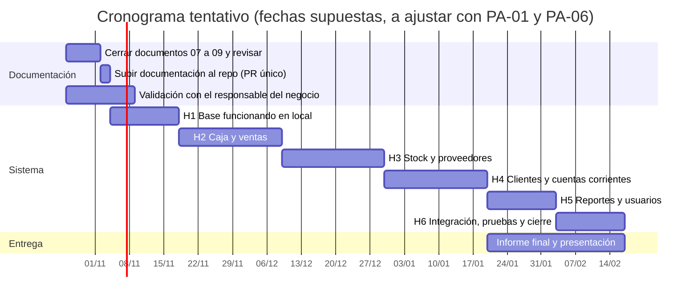

# 07 - Planificación

| Campo | Valor |
|---|---|
| Versión | 0.1 (borrador) |
| Estado | **Tentativa.** Las duraciones son estimaciones en semanas; se recalculan cuando se conozcan la fecha de entrega (PA-01) y las horas semanales disponibles (PA-06) |
| Base | Hito del sistema definido en [06-arquitectura.md](06-arquitectura.md), requisitos en [03-requisitos.md](03-requisitos.md) y casos de uso en [04-casos-de-uso.md](04-casos-de-uso.md) |
| Enfoque | Iterativo: se avanza por hitos chicos y se ajusta lo que falte o sobre. Lo que se pueda prever, se resuelve antes |

## 1. Supuestos

- Proyecto individual: una sola persona decide, desarrolla (con ayuda de agentes de código) y mantiene.
- La duración de cada hito supone una dedicación constante. No hay dato de horas semanales todavía (PA-06).
- El plazo que figura en las metas del relevamiento ("prototipo funcional en 2 meses", M-01) se interpreta como **H1 más H2** (base funcionando, caja y venta). Es una propuesta a confirmar.
- Las fechas del cronograma parten de un inicio supuesto y sirven para ver el orden y la duración; no son compromisos.

## 2. Etapas y entregables

| Etapa | Contenido | Entregable |
|---|---|---|
| A. Documentación | Cerrar los documentos 07, 08 y 09, revisar la consistencia y subir todo al repositorio en un solo Pull Request | `/docs` completo y coherente |
| B. Sistema | Construir la aplicación por hitos (sección 3) | Sistema funcionando en local, con pruebas |
| C. Informe y presentación | Armar el informe final maquetado a partir de `/docs` y la presentación | Informe y presentación listos para entregar |

En paralelo a la etapa A corre la **validación puntual con el responsable del negocio** (preguntas de prioridad alta de [01-relevamiento.md](01-relevamiento.md)). No bloquea el avance: lo no confirmado queda marcado "a confirmar".

## 3. Hitos del sistema

| Hito | Contenido | Casos de uso | Requisitos principales | Se apoya en estas brechas | Duración estimada |
|---|---|---|---|---|---|
| H1 | Base funcionando en local: Django con PostgreSQL, las 17 entidades migradas, datos de ejemplo, Tailwind con plantilla responsive, inicio de sesión con roles, CU-11 de punta a punta y primeras pruebas (detalle en [06-arquitectura.md](06-arquitectura.md), sección 6) | CU-10, CU-11 | RF-01, RF-02, RF-21, RNF-01, RNF-02, RNF-03, RNF-13 | PR-04 | 2 semanas |
| H2 | Caja y ventas | CU-02, CU-03, CU-01, SC-02 | RF-04 a RF-17 | PR-01, PR-05, PR-07, PR-08, PR-09, PR-24 | 3 semanas |
| H3 | Stock y proveedores | CU-06, CU-13, CU-05, CU-07 | RF-22 a RF-26, RF-29 a RF-33 | PR-03, PR-17, PR-18, PR-20 | 3 semanas |
| H4 | Clientes y cuentas corrientes | CU-12, CU-04, CU-08, SC-01, SC-03 | RF-18, RF-35 a RF-41 | PR-12, PR-13, PR-14, PR-15, PR-16 | 3 semanas |
| H5 | Reportes y usuarios | CU-09, CU-14 | RF-03, RF-42 a RF-46 | PR-25, PR-26, PR-27 | 2 semanas |
| H6 | Integración, pruebas integrales, correcciones, manual de usuario y capacitación breve (RNF-04) | Todos | Todos | PR-23, PR-29 | 2 semanas |

**Prototipo funcional (M-01):** H1 más H2, unas 5 semanas de desarrollo.

### Criterio de aceptación de cada hito

Un hito se da por terminado cuando se cumple lo siguiente:

1. Los casos de uso del hito funcionan de punta a punta en local, con datos de ejemplo.
2. Cada regla de negocio e integridad que toca (RN-xx y RI-xx) tiene al menos una prueba automática que pasa.
3. La documentación afectada de `/docs` está actualizada.
4. El cambio llegó a `main` por Pull Request aprobado por el alumno.

## 4. Cronograma tentativo

El eje es referencial: parte de un inicio supuesto. Lo importante es la duración y el orden.

La duración total ronda las **16 a 17 semanas**.

## 5. Escenarios según la fecha de entrega

Si la fecha de entrega es anterior al fin del cronograma, se recorta alcance según la prioridad de los requisitos (Alta, Media y Baja de [03-requisitos.md](03-requisitos.md)), nunca la calidad de lo que se entrega.

| Escenario | Plazo aproximado | Alcance |
|---|---|---|
| Completo | 16 a 17 semanas | H1 a H6 como está |
| Reducido | 10 a 11 semanas | H1 y H2 completos; H3 con CU-11, CU-06 y CU-05; H4 con CU-12, CU-04 y CU-08 básicos; H5 con CU-09 básico y CU-14; H6 acotado |
| Mínimo | 6 a 7 semanas | H1 y H2, más la documentación completa. Es el prototipo funcional |

**Lo primero que se posterga** (prioridad Baja o "a confirmar"): reportes automáticos (RF-46), pedidos a proveedor (RF-34), control de vencimientos (RF-28), pago mixto (RF-19), anticipos (RF-38) y carga de datos históricos (RF-47).

## 6. Seguimiento de tareas

- **Herramienta:** GitHub Projects (Jira solo si la cátedra lo exige, PA-04).
- **Columnas:** Pendiente, Listo para empezar, En curso, En revisión (Pull Request) y Hecho.
- **Unidad de trabajo:** una tarea por caso de uso o sub-caso, vinculada a sus requisitos. Un hito de GitHub agrupa las tareas de H1 a H6.
- **Etiquetas sugeridas:** `docs`, `backend`, `frontend`, `pruebas` y `espera-negocio` (para lo que depende de una pregunta pendiente).
- **Rama y revisión:** una rama por tarea y Pull Request con las pruebas pasando, como en las reglas del proyecto.

### Cómo se cierran los pendientes

Cuando el responsable del negocio confirma algo:
1. Se marca la brecha como respondida en [01-relevamiento.md](01-relevamiento.md) y se anota la respuesta.
2. Se buscan en `/docs` las marcas "a confirmar: PR-xx" correspondientes y se actualizan los documentos de la columna "Documentos afectados".
3. Todo va en un Pull Request con título `docs: confirmar PR-xx`.
4. Si cambia el diseño, se registra la decisión en [09-decisiones.md](09-decisiones.md).

## 7. Riesgos de planificación

| ID | Riesgo | Mitigación |
|---|---|---|
| RP-01 | El plazo de la cátedra es menor al cronograma completo | Escenarios de la sección 5; confirmar PA-01 cuanto antes |
| RP-02 | Brechas de prioridad alta sin responder al llegar a H2 o H4 | Validación puntual en paralelo; construir con el supuesto más simple y marcarlo "a confirmar" |
| RP-03 | Estimaciones optimistas, sin dato de horas disponibles | Recalcular con PA-06 al terminar H1 y ajustar el resto |
| RP-04 | Trabajar con varios agentes a la vez genere conflictos | Una rama por tarea y trabajo en carpetas separadas cuando sea simultáneo |
| RP-05 | Cambios de la cátedra obliguen a rehacer documentos | Documentación modular en `/docs` y un procedimiento claro para actualizar (sección 6) |
| RP-06 | El informe final se deje para el último momento | Empieza al terminar H4, en paralelo al desarrollo |

## 8. Datos pendientes

| Brecha | Impacto en la planificación |
|---|---|
| PA-01 | Fechas de entrega parciales y final |
| PA-02 | Estructura y formato exigidos para el informe |
| PA-06 | Horas semanales disponibles y fecha límite personal |
| PA-05 | Si el despliegue es parte de la entrega |
| PR-33 | Costo del alojamiento, si se despliega |

## 9. Mantenimiento

Al cambiar fechas o alcance, actualizar este documento y el cronograma, el alcance en [02-alcance-objetivos.md](02-alcance-objetivos.md) (metas M-01) y el tablero de GitHub Projects.
