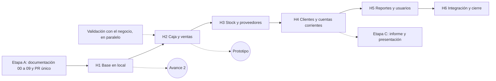

# 07 - Planificación

| Campo | Valor |
|---|---|
| Versión | 0.2 (borrador) |
| Estado | **Sin fechas fijas.** No hay fecha de entrega impuesta (PA-01) ni horas semanales fijas (PA-06): el alumno decide cuándo presenta un avance al profesor y el trabajo avanza por sesiones, tanto como se pueda en cada una |
| Base | Hito del sistema definido en [06-arquitectura.md](06-arquitectura.md), requisitos en [03-requisitos.md](03-requisitos.md) y casos de uso en [04-casos-de-uso.md](04-casos-de-uso.md) |
| Enfoque | Iterativo: se avanza por hitos chicos y se ajusta lo que falte o sobre. Lo que se pueda prever, se resuelve antes |

## 1. Supuestos

- Proyecto individual: una sola persona decide, desarrolla (con ayuda de agentes de código) y mantiene.
- **No hay fecha de entrega fija** (PA-01). El alumno decide cuándo presentar un avance al profesor; el profesor lo controla y se arma una entrega parcial en ese momento.
- **No hay horas semanales fijas** (PA-06). Se trabaja por **sesiones**, cuando el alumno quiere, y en cada sesión se avanza tanto como se pueda.
- Por eso el plan no usa semanas ni fechas: ordena el trabajo en hitos con un **tamaño relativo** (chico, mediano, grande) y define **puntos de entrega** posibles (sección 5).
- El "prototipo funcional en 2 meses" de las metas del relevamiento base (M-01) deja de ser un plazo: se interpreta como **H1 más H2** (base funcionando, caja y venta), que se presenta cuando el alumno decida.

## 2. Etapas y entregables

| Etapa | Contenido | Entregable | Estado |
|---|---|---|---|
| A. Documentación | Cerrar los documentos 07, 08 y 09, revisar la consistencia y subir todo al repositorio en un solo Pull Request | `/docs` completo y coherente | Terminada (Avance 1 disponible) |
| B. Sistema | Construir la aplicación por hitos (sección 3) | Sistema funcionando en local, con pruebas | En curso (H2) |
| C. Informe y presentación | Armar el informe final maquetado a partir de `/docs` y la presentación | Informe y presentación listos para entregar | Pendiente |

En paralelo a la etapa A corre la **validación puntual con el responsable del negocio** (preguntas de prioridad alta de [01-relevamiento.md](01-relevamiento.md)). No bloquea el avance: lo no confirmado queda marcado "a confirmar".

## 3. Hitos del sistema

| Hito | Contenido | Casos de uso | Requisitos principales | Se apoya en estas brechas | Tamaño relativo |
|---|---|---|---|---|---|
| H1 | Base funcionando en local: Django con PostgreSQL, las 17 entidades migradas, datos de ejemplo, Tailwind con plantilla responsive, inicio de sesión con roles, CU-11 de punta a punta y primeras pruebas (detalle en [06-arquitectura.md](06-arquitectura.md), sección 6) | CU-10, CU-11 | RF-01, RF-02, RF-21, RNF-01, RNF-02, RNF-03, RNF-13 | PR-04 | Mediano |
| H2 | Caja y ventas | CU-02, CU-03, CU-01, SC-02 | RF-04 a RF-17, RF-48 | PR-01, PR-04 a PR-10, PR-24 y PR-30 cerradas por DEC-36 a DEC-46 (DEC-35). Quedan abiertas con un supuesto vigente: PR-36 (DEC-76) y PR-37 (DEC-46) | Grande |
| H3 | Stock y proveedores | CU-06, CU-13, CU-05, CU-07 | RF-22 a RF-26, RF-29 a RF-33 | PR-03, PR-17, PR-18 y PR-20 cerradas por DEC-79 a DEC-82 (DEC-78), como supuestos del proyecto | Grande |
| H4 | Clientes y cuentas corrientes | CU-12, CU-04, CU-08, SC-01, SC-03 | RF-18, RF-35 a RF-41 | PR-12, PR-13, PR-14, PR-15, PR-16 | Grande |
| H5 | Reportes y usuarios | CU-09, CU-14 | RF-03, RF-42 a RF-46 | PR-25, PR-26, PR-27. CU-09 agrupa por fecha y turno varias cajas del mismo turno (DEC-83). El "Historial de ventas" (DEC-86) no lo reemplaza: CU-09 son los reportes con totales | Mediano |
| H6 | Integración, pruebas integrales, correcciones, manual de usuario y capacitación breve (RNF-04) | Todos | Todos | PR-23, PR-29 | Mediano |

**Prototipo funcional (M-01):** H1 más H2. Es el primer punto de entrega que muestra un sistema usable (caja y ventas).

**Estado:** H1 terminado y mergeado en `main` (PR #6) con sus tres etapas (modelo y pruebas; datos de ejemplo, interfaz e inicio de sesión; CU-11 y GitHub Actions). H2 en curso: etapas 1 a 3 implementadas (las dos primeras entraron con el PR #11, la tercera con el PR #12); de la etapa 4 están implementados el alta durante la venta y la anulación (spec `docs/specs/SPEC-CU-01-etapa4.md`), y RM-03 y RM-04 están registrados en 08. Los defectos DF-01 y DF-02 que encontró RM-04 están corregidos (DEC-75 y DEC-76, este último un supuesto pendiente de PR-36) y la prueba de venta y cierre al mismo tiempo está automatizada (CP-88). La revisión de H2 está hecha y sus hallazgos bloqueantes y menores, corregidos (DEC-77, PR-37). **H2 está lista para el Pull Request de cierre.** H3 a H6 pendientes; en la etapa 0 de H3 se cerraron sus preguntas como supuestos del proyecto (DEC-78 a DEC-82) y en la etapa 0b se ajustaron caja, venta, ventas de la caja, historial de ventas y reactivación de productos (DEC-83 a DEC-86). El historial de ventas del Administrador es una consulta operativa y no reemplaza a CU-09 (H5). Etapa 1 de H3 implementada: `mover_stock` y `validar_cantidad` en catálogo, usados por la venta y la anulación sin cambiar su comportamiento (DEC-96).

### Etapas de H2

| Etapa | Contenido | Decisiones |
|---|---|---|
| 1. Abrir caja | CU-02: pantalla de Caja con estado y apertura, servicio de caja y cambio del índice de RI-01 | DEC-38, DEC-39 |
| 2. Registrar venta | CU-01: venta con búsqueda o lector, un medio de pago, A4 y A5, ticket; SC-02 para el ingreso a caja | DEC-36, DEC-37, DEC-41, DEC-42, DEC-44, DEC-46 |
| 3. Cerrar caja | CU-03: resumen por medio de pago, montos contados, diferencias con motivo y bloqueo; egresos "otros" de caja | DEC-40, DEC-43 |
| 4. Cierre de H2 | Alta de producto durante la venta (CU-01 A1), anulación de ventas (requiere un estado en `venta`), recorridos RM-03 y RM-04, docs, revisión y Pull Request | DEC-45, DEC-62 a DEC-77 |

### Pendientes que deja H2

Surgieron en la revisión de H2. No bloquean el cierre del hito; se retoman en el hito indicado.

| ID | Pendiente | Cuándo |
|---|---|---|
| L1 | Anular una venta a cuenta corriente no debe crear un egreso de caja, sino revertir el movimiento de la cuenta corriente. Hoy esa venta no existe (DEC-41 no ofrece el medio cuenta corriente), así que no hace falta un rechazo; se resuelve al construir SC-03 | H4 |
| L2 | La unión de `venta.js` con `lector.js` y `buscador.js` no tiene prueba de navegador automatizada (08, sección 9) | A decidir: requiere una dependencia nueva |
| L3 | Archivos estáticos versionados al publicar (06, sección 9) | Con el despliegue |
| L4 | Cualquier cajera abre el ticket de cualquier venta por su número | Resuelto en la etapa 0b de H3 (DEC-84): la cajera solo ve ventas de la caja abierta |
| L5 | El formulario de la venta no limita la cantidad de líneas | H6 o antes, si hace falta |
| L6 | "Ventas de la caja" (cajera) no tiene paginación; el "Historial de ventas" del Administrador sí (DEC-86) | Si una caja tiene muchas ventas |
| L7 | `catalogo/productos.html` a 375 px, por el mismo patrón que DF-02 (08, sección 9) | RM-09 (H6) o antes |
| L8 | DEC-70 usa el control de stock actual del producto; con un registro de movimientos de stock, guardar en el detalle si controlaba stock al vender | Si se agrega `movimiento_stock` |
| L9 | Qué ve la cajera en el inicio (PR-35) | Al responder PR-35 |

### Etapas de H3

Spec: `docs/specs/SPEC-H3.md` (aprobado). Las decisiones de H3 son supuestos del proyecto, no datos confirmados por el negocio (DEC-78). Las etapas 0 y 0b ya están hechas (DEC-78 a DEC-86). R-1 a R-9 son los ajustes del refactor de capas (DEC-96) y S-1 a S-9 las decisiones del spec (DEC-87 a DEC-95).

| Etapa | Alcance | CU / RF / DEC | CP |
|---|---|---|---|
| 1. Catálogo y refactor | Servicio único de stock (`mover_stock`) y de cantidades (`validar_cantidad`) en catálogo; la venta y la anulación de ventas los usan sin cambiar su comportamiento; el tope de DEC-76 queda solo en la venta. Docstrings de PR-03 y PR-18 citan DEC-79 y DEC-81 | CU-01 (sin cambios); RF-16; RI-07, RI-16; DEC-46, DEC-48, DEC-70, DEC-76, DEC-79, DEC-81; R-1, R-2, R-5 | CP-12, CP-13, CP-83, CP-85, CP-87 |
| 2. Proveedores | CU-13: listado, alta, modificación, baja lógica y reactivación; menú "Proveedores" para el Administrador; prueba de estructura de dependencias (`catalogo` y `caja` no importan `proveedores`) | CU-13; RF-29; RI-11; DEC-85 (mismo patrón); R-6, R-9; S-1, S-2, S-9 | CP-99 (nuevo) |
| 3. Ingreso de mercadería | CU-05 a crédito: fecha de hoy, líneas, cantidades (DEC-79), stock con `mover_stock`, precio en el detalle y en `producto_proveedor`, remito en `observacion`, alta de producto (A1); saldo derivado en el servicio. Anulación del ingreso sin pagos vigentes, con motivo y reversa de stock (migración: estado del ingreso) | CU-05; RF-22 a RF-24, RF-30; RN-08; RI-07, RI-12, RI-16; DEC-46, DEC-79, DEC-81; R-4; S-3 a S-8 | CP-30, CP-31, CP-32, CP-93, CP-100 y CP-101 (nuevos) |
| 4. Pago a proveedor | CU-07: ingreso con saldo, efectivo o transferencia (también en el contado), egreso `PAGO_PROVEEDOR` y su reversa con funciones públicas de caja; ingreso al contado con el pago en la misma operación. Anulación del pago: por transferencia siempre, en efectivo con la caja de su egreso abierta (migración: estado del pago y una reversa por pago) | CU-07, CU-05 (contado); RF-31 a RF-33; RN-09; RI-08, RI-09, RI-13, RI-14; DEC-80, DEC-81; R-3, R-4; S-6 | CP-33 a CP-36, CP-90, CP-91, CP-92 y CP-102 (nuevo) |
| 5. Consulta de stock | CU-06 en catálogo: productos con control de stock, filtros por categoría y proveedor (relación inversa, sin servicios de `proveedores`), alertas calculadas en el servicio; tarjeta "stock bajo" del inicio solo para el Administrador; menú "Stock" | CU-06; RF-25, RF-26; RN-10; DEC-30, DEC-82; R-7, R-8, R-9; S-2, S-9 | CP-37 |
| 6. Cierre de H3 | Pruebas integrales (pago en efectivo o su anulación y cierre de caja al mismo tiempo, como CP-88), recorrido manual en localhost, revisión, 07 y 08 al día y Pull Request | Todos los de H3 | Todos los de H3; RM nuevo |

El ingreso al contado pasa a la etapa 4 porque registra su pago con el servicio de CU-07 (DEC-81). Un contado se anula anulando primero su pago (etapa 4) y después el ingreso (etapa 3).

El tamaño es una referencia para ordenar y comparar hitos, no una promesa de tiempo.

### Criterio de aceptación de cada hito

Un hito se da por terminado cuando se cumple lo siguiente:

1. Los casos de uso del hito funcionan de punta a punta en local, con datos de ejemplo.
2. Cada regla de negocio e integridad que toca (RN-xx y RI-xx) tiene al menos una prueba automática que pasa.
3. La documentación afectada de `/docs` está actualizada.
4. El cambio llegó a `main` por Pull Request aprobado por el alumno.

## 4. Orden del trabajo

Sin fechas: lo que importa es el orden y qué depende de qué.

Las líneas punteadas indican paralelismo o puntos de entrega posibles.

## 5. Puntos de entrega (avances al profesor)

El alumno elige cuándo presentar. Cada punto de entrega es un estado coherente del repositorio que se puede mostrar, y entre uno y otro se recorta o se amplía alcance según lo que dé cada sesión.

| Punto | Qué se muestra | Condición mínima |
|---|---|---|
| Avance 1 | Documentación 00 a 09 en `main` (PR mergeado), con las brechas todavía "a confirmar" | Etapa A completa (cumplida: disponible) |
| Avance 2 | Sistema base en local: login con roles y gestión de productos (H1) | H1 terminado y sus pruebas pasando |
| Avance 3 (prototipo) | Caja y ventas funcionando (H1 y H2) | H2 terminado (PR-01 y PR-08 cerradas por DEC-36 y DEC-41) |
| Avance 4 | Más módulos (H3, H4, H5 según se llegue) | Los hitos incluidos terminados |
| Entrega final | Sistema integrado, pruebas, informe maquetado y presentación | H6 y etapa C |

Si hace falta recortar, se posterga primero lo de prioridad Baja o "a confirmar" ([03-requisitos.md](03-requisitos.md)): reportes automáticos (RF-46), pedidos a proveedor (RF-34), control de vencimientos (RF-28), pago mixto (RF-19), anticipos (RF-38) y carga de datos históricos (RF-47). Nunca se recorta la calidad de lo que se entrega.

## 6. Seguimiento de tareas

- **Herramienta:** GitHub Projects (Jira solo si la cátedra lo exige, PA-04).
- **Columnas:** Pendiente, Listo para empezar, En curso, En revisión (Pull Request) y Hecho.
- **Unidad de trabajo:** una tarea por caso de uso o sub-caso, vinculada a sus requisitos. Un hito de GitHub agrupa las tareas de H1 a H6.
- **Etiquetas sugeridas:** `docs`, `backend`, `frontend`, `pruebas` y `espera-negocio` (para lo que depende de una pregunta pendiente).
- **Rama y revisión:** el código se trabaja en una rama por hito, se commitea cuando hay un avance completo y entra a `main` en un solo Pull Request por hito, con las pruebas pasando, mergeado con "Squash and merge" (un commit por Pull Request en `main`; DEC-34).

### Cómo se cierran los pendientes

Cuando el responsable del negocio confirma algo:
1. Se marca la brecha como respondida en [01-relevamiento.md](01-relevamiento.md) y se anota la respuesta.
2. Se buscan en `/docs` las marcas "a confirmar: PR-xx" correspondientes y se actualizan los documentos de la columna "Documentos afectados".
3. Todo va en un Pull Request con título `docs: confirmar PR-xx`.
4. Si cambia el diseño, se registra la decisión en [09-decisiones.md](09-decisiones.md).

## 7. Riesgos de planificación

| ID | Riesgo | Mitigación |
|---|---|---|
| RP-01 | La cátedra fije una fecha que no deje llegar al alcance completo | Puntos de entrega de la sección 5; el orden de los hitos permite cortar en un estado coherente |
| RP-02 | Brechas de prioridad alta sin responder al llegar a H2 o H4 | Validación puntual en paralelo; construir con el supuesto más simple y marcarlo "a confirmar" |
| RP-03 | Sin ritmo fijo de trabajo, el avance es difícil de predecir | Avanzar por hitos chicos y puntos de entrega coherentes (sección 5) |
| RP-04 | Trabajar con varios agentes a la vez genere conflictos | Una rama por hito y trabajo en carpetas separadas cuando sea simultáneo |
| RP-05 | Cambios de la cátedra obliguen a rehacer documentos | Documentación modular en `/docs` y un procedimiento claro para actualizar (sección 6) |
| RP-06 | El informe final se deje para el último momento | Empieza al terminar H4, en paralelo al desarrollo |

## 8. Datos pendientes

| Brecha | Impacto en la planificación |
|---|---|
| PA-01 | Respondida: no hay fecha fija; el alumno decide cuándo presentar avances. Si la cátedra impone una fecha, se agrega aquí y en [09-decisiones.md](09-decisiones.md) |
| PA-02 | Estructura y formato exigidos para el informe |
| PA-06 | Respondida: sin horas fijas; se trabaja por sesiones y se avanza lo que se pueda en cada una |
| PA-05 | Si el despliegue es parte de la entrega |
| PR-33 | Costo del alojamiento, si se despliega |

## 9. Mantenimiento

Al cambiar fechas o alcance, actualizar este documento, el diagrama de orden, el alcance en [02-alcance-objetivos.md](02-alcance-objetivos.md) (metas M-01) y el tablero de GitHub Projects.
