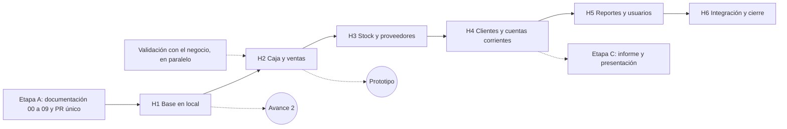

# 07 - Planificación

| Campo | Valor |
|---|---|
| Versión | 0.2 (borrador) |
| Estado | **Sin fechas fijas.** No hay fecha de entrega impuesta (PA-01) ni horas semanales fijas (PA-06): el alumno decide cuándo presenta un avance al profesor y el trabajo avanza por sesiones, tanto como se pueda en cada una |
| Base | Hito del sistema definido en [06-arquitectura.md](06-arquitectura.md), requisitos en [03-requisitos.md](03-requisitos.md) y casos de uso en [04-casos-de-uso.md](04-casos-de-uso.md) |
| Enfoque | Iterativo: se avanza por hitos chicos y se ajusta lo que falte o sobre. Lo que se pueda prever, se resuelve antes |

## 1. Supuestos

- Proyecto individual: una sola persona decide, desarrolla (con ayuda de agentes de código) y mantiene.
- **No hay fecha de entrega fija** (PA-01). El alumno decide cuándo presentar un avance al profesor; el profesor lo controla y se arma una entrega parcial en ese momento.
- **No hay horas semanales fijas** (PA-06). Se trabaja por **sesiones**, cuando el alumno quiere, y en cada sesión se avanza tanto como se pueda.
- Por eso el plan no usa semanas ni fechas: ordena el trabajo en hitos con un **tamaño relativo** (chico, mediano, grande) y define **puntos de entrega** posibles (sección 5).
- El "prototipo funcional en 2 meses" de las metas del relevamiento base (M-01) deja de ser un plazo: se interpreta como **H1 más H2** (base funcionando, caja y venta), que se presenta cuando el alumno decida.

## 2. Etapas y entregables

| Etapa | Contenido | Entregable | Estado |
|---|---|---|---|
| A. Documentación | Cerrar los documentos 07, 08 y 09, revisar la consistencia y subir todo al repositorio en un solo Pull Request | `/docs` completo y coherente | Terminada (Avance 1 disponible) |
| B. Sistema | Construir la aplicación por hitos (sección 3) | Sistema funcionando en local, con pruebas | En curso (H2) |
| C. Informe y presentación | Armar el informe final maquetado a partir de `/docs` y la presentación | Informe y presentación listos para entregar | Pendiente |

En paralelo a la etapa A corre la **validación puntual con el responsable del negocio** (preguntas de prioridad alta de [01-relevamiento.md](01-relevamiento.md)). No bloquea el avance: lo no confirmado queda marcado "a confirmar".

## 3. Hitos del sistema

| Hito | Contenido | Casos de uso | Requisitos principales | Se apoya en estas brechas | Tamaño relativo |
|---|---|---|---|---|---|
| H1 | Base funcionando en local: Django con PostgreSQL, las 17 entidades migradas, datos de ejemplo, Tailwind con plantilla responsive, inicio de sesión con roles, CU-11 de punta a punta y primeras pruebas (detalle en [06-arquitectura.md](06-arquitectura.md), sección 6) | CU-10, CU-11 | RF-01, RF-02, RF-21, RNF-01, RNF-02, RNF-03, RNF-13 | PR-04 | Mediano |
| H2 | Caja y ventas | CU-02, CU-03, CU-01, SC-02 | RF-04 a RF-17 | PR-01, PR-05, PR-07, PR-08, PR-09, PR-24 | Grande |
| H3 | Stock y proveedores | CU-06, CU-13, CU-05, CU-07 | RF-22 a RF-26, RF-29 a RF-33 | PR-03, PR-17, PR-18, PR-20 | Grande |
| H4 | Clientes y cuentas corrientes | CU-12, CU-04, CU-08, SC-01, SC-03 | RF-18, RF-35 a RF-41 | PR-12, PR-13, PR-14, PR-15, PR-16 | Grande |
| H5 | Reportes y usuarios | CU-09, CU-14 | RF-03, RF-42 a RF-46 | PR-25, PR-26, PR-27 | Mediano |
| H6 | Integración, pruebas integrales, correcciones, manual de usuario y capacitación breve (RNF-04) | Todos | Todos | PR-23, PR-29 | Mediano |

**Prototipo funcional (M-01):** H1 más H2. Es el primer punto de entrega que muestra un sistema usable (caja y ventas).

**Estado:** H1 terminado y mergeado en `main` (PR #6) con sus tres etapas (modelo y pruebas; datos de ejemplo, interfaz e inicio de sesión; CU-11 y GitHub Actions). H2 a H6 pendientes.

El tamaño es una referencia para ordenar y comparar hitos, no una promesa de tiempo.

### Criterio de aceptación de cada hito

Un hito se da por terminado cuando se cumple lo siguiente:

1. Los casos de uso del hito funcionan de punta a punta en local, con datos de ejemplo.
2. Cada regla de negocio e integridad que toca (RN-xx y RI-xx) tiene al menos una prueba automática que pasa.
3. La documentación afectada de `/docs` está actualizada.
4. El cambio llegó a `main` por Pull Request aprobado por el alumno.

## 4. Orden del trabajo

Sin fechas: lo que importa es el orden y qué depende de qué.

Las líneas punteadas indican paralelismo o puntos de entrega posibles.

## 5. Puntos de entrega (avances al profesor)

El alumno elige cuándo presentar. Cada punto de entrega es un estado coherente del repositorio que se puede mostrar, y entre uno y otro se recorta o se amplía alcance según lo que dé cada sesión.

| Punto | Qué se muestra | Condición mínima |
|---|---|---|
| Avance 1 | Documentación 00 a 09 en `main` (PR mergeado), con las brechas todavía "a confirmar" | Etapa A completa (cumplida: disponible) |
| Avance 2 | Sistema base en local: login con roles y gestión de productos (H1) | H1 terminado y sus pruebas pasando |
| Avance 3 (prototipo) | Caja y ventas funcionando (H1 y H2) | H2 terminado, validación de PR-01 y PR-08 |
| Avance 4 | Más módulos (H3, H4, H5 según se llegue) | Los hitos incluidos terminados |
| Entrega final | Sistema integrado, pruebas, informe maquetado y presentación | H6 y etapa C |

Si hace falta recortar, se posterga primero lo de prioridad Baja o "a confirmar" ([03-requisitos.md](03-requisitos.md)): reportes automáticos (RF-46), pedidos a proveedor (RF-34), control de vencimientos (RF-28), pago mixto (RF-19), anticipos (RF-38) y carga de datos históricos (RF-47). Nunca se recorta la calidad de lo que se entrega.

## 6. Seguimiento de tareas

- **Herramienta:** GitHub Projects (Jira solo si la cátedra lo exige, PA-04).
- **Columnas:** Pendiente, Listo para empezar, En curso, En revisión (Pull Request) y Hecho.
- **Unidad de trabajo:** una tarea por caso de uso o sub-caso, vinculada a sus requisitos. Un hito de GitHub agrupa las tareas de H1 a H6.
- **Etiquetas sugeridas:** `docs`, `backend`, `frontend`, `pruebas` y `espera-negocio` (para lo que depende de una pregunta pendiente).
- **Rama y revisión:** el código se trabaja en una rama por hito, se commitea cuando hay un avance completo y entra a `main` en un solo Pull Request por hito, con las pruebas pasando, mergeado con "Squash and merge" (un commit por Pull Request en `main`; DEC-34).

### Cómo se cierran los pendientes

Cuando el responsable del negocio confirma algo:
1. Se marca la brecha como respondida en [01-relevamiento.md](01-relevamiento.md) y se anota la respuesta.
2. Se buscan en `/docs` las marcas "a confirmar: PR-xx" correspondientes y se actualizan los documentos de la columna "Documentos afectados".
3. Todo va en un Pull Request con título `docs: confirmar PR-xx`.
4. Si cambia el diseño, se registra la decisión en [09-decisiones.md](09-decisiones.md).

## 7. Riesgos de planificación

| ID | Riesgo | Mitigación |
|---|---|---|
| RP-01 | La cátedra fije una fecha que no deje llegar al alcance completo | Puntos de entrega de la sección 5; el orden de los hitos permite cortar en un estado coherente |
| RP-02 | Brechas de prioridad alta sin responder al llegar a H2 o H4 | Validación puntual en paralelo; construir con el supuesto más simple y marcarlo "a confirmar" |
| RP-03 | Sin ritmo fijo de trabajo, el avance es difícil de predecir | Avanzar por hitos chicos y puntos de entrega coherentes (sección 5) |
| RP-04 | Trabajar con varios agentes a la vez genere conflictos | Una rama por hito y trabajo en carpetas separadas cuando sea simultáneo |
| RP-05 | Cambios de la cátedra obliguen a rehacer documentos | Documentación modular en `/docs` y un procedimiento claro para actualizar (sección 6) |
| RP-06 | El informe final se deje para el último momento | Empieza al terminar H4, en paralelo al desarrollo |

## 8. Datos pendientes

| Brecha | Impacto en la planificación |
|---|---|
| PA-01 | Respondida: no hay fecha fija; el alumno decide cuándo presentar avances. Si la cátedra impone una fecha, se agrega aquí y en [09-decisiones.md](09-decisiones.md) |
| PA-02 | Estructura y formato exigidos para el informe |
| PA-06 | Respondida: sin horas fijas; se trabaja por sesiones y se avanza lo que se pueda en cada una |
| PA-05 | Si el despliegue es parte de la entrega |
| PR-33 | Costo del alojamiento, si se despliega |

## 9. Mantenimiento

Al cambiar fechas o alcance, actualizar este documento, el diagrama de orden, el alcance en [02-alcance-objetivos.md](02-alcance-objetivos.md) (metas M-01) y el tablero de GitHub Projects.
